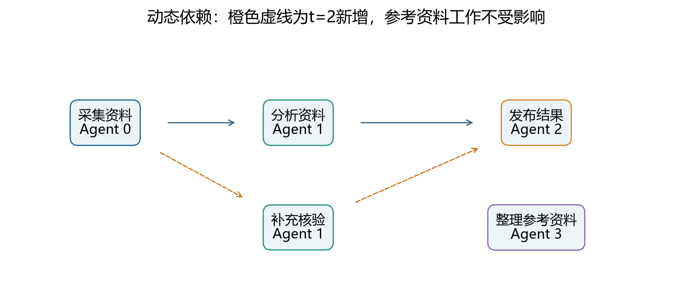
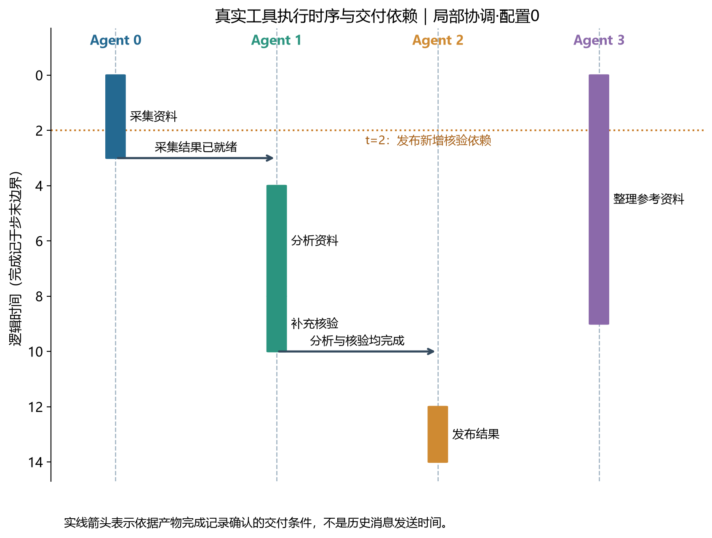

# 面向未来依赖的多Agent滚动协调：设计与初步验证

## 摘要

多个Agent即使各自能够执行任务，也可能因交付依赖变化、计划不一致和重复协商而降低协作效率。本作业以ReAct推理—行动—观察循环为基础，设计面向未来依赖的滚动协调方法：各成员维护自身计划及公开交付承诺，变化发生时联系受影响成员，确认调整后执行近期动作，并保留仍有效的安排。在统一模拟工具任务的两个耗时配置中，局部协调、全员重议和AutoGen轮换团队适配均完成任务；局部协调相对AutoGen适配的模型调用由36次降为24次。该结果仅说明受控条件下减少重复协调的可行性，尚不能证明复杂任务完成能力更强。MARBLE原生三Agent编程任务进一步暴露出角色执行错误及缺少实际通信的问题。本文据此区分方法设计、已验证机制与尚未验证的能力，不作SOTA声明。

**关键词：** 多智能体；ReAct；未来依赖；滚动协调；按需通信

## 1. 问题与研究思路

ReAct来自Yao等发表于ICLR 2023的研究，通过交替推理、行动和观察，使Agent根据环境反馈继续决策[2]。ReAct允许多步思考，因此本作业不是简单地把“想一步”改为“想多步”，而是关注多个Agent的未来计划如何相互配合。

例如，分析成员需要采集成员的产物，发布成员又依赖分析结果。若发布前临时新增核验要求，相关成员应重新确认交付条件，而独立整理参考资料的成员不应重新参与全部讨论。这里的协调对象是未来依赖、交付承诺及变化传播，不是工具内部怎样完成具体操作。

本作业假设各Agent在初始化后已经拥有确定的角色、职责和任务，不研究初始分工协商。任务模块提供自身状态、环境状态、执行回执和依赖信息；协调模块负责决定联系谁、修改哪些安排，以及何时可以继续执行。分布式计划修复已有保留有效计划、修复变化部分的研究[3]，因此本文将其作为设计依据，而不声称首次提出局部修复。

## 2. 方法设计

### 2.1 计划、依赖与公开承诺

每个Agent维护自己的后续工作及其前置条件，并对外公开需要队友配合的内容，如交付物、资源占用和预计可用条件。私有计划由本人调整，其他成员不能直接替它编写全部行动。本文不要求公开模型的完整内部思考过程，只保留可检查的任务计划和简短决策说明。

设计中的多步规划包含两个层次：一是成员安排自己的后续动作，二是把这些动作与其他成员的交付联系起来。当前实现对协调流程和局部更新提供了机制支持，但尚未证明模型能够在复杂任务中自主发现完整依赖链。

### 2.2 滚动协调流程

1. **观察执行状态。** 成员接收自身状态、任务状态和工具回执，检查原承诺是否仍成立。
2. **确定相关方。** 条件变化时，先联系直接受影响的成员；若其调整影响第三方，再扩展协调范围。
3. **本人提出响应。** 相关成员根据自己的职责和约束提出可配合方案，不由发起者包办全体计划。
4. **检查并确认。** 组合公开响应，检查依赖、资源和版本是否一致，再共同确认局部修改。
5. **执行近期工作。** 更新受影响部分，保留有效安排；根据新的执行反馈决定继续还是再次协调。

核心源码中的版本检查和局部补丁用于防止旧响应覆盖新状态；统一工具层负责执行合法性与结果反馈。程序约束保证工具调用可检查，但不能据此把所有合法执行都归因于LLM的推理能力。

### 2.3 与基线的区别

全员重议在协调触发点重新询问所有成员；局部协调尽量只处理受影响成员，并复用仍有效的安排。两者的差异首先是协调范围和重复计算量，而不是底层动作接口。AutoGen是多Agent工程框架[10]，本文使用其官方轮换团队组件作为外部框架适配对照，不将其称为某篇论文的SOTA算法。

理想的进一步对照应比较“各自多步规划”和“显式关联跨Agent未来依赖”，以识别跨成员协调的独立贡献。本作业尚未完成这一充分验证，不能把已有降本结果解释为多步规划能力已经优于ReAct。

## 3. 实验与分析

### 3.1 整体任务效果：统一工具任务

实验使用采集、分析、核验、发布和独立参考资料工作组成的模拟任务。成员职责固定，工具操作封装在统一接口之后。执行时刻2新增核验要求，发布条件随之变为分析与核验均已完成。依赖变化由环境明确提供，不要求模型自主发现未知依赖。

使用同一本地Qwen2.5-1.5B模型，在两个耗时配置上分别运行局部协调、全员重议及AutoGen 0.7.5轮换团队适配，共六局。六局均完成任务，各配置三方法的提交与完成轨迹一致，分别用14、18个逻辑轮次，未发生违反新增依赖的发布。

该实验说明共享执行底座能够支持依赖变化后的合法完成，但没有展示某方法成功率更高：三种方法在这两个配置上都成功。工具是模拟执行，不能表述为真实完成了资料分析或软件开发。

### 3.2 局部协调：哪些成员需要改变计划

{width=85%}

新增核验条件后，需要修改的是交付链中相关成员的安排。局部法保持无关成员的计划版本为1，对照中该版本升至4、5，说明其反复安装方案；这不等于对照重复执行了工具工作。

{width=90%}

图中Agent0采集，Agent1分析并核验，Agent2等待前置交付后发布，Agent3独立工作。纵轴是模拟逻辑时间，不是模型推理耗时。本实验允许独立工具工作推进，但不能据此声称LLM请求或MARBLE原生运行器并发执行。

### 3.3 按需协调成本

两个配置的模型调用合计为：局部法24次，全员重议45次，AutoGen适配36次；输入token分别为4268、8763、8398。相对AutoGen适配，局部法调用减少33.33%，输入token减少49.18%。

{width=85%}

这些数字支持“在所测受控场景中减少重复协调”，不支持“普遍比AutoGen更好”。实验中的任务所有者固定、多数合法动作域为单选，模型自主规划空间有限；每配置仅一次，没有统计显著性。AutoGen对照还包含每决策轮新建团队等适配选择，结果不能外推为框架本身的性能结论。

原始结果位于015-tool-coordination/dynamic_runs/20261118-172010，图的来源记录位于该实验figures/provenance.json。

### 3.4 外部任务验收：MARBLE暴露的问题

为检查方法能否落到已有多Agent任务，另运行MultiAgentBench/MARBLE的原生编程任务1。源码锁定为eae9f15e5b9f1e808f8ff61800b129d5538c1b47，保留原角色、graph协调及工具，使用本地Qwen2.5-7B，限定一轮作为链路验收。它不是与前述1.5B实验的配对比较，也没有加入本文改进。

Agent1正确调用创建工具，生成约4.3 KB初版代码；Agent2和Agent3均再次调用创建工具，因文件已存在被拒绝，没有按角色完成修改。实际通信会话为0。全流程包含生成、总结与评估共9次模型调用，累计模型调用耗时约13分钟。规划器认为需要继续，但到达一轮上限后结束。

原生汇总的completed表示引擎正常结束，不表示开发需求全部完成；同一模型给出的代码评分也不替代客观验收。当前代码主要包含类定义与模拟功能，尚不能证明完成了目标软件。本次运行是串行角色交接，graph指通信关系而非并发调度。日志位于017-marble/runs/20261119-110941。

这一失败说明：引入外部开源框架不自动产生有效协调，角色执行、失败恢复和实际通信仍需验收。目前不把MARBLE运行当成本文方法有效性的证据，也不为得到正结果继续无限扩展实验。

## 4. 结论与局限

本作业围绕固定角色之后的多Agent协作，提出面向未来依赖的滚动协调设计，并实现相关方响应、局部更新和反馈触发机制。统一工具实验初步验证了依赖变化后的合法执行，以及复用有效安排减少模型调用的可行性。

**尚未证明的是：复杂任务中，跨Agent多步思考能够提高任务成功率。** 现有成本实验规模小、程序约束强；MARBLE验收则未形成有效协作。因而本文的结论是机制实现与初步验证，而非完整方法超越现有研究。

后续最重要的工作不是继续扩展任务数量，而是在一个既有协作任务上，保证角色正确执行和结果可检查，再以同模型、同任务、同预算比较原生协作、各自多步规划和跨Agent依赖协调，分别报告成功率、通信、全部模型调用及时间成本。
