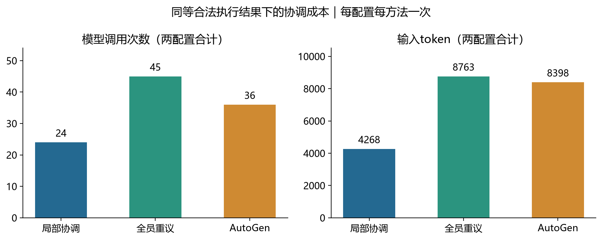

# 面向未来依赖的多Agent滚动协调：设计与初步验证

## 摘要

多Agent协作不仅要求成员完成各自的工作，还需要协调交付顺序、任务前置条件和共享资源。任务执行中出现新要求时，成员原有安排可能相互冲突；反复组织全体成员重新讨论，又会增加通信与模型调用成本。针对这一问题，本作业以ReAct推理—行动—观察循环为基础，设计面向未来依赖的多Agent滚动协调方法。

方法由各成员维护自身计划和对外交付承诺，依据任务变化与执行反馈检查安排是否仍然有效。需要调整时，先联系直接受影响的成员，由相关成员自行提出响应；影响进一步传递时，再逐级扩展参与范围。各方检查依赖、资源与计划版本后共同确认，仅修改受影响的部分，保留有效安排，并继续执行近期工作。

实验围绕临时新增核验要求、铁路协商通行、局部变化后的恢复执行及重复协调开销四个问题展开。在采集、分析与发布的模拟任务中，三种方法在两套任务耗时配置下均完成工作，局部协调保留了无关成员的安排；相对微软开源多Agent框架AutoGen的轮换团队适配，模型调用由36次降至24次。铁路规则规划对照中，协调方法相对无通信独立规划，在扩展开发集与新种子保留集的到达数分别由33/70、10/28提高至63/70、15/28。局部变化实验验证了计划修改、参与成员扩展和版本检查，六次真实模型动态窗口实验均完成撤销、重新确认与任务执行。固定通行许可的36局实验全部到达，按需协调与每步询问在九组配对中逐步轨迹一致，通信字节减少96.53%；真实模型资源预约对照中，按需协调的模型调用由42次降至24次，减少42.86%。

上述结果从任务完成、变化后的协作恢复和协调成本三个方面，展示了维护未来依赖、局部调整与复用有效安排在所测场景中的作用，为多Agent滚动协调提供了实现与实验依据。

**关键词：** 多智能体；ReAct；未来依赖；滚动协调；按需通信

## 1. 问题与研究思路

ReAct来自Yao等发表于ICLR 2023的研究，通过交替推理、行动和观察，使Agent根据环境反馈继续决策[2]。ReAct允许多步思考，因此本作业不是简单地把“想一步”改为“想多步”，而是关注多个Agent的未来计划如何相互配合。

例如，分析成员需要采集成员的产物，发布成员又依赖分析结果。若发布前临时新增核验要求，相关成员应重新确认交付条件，而独立整理参考资料的成员不应重新参与全部讨论。这里的协调对象是未来依赖、交付承诺及变化传播，不是工具内部怎样完成具体操作。

本作业假设各Agent在初始化后已经拥有确定的角色、职责和任务，不研究初始分工协商。任务模块提供自身状态、环境状态、执行回执和依赖信息；协调模块负责决定联系谁、修改哪些安排，以及何时可以继续执行。分布式计划修复已有保留有效计划、修复变化部分的研究[3]，因此本文将其作为设计依据，而不声称首次提出局部修复。

## 2. 方法设计

### 方法特点：多步前瞻与跨成员滚动协调

1. **向前看多步，但只执行近期行动。** 决策时检查后续若干步所需输入、资源与对外交付，执行近期行动后根据反馈更新，而不是每轮重新生成全部计划。
2. **关联自己的未来安排与队友后续工作。** 检查当前修改怎样影响其他成员后续步骤，由相关成员自行提出替代安排并共同确认。
3. **沿依赖协调，只修改受影响部分。** 需要时逐级扩展参与者，保留有效计划片段，减少重复协商与安装。
4. **以版本检查和执行反馈闭合循环。** 拒绝过时修改，用工具回执检查承诺并触发下一轮前瞻。

设计重点是“多步依赖检查—相关成员协商—局部更新—近期执行—反馈后继续前瞻”的组合与可执行实现，不是将多步规划或局部修复本身视为首次提出。

### 2.1 计划、依赖与公开承诺

每个Agent维护自己的后续工作及其前置条件，并对外公开需要队友配合的内容，如交付物、资源占用和预计可用条件。私有计划由本人调整，其他成员不能直接替它编写全部行动。本文不要求公开模型的完整内部思考过程，只保留可检查的任务计划和简短决策说明。

设计中的多步规划包含两个层次：一是成员安排自己的后续动作，二是把这些动作与其他成员的交付联系起来。当前实现对协调流程和局部更新提供了机制支持，但尚未证明模型能够在复杂任务中自主发现完整依赖链。

### 2.2 滚动协调流程

1. **观察执行状态。** 成员接收自身状态、任务状态和工具回执，检查原承诺是否仍成立。
2. **确定相关方。** 条件变化时，先联系直接受影响的成员；若其调整影响第三方，再扩展协调范围。
3. **本人提出响应。** 相关成员根据自己的职责和约束提出可配合方案，不由发起者包办全体计划。
4. **检查并确认。** 组合公开响应，检查依赖、资源和版本是否一致，再共同确认局部修改。
5. **执行近期工作。** 更新受影响部分，保留有效安排；根据新的执行反馈决定继续还是再次协调。

核心源码中的版本检查和局部补丁用于防止旧响应覆盖新状态；统一工具层负责执行合法性与结果反馈。程序约束保证工具调用可检查，但不能据此把所有合法执行都归因于LLM的推理能力。

### 2.3 与基线的区别

全员重议在协调触发点重新询问所有成员；局部协调尽量只处理受影响成员，并复用仍有效的安排。两者的差异首先是协调范围和重复计算量，而不是底层动作接口。AutoGen是多Agent工程框架[10]，本文使用其官方轮换团队组件作为外部框架适配对照，不将其称为某篇论文的SOTA算法。

理想的进一步对照应比较“各自多步规划”和“显式关联跨Agent未来依赖”，以识别跨成员协调的独立贡献。本作业尚未完成这一充分验证，不能把已有降本结果解释为多步规划能力已经优于ReAct。

## 3. 实验与分析

### 3.1 实验总览

本章围绕三个问题组织实验：相关成员协调能否改善任务完成情况；任务条件变化后能否调整相关安排并恢复执行；保留有效安排能否减少重复通信和模型调用。实验按任务与验证目标分组，而不是将同一实验的执行效果、过程和成本拆成彼此独立的实验。

首先，统一工具任务通过“采集—分析—发布”过程中临时增加核验要求，观察成员如何调整工作衔接，并在同一组实验内报告完成情况、局部更新与模型调用成本。其次，铁路路线响应实验比较无通信、单响应与多响应方法的到达数及惩罚完成步数，分别报告开发实例和新种子保留实例。随后，实验三：局部变化能否逐级协调并恢复执行实验检查变化传播、版本核验、撤销和重新提交。最后，固定路线许可与真实模型资源预约实验分别考察通信、响应评估及实际模型调用的变化。

任务效果主要记录完成数和完成步数；协调过程检查参与者、计划版本及执行记录；成本记录通信字节、响应评估次数、模型调用和token。规则后端与真实模型实验分别说明，各组使用各自一致的任务配置进行方法对照，不同任务的指标分别报告。

### 3.2 实验一：临时增加核验要求后，成员如何调整工作

#### 任务设置与完成情况

实验初始流程为“采集—分析—发布”。任务执行过程中，模拟环境临时增加“发布前必须完成核验”的要求，因此发布成员需要等待分析和核验全部完成后，才能发布结果。实验据此观察：相关成员能否调整后续安排，同时让不受影响的成员继续原有工作。成员职责固定，采集、分析、核验和发布均通过统一模拟工具接口执行；另有一名成员独立整理参考资料。

本实验使用本地部署的Qwen2.5-1.5B语言模型，由同一模型分别扮演各个成员。设置两套任务耗时：配置一中，采集、分析、核验、发布和独立参考资料工作分别耗时3、4、2、2和9个模拟时间单位；配置二仅将分析延长到5、核验延长到3，其余不变。这里的耗时是模拟任务占用的逻辑时间，不是模型响应的实际秒数。

比较三种组织方式：局部协调只联系受影响成员；全员重议在协调时重新询问所有成员；AutoGen对照使用微软开源多Agent应用框架AutoGen 0.7.5的轮换团队组件（RoundRobinGroupChat），让四名成员依次发言，再将各自输出转为执行安排。两套耗时配置分别运行三种方法，共六局。六局均完成任务，各配置三方法的提交与完成轨迹一致，分别用14、18个逻辑轮次，未发生违反新增依赖的发布。

该实验验证共享模拟执行底座支持依赖变化后的合法完成，三种方法在两个配置上均成功。

#### 局部协调：哪些成员需要改变计划

{width=85%}

新增核验条件后，需要修改的是交付链中相关成员的安排。局部法保持无关成员的计划版本为1，对照中该版本升至4、5，说明其反复安装方案；这不等于对照重复执行了工具工作。

{width=90%}

图中Agent0采集，Agent1分析并核验，Agent2等待前置交付后发布，Agent3独立工作。纵轴是模拟逻辑时间，不是模型推理耗时。本实验允许独立工具工作推进，但不能据此声称LLM请求或MARBLE原生运行器并发执行。

#### 模型调用与输入成本

两个配置的模型调用合计为：局部法24次，全员重议45次，AutoGen适配36次；输入token分别为4268、8763、8398。相对AutoGen适配，局部法调用减少33.33%，输入token减少49.18%。

{width=85%}

两个耗时配置的执行轨迹一致，模型调用与输入token均减少。

原始结果位于015-tool-coordination/dynamic_runs/20261118-172010，图的来源记录位于该实验figures/provenance.json。

### 3.3 实验二：协商通行方案能否让更多列车到达终点

本组比较列车各自决定路线与成员协商通行方案后的任务结果。核心问题是：在相同场景中，协调能否让更多列车到达终点，并减少包含未完成惩罚的总完成步数？这里评价任务效果，通信量仅作为附带成本记录。

#### 实验设置与评价指标

铁路任务把共享条件具体化为通行安排。A准备改变通行时间时，即使B尚未进入区段，B的后续路线仍可能依赖A的让行；B需要自行判断怎样调整路线或窗口，C也按相同方式参与。环境为Python 3.11.15、Flatland 4.2.6、NumPy 1.26.4。场景依据官方场景仓库固定版本的配置生成，每个实例七列车[9]。

早期开发对照包含三个实例、四种方法，共12局；扩展开发对照包含十个已接触实例、四种方法，共40局。保留对照在运行前固定四个新种子1042—1045，采用相同配置重新生成实例，五种方法各运行一次，共20局。每组方法复用相同场景文件，核对文件校验值，运行结果完整保存。

表3-1给出整体效果对照方法。

| 方法 | 行为 |
| --- | --- |
| 无通信独立规划 | 根据本地代价选择，不交换队友消息 |
| 单响应协调 | 同一协议下每人返回一项响应 |
| 多响应、不计修复代价 | 每人最多返回三项配合方案 |
| 多响应、计修复代价 | 最多三项方案，计入单位计划变更成本 |
| 官方规则参照 | 使用DeadLockAvoidancePolicy检查工程完成水平 |

: 整体效果对照方法 {#tbl-methods}

路线响应实验每候选最多检查128项组合，最多生成3条路线，结合0、3、8、16步等待；预测窗口32步，承诺有效期8步，每次推进1个环境步。上述参数在同组对照中保持一致。

主指标为到达数和惩罚完成步数。惩罚完成步数是各列车到达时刻之和，未完成者按环境原生最大步数计。另记录消息数、消息UTF-8序列化字节、组合检查次数、循环耗时和已提交计划变更次数。实验运行上限1000步，环境原生终止时结束。批量响应实验使用规则规划；小模型接入另设对照。

#### 整体任务效果汇总

下表直接比较包含路线响应、公开条件组合、确认执行及修复代价的多响应方法与无通信独立规划。不同批次分别汇总，不合并样本。

表3-2给出整体任务效果汇总。

| 实验批次 | 无通信独立规划到达 | 多响应方法到达 | 到达率提高 | 无通信独立规划惩罚步数 | 多响应惩罚步数 | 惩罚步数降低 |
| --- | --- | --- | --- | --- | --- | --- |
| 三个早期开发实例 | 13/21 | 21/21 | 38.10个百分点 | 3383 | 2796 | 17.35% |
| 十个扩展开发实例 | 33/70 | 63/70 | 42.86个百分点 | 11198 | 9182 | 18.00% |
| 四个新种子保留实例 | 10/28 | 15/28 | 17.86个百分点 | 4634 | 4371 | 5.67% |

: 整体任务效果汇总 {#tbl-overall}

这些结果显示，在三个批次中，相关方协商都比无通信独立规划完成更多任务；扩展开发集多完成30辆次，保留集多完成5辆次。该汇总评价的是当时实际运行的路线响应方法整体，不要求先分离每个内部模块的贡献。

#### 开发实例结果与响应组合分析

三个早期实例的结果如下。

表3-3给出三个开发场景的任务结果。各场景单元格按“到达数/列车数，惩罚完成步数”列示。

| 方法 | Level_0：到达/惩罚步数 | Level_1 | Level_2 | 总到达 | 总惩罚步数 |
| --- | --- | --- | --- | --- | --- |
| 无通信独立规划 | 3/7，1391 | 7/7，853 | 3/7，1139 | 13/21 | 3383 |
| 单响应 | 6/7，1086 | 7/7，923 | 7/7，923 | 20/21 | 2932 |
| 多响应无修复项 | 7/7，983 | 7/7，925 | 7/7，906 | 21/21 | 2814 |
| 多响应含修复项 | 7/7，983 | 7/7，925 | 7/7，888 | 21/21 | 2796 |

: 早期开发实例的任务结果 {#tbl-early}

多响应计修复代价方法完成全部21辆次，惩罚步数比无通信独立规划降低17.35%，比单响应降低4.64%。

十个开发实例的扩展结果如下。

表3-4给出扩展开发实例的效果与成本。

| 方法 | 到达/总数 | 惩罚完成步数 | 消息字节 | 组合检查 | 循环秒 |
| --- | --- | --- | --- | --- | --- |
| 无通信独立规划 | 33/70 | 11198 | 0 | 0 | 2.984 |
| 单响应 | 49/70 | 9954 | 116671092 | 4358 | 96.115 |
| 多响应无修复项 | 63/70 | 9200 | 91650580 | 83389 | 102.645 |
| 多响应含修复项 | 63/70 | 9182 | 91410394 | 79431 | 108.017 |

: 扩展开发实例的效果与成本 {#tbl-development}

多响应方法比单响应多完成14辆次，惩罚步数减少772；计入修复代价后，到达数保持63/70，惩罚步数由9200降至9182。表中的消息字节、组合检查与循环耗时同时展示运行成本。

#### 新种子保留实例结果

四个新种子实例的完整结果如下。方法定义沿用本组实验设置，官方规则作为工程参照单列。

表3-5给出新种子保留实例的效果与成本。

| 方法 | 到达/总数 | 惩罚完成步数 | 消息数 | 消息字节 | 组合检查 | 循环秒 | 已提交计划变更次数 |
| --- | --- | --- | --- | --- | --- | --- | --- |
| 无通信独立规划 | 10/28 | 4634 | 0 | 0 | 0 | 0.824 | 未按同定义记录 |
| 单响应 | 15/28 | 4333 | 12938 | 84728639 | 2119 | 44.000 | 28 |
| 多响应无修复项 | 15/28 | 4371 | 12681 | 107478013 | 97880 | 67.116 | 58 |
| 多响应含修复项 | 15/28 | 4371 | 12681 | 107477763 | 97301 | 67.898 | 58 |
| 官方规则 | 28/28 | 3328 | 不适用 | 不适用 | 不适用 | 0.474 | 不适用 |

: 新种子保留实例的效果与成本 {#tbl-holdout}

与无通信独立规划相比，协调方法均多完成5辆次。计修复代价的多响应方法惩罚完成步数由4634降至4371，降低5.67%。单响应与多响应在本组均到达15/28，表中同步列出其代价差异；官方规则参照单独列示。

#### 小模型接入的补充检查

小模型验证使用Qwen2.5-1.5B，在一个保留场景中分别运行无通信独立规划与多响应协调，温度0，每局最多6次真实模型调用，之后由规则接续。保留输入、输出及调用次数，检查模型接口与协调流程能否联通。

表3-6给出Qwen小模型接入结果。

| 方法 | 到达 | 惩罚完成步数 | 模型调用 | 输入/输出token | 规则回退次数 | 墙钟秒 |
| --- | --- | --- | --- | --- | --- | --- |
| 无通信独立规划 | 3/7 | 958 | 6 | 2331 / 42 | 92 | 29.975 |
| 多响应含修复项 | 7/7 | 800 | 6 | 2486 / 42 | 2669 | 25.012 |

: Qwen小模型接入结果 {#tbl-qwen}

在这一配对运行中，多响应方法完成7/7，无通信独立规划完成3/7，两个流程均完成预设模型调用并记录输入输出。另用三份相同局部输入检查模型选择，作为接口诊断记录。

### 3.4 实验三：局部变化能否逐级协调并恢复执行

本组回答：局部变更进一步影响第三方或原资源窗口失效时，能否补齐参与者、共同确认并恢复执行，同时保留无关任务？

#### 实验设置与验证目标

局部连锁实验检查A的变化经B继续影响C和D时，能否扩展参与范围、安装局部补丁并保留无关任务。响应组合实验设置3、4、5名相关成员，各增加一名无关成员；比较单响应与双响应在资源时间槽冲突后的协商结果。

补充三个预先固定的资源配置，种子为1046、1047、1048，用于生成释放时刻。每配置有3名相关成员和1名无关成员，比较按依赖逐步扩组与全组重新协调。双方使用相同模型、合法输出域、冲突反馈和确认规则。初次预约完成后，在执行前关闭旧资源窗口，将合法时间统一后移12个单位；发起方撤销旧安排，重新协调后按新预约执行。

按依赖方法从发起方自身开始，成员生成响应时报告下一名受影响者，逐步补齐参与集合；撤销仅通知相关成员。全组方法从开始就联系全部成员。逐阶段检查提交、时间合法性、资源互斥、撤销通知、无关片段保持及模型调用记录。

以下另用整体效果实验中的一段已保存轨迹说明公开响应组合如何进入实际执行；它是过程案例，不作为新增独立样本。

#### 局部计划修改与参与成员扩展结果

确定性局部变更案例中，A发起的修改经过B的响应继续影响C和D，参与集合随依赖扩展；无关成员不接收提案，无关任务片段保持原内容与版本。该过程体现了局部变更与连锁协调的实际执行。

在3、4、5名相关成员的六次响应组合对照中，单响应与双响应均能在冲突反馈后继续协商，最终确认互不冲突的时间槽。所有相关成员分别安装自己的共享任务补丁，无关成员及无关任务保持不变。

#### 一次响应组合的执行过程

早期七车场景中，第141步由列车1发起局部变更。列车2的首项响应经过坐标(9,17)、(9,16)、(9,15)，列车3则从(9,15)反向进入(9,16)，两者首选组合出现换位冲突。

列车2自行给出替代路线，改经(9,17)、(8,17)、(8,16)。发起方检查3个组合后找到相容项，选择列车2的第三项响应。该项公开增量代价为0，前两项为−1，但前两项无法与队友共同执行。

全部相关方确认后，列车2安装自己生成的替代方案；逐步轨迹记录表明它实际经过(8,17)和(8,16)，最终于第159步到达。这个案例把自行响应、公开组合检查、共同确认和实际动作连接起来。

#### 动态撤销、扩组与重新提交

六次真实模型运行均完成初次预约、窗口变化后的重新提交以及最终3项任务执行，两个方法各完成9/9。所有阶段的预约均合法且互不冲突；按依赖方法均实际触发响应依赖扩组，无关成员全程未收到消息，无关任务片段保持原版本。撤销通知在全部运行中实际投递。

按依赖协调合计调用72次，全组对照74次；输入token分别为16531和17897，减少7.63%；消息分别为240和261条，减少8.05%。三组配对中，两组最终执行轨迹完全一致。

这组实验把真实模型响应、局部补丁、连锁扩组、撤销通知和重新确认连接到同一任务流程，补充了条件变化后仍能恢复可执行安排的证据。

### 3.5 实验四：保留有效安排能否减少重复协调

本组不再比较不同路线方案能完成多少任务，而是考察原安排仍然可用时，是否有必要重复询问成员。设置两项独立对照：列车通行实验比较通信和本地响应评估；共享资源预约实验让语言模型决定各自使用同一资源的时间，比较实际模型调用与token。两项成本分别报告。

#### 实验设置与公平比较条件

固定路线许可对照：

三个已有七车场景分别加入无、低、高三档固定时钟停止指令扰动，四种方法共36局；统一1000步上限，关闭原生随机故障。共享路线的车辆按编号申请互斥许可，不相交路线可以同时执行。四种方法为全车串行、每8步询问、每步询问和按需协调。后三者使用相同许可规则、消息协议和轮换发起方式，改变的只有询问触发条件。

各方法共享同一状态发布规则，并将状态发布计入通信总量。逐步保存动作和位置，用于检查任务到达、占用冲突、未授权入场，以及不同方法是否保持相同轨迹。

真实模型资源协调对照：

新增容量为1的共享资源任务，分别设置3名成员（释放时刻0）和4名成员（释放时刻2），每人需要1个时间单位。每名成员使用相同Qwen2.5-1.5B模型和相同核心；模型只输出本人的时间槽，不生成其他成员的私有方案。冲突时公开当前预约和编号优先关系，再由各成员调用模型修订。

比较按需协调与固定轮换重新协调。两者使用相同提示、温度0、合法输出域、轮换规则和消息协议，各观察2N+1轮，再按最终预约推进资源时钟执行。任务插件通过结构化输出限定合法整数时间槽，原选择仍合法时保持该选择；发生冲突才重新选择。模型在合法域中做本地选择，程序检查跨成员互斥与版本，没有模型调用额度耗尽后的规则回退。

#### 列车通行实验：相同运行轨迹下的通信开销

表3-7给出按需协调的执行与通信成本。

| 方法 | 九局总到达 | 累计完成步数 | 总通信字节（含状态） | 本地响应评估次数 |
| --- | --- | --- | --- | --- |
| 全车串行 | 63/63 | 20707 | 34704 | 0 |
| 每8步询问 | 63/63 | 19163 | 1695256 | 2262 |
| 每步询问 | 63/63 | 16277 | 10911441 | 14906 |
| 按需协调 | 63/63 | 16277 | 379014 | 393 |

: 按需协调的执行与通信成本 {#tbl-event}

九组配对条件下，按需协调与每步询问的动作及位置轨迹逐步完全一致。相对于每步询问，通信字节由10911441降至379014，减少96.53%；本地响应评估由14906次降至393次，减少97.36%。这表明，在相同任务执行过程下，重复协调可以显著减少。

相对于每8步询问，按需协调累计完成步数减少15.06%，通信字节减少77.64%；相对于全车串行，累计完成步数减少21.39%。36局全部到达，保存轨迹中的同格占用、交换占用及未授权入场违规均为0。状态发布成本已经计入上表。

#### 模型预约实验：任务完成情况与模型调用开销

四次运行均真实调用本机Qwen2.5-1.5B。3人配置最终预约为6、0、2；4人配置为9、2、3、8。两种方法在各配置的最终预约及资源执行轨迹完全一致，总等待代价分别为8和14；任务完成分别为3/3和4/4，资源同时占用违规为0，无关任务片段保持原内容和版本，规则回退次数为0。

表3-8给出真实模型协调的调用与通信成本。

| 成员数 | 方法 | 完成 | 模型调用 | 输入token | 输出token | 通信字节 |
| --- | --- | --- | --- | --- | --- | --- |
| 3 | 按需协调 | 3/3 | 7 | 1545 | 58 | 4893 |
| 3 | 固定轮换重新协调 | 3/3 | 15 | 2983 | 123 | 9975 |
| 4 | 按需协调 | 4/4 | 17 | 4164 | 149 | 12972 |
| 4 | 固定轮换重新协调 | 4/4 | 27 | 6002 | 225 | 19788 |

: 真实模型协调的调用与通信成本 {#tbl-llm}

两组按需协调共调用24次，对照42次，减少42.86%；输入token由8985降至5709，减少36.46%；输出token由348降至207，减少40.52%；通信字节减少39.98%。这里的token来自真实模型服务统计。3人配置每种方法各有3次响应调用携带冲突反馈，4人配置各有12次，表明模型确实接收到队友响应形成的约束并再次作答，而非只在开始时选择一次规则方案。

## 4. 总结

### 4.1 工作总结与实验收获

铁路扩展开发集到达数由33/70提高到63/70，保留集由10/28提高到15/28；动态模型六次运行完成撤销与重新提交；固定许可36局全部到达，九组等轨迹配对中通信减少96.53%；真实模型预约调用由42次降至24次。局部补丁、连锁扩组与统一工具实验补充了机制执行和依赖变化后的协作证据。

### 4.2 当前不足

截至目前，本作业仍存在以下不足：所用模型主要集中于Qwen2.5系列，模型规模与家族覆盖较为单一，尚需引入更大规模及不同模型家族进行对照，以检验方法对模型能力和模型差异的适应性；实验任务和样本规模有限，部分依赖关系与执行约束由程序预先设定，对复杂开放任务的覆盖还不充分；方法在自主识别依赖、稳定执行角色职责及异常恢复方面仍需完善；现有对照和成本统计也有待通过更多任务、多次重复与统一评价进一步检验。因此，当前结果主要反映所测场景中的协调效果与降本可行性，尚不足以说明方法具有普遍优势。

### 4.3 后续工作

使用同模型、同任务、同预算的配对消融及多种子重复，补充客观任务验收和全部调用耗时。原始运行和失败批次保留，路径见《报告证据定位》。
