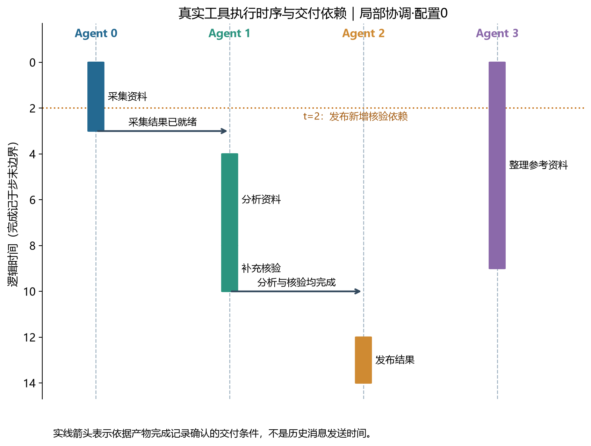
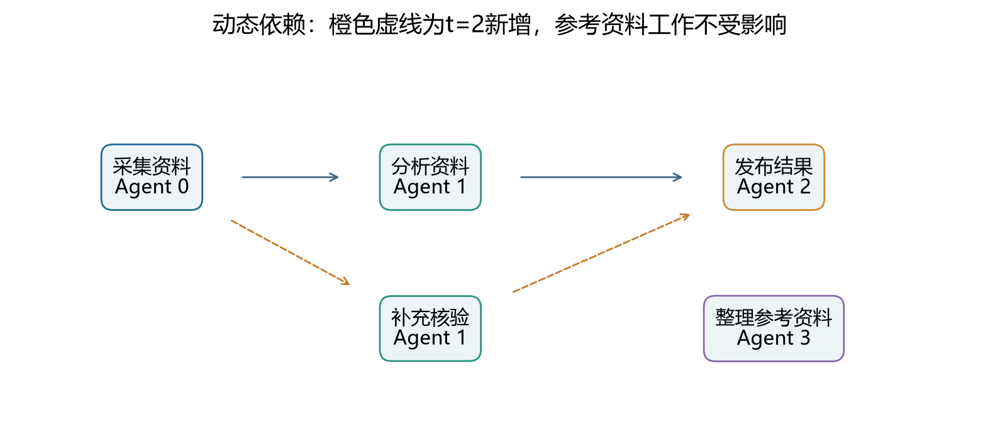
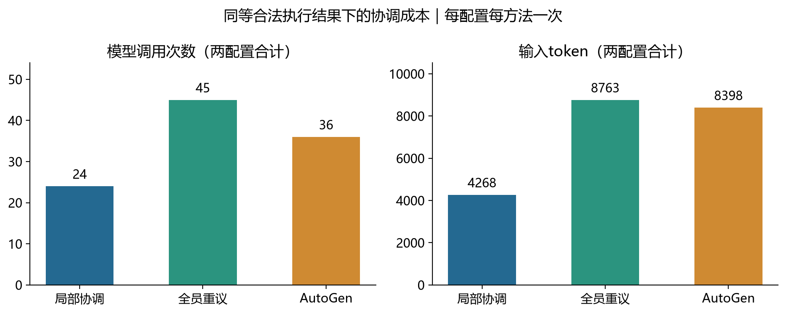
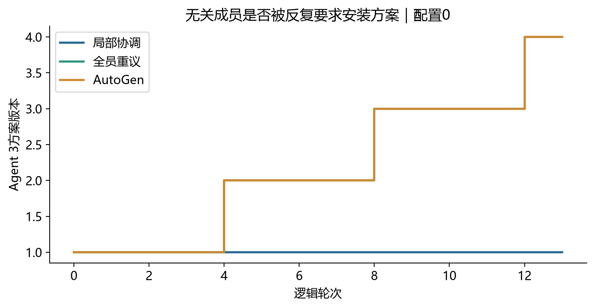

# 从ReAct“再想”到多Agent滚动响应协同：方法设计与实验验证

## 摘要

本作业从课程中的ReAct（Reasoning and Acting，推理与行动交替）循环出发，研究多智能体如何在修改自身计划时兼顾队友的后续任务。提出“局部变更、相关方自行响应、组合检查、共同确认、近期执行”的协作方法。每个成员运行相同核心，根据自己的任务生成配合方案；发起方只组合公开响应，不代替其他成员制定私有行动步骤。每次只更新受影响的计划片段，若调整又影响第三方，则在提交前扩展协调范围；已经确认且条件未变的安排继续执行。

实验从整体任务完成效果、连锁协调流程和重复协调成本三个方面检验方法。在十个开发实例中，多响应含修复代价的方法到达63/70，无通信独立规划到达33/70，惩罚完成步数降低18.00%；四个新种子保留实例中，两者分别到达15/28和10/28。在另一个按需协调对照中，三个七车场景、三档扰动、四种方法共36局全部到达。按需协调与每步询问的九组逐步执行轨迹完全一致；相对于每步询问，含状态发布的通信字节减少96.53%，本地响应评估次数减少97.36%。结果展示了相关方协商改善任务完成情况，以及保留有效安排减少重复协调的价值。新增真实大模型协调对照中，3名和4名成员均由Qwen2.5-1.5B生成本人的资源预约响应，并在冲突反馈后修订。在两组最终预约和执行轨迹一致时，按需协调相对于固定轮换重新协调，将模型调用从42次降至24次，输入token从8985降至5709，减少36.46%。

**关键词：** 多智能体协作；滚动规划；承诺管理；局部计划修复；按需协调

统一工具执行层的动态依赖补充实验中，两个配置下局部协调、全员重议及AutoGen官方轮换团队适配共六局均完成任务，执行轨迹一致；局部协调相对AutoGen的模型调用由36次降至24次，减少33.33%。该结果支持受控场景中的协调降本价值，但任务所有者固定、合法动作域受程序约束，每配置仅一次，不证明复杂任务能力或框架普遍领先。路线、资源与工具任务的证据分别报告，不拼接为统一端到端领先结论。

## 1. 研究背景与问题提出

### 1.1 课程切入点与协作问题

本文的核心问题进一步明确为：如何在ReAct推理—行动—观察循环上加入显式的多步未来计划，使当前行动考虑后续前置条件、资源消耗和交付依赖。ReAct源于Yao等发表于ICLR 2023的论文，并有作者开源实现https://github.com/ysymyth/ReAct 。ReAct并未禁止多步思考，不能把其定义为只能想一步；本工作的区别应是强制形成可检查的有限前瞻表示，只执行近期动作，再根据真实观察更新，而非声称首次引入规划。

多Agent协调是未来计划存在跨成员依赖时的扩展，不取代上述研究主线。既有通信和局部协调实验只提供补充机制证据，尚不能单独证明对ReAct的改进。后续以同模型、同工具、同观测的ReAct式循环与显式前瞻循环直接对照；进一步区分规划收益与增加输出token带来的计算成本。

课件《第7讲_课时1_质量良好是怎么来的》第8页介绍ReAct节拍：想一步、做一步、看一步，再根据观察决定下一步[1]。本作业从这一具体循环出发，考虑多个成员各自拥有任务和计划时，如何根据执行反馈共同调整安排。

单个成员的局部优化可能改变队友将来需要的资源、交付时间或前置条件。即使队友尚未开始行动，也可能已经把这些条件纳入后续计划。因此，协调不能只问“对方是否已经执行”，还要问“我的修改将改变对方哪些未来安排”。另一方面，已经确认的安排如果仍然成立，每次获得观察就重新商量又会重复计算和通信。

本文研究任务无关的协作方法。任务适配器负责提供状态、候选、约束和执行动作；通用核心负责组织响应、协调、确认和局部更新。

### 1.2 现有技术怎样处理协作

ReAct把推理、行动和观察组织为交替循环，使Agent能够根据环境结果继续决策[2]。它为反馈式行动提供了基础，但其单Agent循环没有直接规定：一个成员修改计划时应联系谁，如何核验队友的配合方案，以及哪些原有安排可以保留。

分布式计划修复直接关注执行中发生变化后的协作。Komenda等的《Decentralized Multi-agent Plan Repair in Dynamic Environments》将修复与重新规划进行比较，利用已有计划结构处理动态变化[3]。这条技术路线说明，保留已有工作、仅处理变化部分，是有价值的协作原则。

另一条路线从共享资源和执行次序入手。Berndt等在《Receding Horizon Re-ordering of Multi-Agent Execution Schedules》中通过滚动优化调整多机器人执行次序[4]。模型预测控制以有限预测窗口比较近期安排，再用真实反馈更新后续计划[5]；Wei等的自触发分布式控制进一步研究何时需要更新和通信[6]。本文借鉴有限前瞻、反馈更新和按需协调的思想，将其放入每个Agent的工作循环。

在LLM多Agent领域，SyncPlan通过显式同步原语和计划失效检测组织长程执行，其主要组织方式是中央协调器生成多条行动链[7]。Stronger-MAS则从训练入手，通过面向协作LLM的多Agent强化学习改善协作行为[8]。这两类工作分别代表运行时组织和训练优化：前者强调计划如何执行，后者强调协作策略如何学到。

现有路线的组织方式与本文的对应设计见表1-1。表中分别列出思想借鉴与组织方式上的区别，避免将两者混为同一种关系。

| 技术路线 | 主要做法 | 本文借鉴的思想 | 本文采用的组织方式 |
| --- | --- | --- | --- |
| ReAct反馈循环 | 行动后观察并继续推理 | 用真实反馈修订安排 | 扩展为相关成员共同响应 |
| 分布式计划修复 | 保留并修复已有计划 | 复用仍有效的工作 | 以版本化局部补丁提交修改 |
| 多机器人滚动协调 | 优化近期执行次序 | 有限前瞻与滚动更新 | 各成员自行响应，组合公开条件 |
| 自触发协调 | 按条件更新与通信 | 条件未变时保留安排 | 在Agent循环中按需发起协调 |
| 显式同步的LLM协调 | 中央协调器生成行动链 | 将协作条件显式化 | 临时发起方不生成队友私有计划 |
| 协作LLM强化学习 | 训练协作策略 | 关注共同任务效果 | 先设计可插拔的运行时协调流程 |

: 现有技术路线与本文设计的关系 {#tbl-background}

### 1.3 本文的改进思路与创新点

本文提出一种分布式滚动响应协作方法。每个Agent维护自己的任务状态、计划和依赖记录，运行相同的决策与协调流程。发生变更的成员临时发起提案；受影响者根据自己的任务生成配合方案，而不是由一个中央规划器统一生成所有成员的行动链。发起方的职责是检查并选择公开响应组合，确认后由各成员分别安装自己的局部方案。

**第一，将队友的未来依赖纳入变更决策。** 协调对象不只包括已经开始行动的成员，也包括后续任务将使用当前承诺的成员。受影响者自己说明能否接受候选、怎样调整以及付出什么代价，使本地修改能够考虑尚未发生的协作需求。

**第二，以局部补丁组织分布式调整。** 一个小任务的变更不重做成员的全部任务。生成响应时记录相关片段版本，确认时重新核验，只修改受影响片段；未受影响的任务和已有成果继续保留。这使“各人自主规划”与“共同约束下协调”可以同时成立。

**第三，按交互内容组织协调并处理连锁影响。** 初始参与者由共享条件和依赖关系确定，不机械地全网广播。如果B为配合A而提出的修改又影响C，就在提交前扩展集合，让C自行响应，再继续协调。协调范围随真实影响变化，而不是固定由某个中央角色管理所有任务。

**第四，将大模型决策与确定性执行保障分开。** 每个成员在需要变更或响应时调用模型，提出本人的局部安排；程序检查硬约束、版本与组合可行性。冲突反馈进入下一轮模型输入，最终经准备、确认和提交进入执行。模型不替代约束检查，约束检查也不冒充模型决策。

**第五，通过保留有效安排减少重复协调。** 原承诺及外部条件仍成立时直接继续执行，只有变更、失效或必须获得反馈时才重新处理；对近期难以确定的后续内容，等真实反馈到来再更新。本文通过整体任务对照、连锁流程检查和真实模型调用统计，分别观察协作效果、流程实现及成本变化。

以上创新定位于这些环节在同构Agent运行循环中的具体组合与实现；相关思想来源见上一节，实验结果按实际运行版本报告。

## 2. 方法设计与实现

### 2.1 同构成员与公开响应

本研究将初始化分工作为已知输入：每个Agent在执行开始前已拥有明确的角色、职责、任务、工具权限及交付对象，不研究最初如何协商产生这些分工。研究对象限定为初始化之后，成员如何依据自身状态、任务进度和环境变化，处理交接、等待、承诺调整与局部重新协调。固定职责不代表固定执行时间，也不代表失去对变化的响应能力。

每轮决策应读取环境生成的真实观测，包括本人位置、朝向、手持物、当前执行及待执行动作、成功与失败反馈，以及可见的任务订单、工具/资源状态和交接位置内容。模型计划与自然语言承诺不能替代真实完成状态。观测范围由任务适配器统一提供给各方法，不访问队友隐藏推理，也不让模型自行编造状态。

动作接口修订与协调方法改动分别记录。修订层统一规范动作名称、参数格式及任务目标名称，仍由原环境核验权限与前置条件，不通过把非法动作悄悄当作成功来提高分数。修订版本不再称未经修改的原始基线；具体适配、失败与完成记录独立保留。

每位成员保存自己的观测、私有计划和承诺版本，并运行相同的Agent核心。候选描述共享资源窗口、交付条件、有效期和版本等局部变化。响应包含可行性、增量代价、公开条件与私有配合方案；私有方案留在本人本地，发送给发起方的是用于组合检查的公开内容。

发起方是本次变更的临时角色。它可以选择各方已公布的方案编号，但不接管其他成员的完整任务，也不生成其私有行动链。成员收到最终确认后，按编号安装自己预先生成并核验的响应。

### 2.2 六个协作环节

表2-1给出六个协作环节及其作用。

| 环节 | 核心处理 | 作用 |
| --- | --- | --- |
| 承诺管理 | 记录版本、有效期和成立条件 | 明确哪些安排仍可依赖 |
| 未来依赖 | 登记提供者、使用者和未来使用窗口 | 将尚未执行的需求纳入变更检查 |
| 候选前瞻 | 由任务插件生成保持、调整等有限候选 | 比较近期可执行安排 |
| 消息确认 | 各方先准备，再共同确认提交 | 防止过时响应直接进入执行 |
| 局部修复 | 核验相关片段版本，仅写入受影响片段 | 保留无关任务和已有成果 |
| 紧急撤销 | 条件失效时撤销并通知相关成员 | 使依赖方及时调整后续行动 |

: 六个协作环节及其作用 {#tbl-modules}

### 2.3 局部变更与连锁协调

本地计划按任务片段保存。补丁记录读取过的相关片段版本，以及确实需要写入的内容。安装前先检查读取版本；通过后只更新写集合并递增对应版本，无关片段保持不变。

例如，B为配合A修改交付时间，却发现新的交付时间还影响C的准备任务。B自行生成响应后报告这条依赖，发起方扩大参与集合，用新提案重新协调。新成员确认前，不安装可能影响它的安排。若现有组合不相容，各成员可以依据新的公开约束继续生成响应；一次观察中的协调预算用完后保留修订请求，在后续反馈轮继续。

### 2.4 有限前瞻与近期执行

核心流程为：观察状态，检查原安排是否有效，必要时提出候选，收集相关方响应，检查组合，确认局部补丁，执行近期动作，再读取真实反馈。没有外部影响的修改可在本地完成；涉及共享条件才联系相应成员。

在响应组合阶段，发起方按公开增量总代价优先比较有限候选，各成员的代价以自身保持方案为基准，先核验硬约束，再比较可行安排的代价。系统执行近期已确认部分，并在需要真实反馈的位置更新后续安排。搜索预算、预测窗口和任务候选数量由具体实验设置。

### 2.5 可插拔代码结构

核心新增统一模型决策入口：每个成员在需要发起变更时调用模型提出局部请求，收到提案时调用模型生成自己的响应；冲突反馈进入下一次模型输入。任务插件将结构化输出转换为带版本的局部补丁，协议程序执行约束核验和提交。真实调用由本机Ollama服务承载，完整保存请求、原始回答和token计数。

核心分为任务接口、消息接口和环境时钟。任务接口负责观察、生成候选、生成响应、检查组合、核验与安装局部方案；消息接口负责按收件人投递；环境时钟负责交换阶段与执行阶段推进。任务相关规划器保存在实验目录，与通用协调核心分离。

代码阅读材料按语法、执行步骤和成立条件解释核心循环、数据结构、版本检查和消息状态机。实验同时保存源码快照、参数、逐步动作、位置轨迹和协商记录，便于将结果对应到实际运行版本。

## 3. 实验与分析

### 实验边界：固定执行底座，只比较协调机制

实现上新增统一工具运行器：任务适配器把具体操作封装为函数，协调层仅提交工具名、任务编号和前驱依赖；运行器报告能力不足、依赖阻塞、执行中、失败或完成。模拟耗时使用逻辑时钟，只有完成后才发布产物，不把请求或调用当成交付。现已继承既有ResourceTask接入现有Agent，四项工具测试与三项插件测试验证执行边界。真实Qwen2.5-1.5B集成回合中，三个成员经过模型响应、局部补丁和协议提交，在8轮内完成4项工具工作，共12次模型调用、2398输入token、118输出token和45条协议消息；独立工作与采集并行，其后分析和发布按真实完成反馈推进。任务所有者和依赖固定，程序限定就绪动作域，最终多数决策为单选，故这只是工程闭环证据，不作为LLM自主协调收益或公开基线复现证据。此前两次等待停滞及校验失败批次也已保留，记录见015-tool-coordination。

本文研究分工、依赖处理、交接确认、局部修订及按需通信，不研究特定任务的操作技能。任务执行层负责合法技能、角色权限、动作前置条件、环境执行与真实结果反馈；协调层基于执行层公开的能力、需求和结果组织协作，不重写取料、烹饪等具体流程。所有被比较方法必须共用同一执行层、技能与校验规则；不得只给本文方法增加任务专用规则后归因于协调改进。

公开任务复现应先核对原始实现并确认原始LLM方法能够完成任务，再固定执行底座比较协调机制。统一工具任务作为单独的受控机制实验，不冒充公开任务复现。执行接口一致并不代表成功率相同；需统一模型、观测权限、预算口径与任务配置。某项执行底座未通过时，该任务只报告接入诊断，不做协调优劣排名。

新增Collab-Overcooked验收采用官方仓库固定提交d7ae1aa5e63d8ec076e96ee437fcbbd095278ef4（论文及代码链接见实验目录README）。复跑官方RecipePolicy，四种订单各交换双方角色，共8回合全部完成，均得20分；apple、boiled_egg、boiled_corn_slices、baked_carrot_soup分别用11、17、26、43步。这是脚本配方策略的环境验收，不是LLM基线成功，也不能拿它代替协调层来证明本文方法有效。原始状态与交接日志保存在014-collab-overcooked/gate_runs。

原始LLMPair入口使用本地Qwen2.5-1.5B和7B时，最初均完成3步快速测试，得分0且无有效技能行为。随后7B设置120步上限，但在完成7个环境步后耗尽40次接口预算而中断，仍为0分，不能视为完整120步成功率评估。修改提示的1.5B试跑也未获得有效行为。模型与嵌入服务采用本地替代，不是论文原配置复现。此公开任务尚未通过LLM完成验收，不纳入协调优劣比较；后文统一工具任务的AutoGen适配是另一项受控实验。

### 3.1 实验目标与总体安排

实验分为整体任务效果、局部连锁协调、按需协调成本三组。整体效果采用路线响应适配器；连锁协调采用确定性局部变更案例、资源时间槽任务和动态窗口变更任务；按需成本采用固定路线许可与真实模型资源协调对照。三组分别检验任务完成情况、协调过程和重复工作量，各节分别说明设置、结果与适用范围。

### 3.2 整体任务效果

本组回答：在相同路线任务与评价口径下，相关方自行响应并共同确认，能否比无通信独立规划完成更多任务、降低惩罚完成步数？

#### 3.2.1 实验设置与评价指标

铁路任务把共享条件具体化为通行安排。A准备改变通行时间时，即使B尚未进入区段，B的后续路线仍可能依赖A的让行；B需要自行判断怎样调整路线或窗口，C也按相同方式参与。环境为Python 3.11.15、Flatland 4.2.6、NumPy 1.26.4。场景依据官方场景仓库固定版本的配置生成，每个实例七列车[9]。

早期开发对照包含三个实例、四种方法，共12局；扩展开发对照包含十个已接触实例、四种方法，共40局。保留对照在运行前固定四个新种子1042—1045，采用相同配置重新生成实例，五种方法各运行一次，共20局。每组方法复用相同场景文件，核对文件校验值，运行结果完整保存。

表3-1给出整体效果对照方法。

| 方法 | 行为 |
| --- | --- |
| 无通信独立规划 | 根据本地代价选择，不交换队友消息 |
| 单响应协调 | 同一协议下每人返回一项响应 |
| 多响应、不计修复代价 | 每人最多返回三项配合方案 |
| 多响应、计修复代价 | 最多三项方案，计入单位计划变更成本 |
| 官方规则参照 | 使用DeadLockAvoidancePolicy检查工程完成水平 |

: 整体效果对照方法 {#tbl-methods}

路线响应实验每候选最多检查128项组合，最多生成3条路线，结合0、3、8、16步等待；预测窗口32步，承诺有效期8步，每次推进1个环境步。上述参数在同组对照中保持一致。

主指标为到达数和惩罚完成步数。惩罚完成步数是各列车到达时刻之和，未完成者按环境原生最大步数计。另记录消息数、消息UTF-8序列化字节、组合检查次数、循环耗时和已提交计划变更次数。实验运行上限1000步，环境原生终止时结束。批量响应实验使用规则规划；小模型接入另设对照。

#### 3.2.2 整体任务效果汇总

下表直接比较包含路线响应、公开条件组合、确认执行及修复代价的多响应方法与无通信独立规划。不同批次分别汇总，不合并样本。

表3-2给出整体任务效果汇总。

| 实验批次 | 无通信独立规划到达 | 多响应方法到达 | 到达率提高 | 无通信独立规划惩罚步数 | 多响应惩罚步数 | 惩罚步数降低 |
| --- | --- | --- | --- | --- | --- | --- |
| 三个早期开发实例 | 13/21 | 21/21 | 38.10个百分点 | 3383 | 2796 | 17.35% |
| 十个扩展开发实例 | 33/70 | 63/70 | 42.86个百分点 | 11198 | 9182 | 18.00% |
| 四个新种子保留实例 | 10/28 | 15/28 | 17.86个百分点 | 4634 | 4371 | 5.67% |

: 整体任务效果汇总 {#tbl-overall}

这些结果显示，在三个批次中，相关方协商都比无通信独立规划完成更多任务；扩展开发集多完成30辆次，保留集多完成5辆次。该汇总评价的是当时实际运行的路线响应方法整体，不要求先分离每个内部模块的贡献。

#### 3.2.3 开发实例结果与响应组合分析

三个早期实例的结果如下。

表3-3给出早期开发实例的任务结果。

| 方法 | Level_0：到达/惩罚步数 | Level_1 | Level_2 | 总到达 | 总惩罚步数 |
| --- | --- | --- | --- | --- | --- |
| 无通信独立规划 | 3/7，1391 | 7/7，853 | 3/7，1139 | 13/21 | 3383 |
| 单响应 | 6/7，1086 | 7/7，923 | 7/7，923 | 20/21 | 2932 |
| 多响应无修复项 | 7/7，983 | 7/7，925 | 7/7，906 | 21/21 | 2814 |
| 多响应含修复项 | 7/7，983 | 7/7，925 | 7/7，888 | 21/21 | 2796 |

: 早期开发实例的任务结果 {#tbl-early}

多响应计修复代价方法完成全部21辆次，惩罚步数比无通信独立规划降低17.35%，比单响应降低4.64%。

十个开发实例的扩展结果如下。

表3-4给出扩展开发实例的效果与成本。

| 方法 | 到达/总数 | 惩罚完成步数 | 消息字节 | 组合检查 | 循环秒 |
| --- | --- | --- | --- | --- | --- |
| 无通信独立规划 | 33/70 | 11198 | 0 | 0 | 2.984 |
| 单响应 | 49/70 | 9954 | 116671092 | 4358 | 96.115 |
| 多响应无修复项 | 63/70 | 9200 | 91650580 | 83389 | 102.645 |
| 多响应含修复项 | 63/70 | 9182 | 91410394 | 79431 | 108.017 |

: 扩展开发实例的效果与成本 {#tbl-development}

多响应方法比单响应多完成14辆次，惩罚步数减少772；计入修复代价后，到达数保持63/70，惩罚步数由9200降至9182。表中的消息字节、组合检查与循环耗时同时展示运行成本。

#### 3.2.4 新种子保留实例结果

四个新种子实例的完整结果如下。方法定义沿用本组实验设置，官方规则作为工程参照单列。

表3-5给出新种子保留实例的效果与成本。

| 方法 | 到达/总数 | 惩罚完成步数 | 消息数 | 消息字节 | 组合检查 | 循环秒 | 已提交计划变更次数 |
| --- | --- | --- | --- | --- | --- | --- | --- |
| 无通信独立规划 | 10/28 | 4634 | 0 | 0 | 0 | 0.824 | 未按同定义记录 |
| 单响应 | 15/28 | 4333 | 12938 | 84728639 | 2119 | 44.000 | 28 |
| 多响应无修复项 | 15/28 | 4371 | 12681 | 107478013 | 97880 | 67.116 | 58 |
| 多响应含修复项 | 15/28 | 4371 | 12681 | 107477763 | 97301 | 67.898 | 58 |
| 官方规则 | 28/28 | 3328 | 不适用 | 不适用 | 不适用 | 0.474 | 不适用 |

: 新种子保留实例的效果与成本 {#tbl-holdout}

与无通信独立规划相比，协调方法均多完成5辆次。计修复代价的多响应方法惩罚完成步数由4634降至4371，降低5.67%。单响应与多响应在本组均到达15/28，表中同步列出其代价差异；官方规则参照单独列示。

#### 3.2.5 小模型接入的补充检查

小模型验证使用Qwen2.5-1.5B，在一个保留场景中分别运行无通信独立规划与多响应协调，温度0，每局最多6次真实模型调用，之后由规则接续。保留输入、输出及调用次数，检查模型接口与协调流程能否联通。

表3-6给出Qwen小模型接入结果。

| 方法 | 到达 | 惩罚完成步数 | 模型调用 | 输入/输出token | 规则回退次数 | 墙钟秒 |
| --- | --- | --- | --- | --- | --- | --- |
| 无通信独立规划 | 3/7 | 958 | 6 | 2331 / 42 | 92 | 29.975 |
| 多响应含修复项 | 7/7 | 800 | 6 | 2486 / 42 | 2669 | 25.012 |

: Qwen小模型接入结果 {#tbl-qwen}

在这一配对运行中，多响应方法完成7/7，无通信独立规划完成3/7，两个流程均完成预设模型调用并记录输入输出。另用三份相同局部输入检查模型选择，作为接口诊断记录。

该配对用于补充接口联通与任务执行记录，不作为模型独立增益或稳定速度优势的证据；模型调用后的规则接续与上面的批量规则实验应分别理解。

### 3.3 局部补丁与连锁协调

本组回答：局部变更进一步影响第三方或原资源窗口失效时，能否补齐参与者、共同确认并恢复执行，同时保留无关任务？

#### 3.3.1 实验设置与验证目标

局部连锁实验检查A的变化经B继续影响C和D时，能否扩展参与范围、安装局部补丁并保留无关任务。响应组合实验设置3、4、5名相关成员，各增加一名无关成员；比较单响应与双响应在资源时间槽冲突后的协商结果。

补充三个预先固定的资源配置，种子为1046、1047、1048，用于生成释放时刻。每配置有3名相关成员和1名无关成员，比较按依赖逐步扩组与全组重新协调。双方使用相同模型、合法输出域、冲突反馈和确认规则。初次预约完成后，在执行前关闭旧资源窗口，将合法时间统一后移12个单位；发起方撤销旧安排，重新协调后按新预约执行。

按依赖方法从发起方自身开始，成员生成响应时报告下一名受影响者，逐步补齐参与集合；撤销仅通知相关成员。全组方法从开始就联系全部成员。逐阶段检查提交、时间合法性、资源互斥、撤销通知、无关片段保持及模型调用记录。

以下另用整体效果实验中的一段已保存轨迹说明公开响应组合如何进入实际执行；它是过程案例，不作为新增独立样本。

#### 3.3.2 局部补丁与连锁扩组结果

确定性局部变更案例中，A发起的修改经过B的响应继续影响C和D，参与集合随依赖扩展；无关成员不接收提案，无关任务片段保持原内容与版本。该过程体现了局部变更与连锁协调的实际执行。

在3、4、5名相关成员的六次响应组合对照中，单响应与双响应均能在冲突反馈后继续协商，最终确认互不冲突的时间槽。所有相关成员分别安装自己的共享任务补丁，无关成员及无关任务保持不变。

#### 3.3.3 一次响应组合的执行过程

早期七车场景中，第141步由列车1发起局部变更。列车2的首项响应经过坐标(9,17)、(9,16)、(9,15)，列车3则从(9,15)反向进入(9,16)，两者首选组合出现换位冲突。

列车2自行给出替代路线，改经(9,17)、(8,17)、(8,16)。发起方检查3个组合后找到相容项，选择列车2的第三项响应。该项公开增量代价为0，前两项为−1，但前两项无法与队友共同执行。

全部相关方确认后，列车2安装自己生成的替代方案；逐步轨迹记录表明它实际经过(8,17)和(8,16)，最终于第159步到达。这个案例把自行响应、公开组合检查、共同确认和实际动作连接起来。

#### 3.3.4 动态撤销、扩组与重新提交

六次真实模型运行均完成初次预约、窗口变化后的重新提交以及最终3项任务执行，两个方法各完成9/9。所有阶段的预约均合法且互不冲突；按依赖方法均实际触发响应依赖扩组，无关成员全程未收到消息，无关任务片段保持原版本。撤销通知在全部运行中实际投递。

按依赖协调合计调用72次，全组对照74次；输入token分别为16531和17897，减少7.63%；消息分别为240和261条，减少8.05%。三组配对中，两组最终执行轨迹完全一致，另一组最终时间槽不同，不能按等轨迹降本解释全部汇总。该组按依赖法总等待代价为7，对照为3；因此同时报告完成情况和安排质量。

这组实验把真实模型响应、局部补丁、连锁扩组、撤销通知和重新确认连接到同一任务流程，补充了条件变化后仍能恢复可执行安排的证据。

### 3.4 按需协调成本

本组回答：在任务完成与执行结果可比的前提下，保留仍有效的安排能否减少重复询问、响应评估和真实模型调用？固定路线许可与资源预约是两项独立对照，分别报告，不合并成本总量。

#### 3.4.1 实验设置与公平比较条件

固定路线许可对照：

三个已有七车场景分别加入无、低、高三档固定时钟停止指令扰动，四种方法共36局；统一1000步上限，关闭原生随机故障。共享路线的车辆按编号申请互斥许可，不相交路线可以同时执行。四种方法为全车串行、每8步询问、每步询问和按需协调。后三者使用相同许可规则、消息协议和轮换发起方式，改变的只有询问触发条件。

各方法共享同一状态发布规则，并将状态发布计入通信总量。逐步保存动作和位置，用于检查任务到达、占用冲突、未授权入场，以及不同方法是否保持相同轨迹。

真实模型资源协调对照：

新增容量为1的共享资源任务，分别设置3名成员（释放时刻0）和4名成员（释放时刻2），每人需要1个时间单位。每名成员使用相同Qwen2.5-1.5B模型和相同核心；模型只输出本人的时间槽，不生成其他成员的私有方案。冲突时公开当前预约和编号优先关系，再由各成员调用模型修订。

比较按需协调与固定轮换重新协调。两者使用相同提示、温度0、合法输出域、轮换规则和消息协议，各观察2N+1轮，再按最终预约推进资源时钟执行。任务插件通过结构化输出限定合法整数时间槽，原选择仍合法时保持该选择；发生冲突才重新选择。模型在合法域中做本地选择，程序检查跨成员互斥与版本，没有模型调用额度耗尽后的规则回退。

#### 3.4.2 固定路线许可下的执行与通信成本

表3-7给出按需协调的执行与通信成本。

| 方法 | 九局总到达 | 累计完成步数 | 总通信字节（含状态） | 本地响应评估次数 |
| --- | --- | --- | --- | --- |
| 全车串行 | 63/63 | 20707 | 34704 | 0 |
| 每8步询问 | 63/63 | 19163 | 1695256 | 2262 |
| 每步询问 | 63/63 | 16277 | 10911441 | 14906 |
| 按需协调 | 63/63 | 16277 | 379014 | 393 |

: 按需协调的执行与通信成本 {#tbl-event}

九组配对条件下，按需协调与每步询问的动作及位置轨迹逐步完全一致。相对于每步询问，通信字节由10911441降至379014，减少96.53%；本地响应评估由14906次降至393次，减少97.36%。这表明，在相同任务执行过程下，重复协调可以显著减少。

相对于每8步询问，按需协调累计完成步数减少15.06%，通信字节减少77.64%；相对于全车串行，累计完成步数减少21.39%。36局全部到达，保存轨迹中的同格占用、交换占用及未授权入场违规均为0。状态发布成本已经计入上表。

#### 3.4.3 真实模型协调的执行结果与调用成本

四次运行均真实调用本机Qwen2.5-1.5B。3人配置最终预约为6、0、2；4人配置为9、2、3、8。两种方法在各配置的最终预约及资源执行轨迹完全一致，总等待代价分别为8和14；任务完成分别为3/3和4/4，资源同时占用违规为0，无关任务片段保持原内容和版本，规则回退次数为0。

表3-8给出真实模型协调的调用与通信成本。

| 成员数 | 方法 | 完成 | 模型调用 | 输入token | 输出token | 通信字节 |
| --- | --- | --- | --- | --- | --- | --- |
| 3 | 按需协调 | 3/3 | 7 | 1545 | 58 | 4893 |
| 3 | 固定轮换重新协调 | 3/3 | 15 | 2983 | 123 | 9975 |
| 4 | 按需协调 | 4/4 | 17 | 4164 | 149 | 12972 |
| 4 | 固定轮换重新协调 | 4/4 | 27 | 6002 | 225 | 19788 |

: 真实模型协调的调用与通信成本 {#tbl-llm}

两组按需协调共调用24次，对照42次，减少42.86%；输入token由8985降至5709，减少36.46%；输出token由348降至207，减少40.52%；通信字节减少39.98%。这里的token来自真实模型服务统计。3人配置每种方法各有3次响应调用携带冲突反馈，4人配置各有12次，表明模型确实接收到队友响应形成的约束并再次作答，而非只在开始时选择一次规则方案。

### 3.5 统一工具任务的动态协调补充实验

#### ReAct主线的直接对照预试

为避免把通信协议收益当作ReAct规划收益，另开展同模型、同工具和观测历史下的直接开发预试。ReAct式结构化适配每次输出下一动作与简短决策摘要，显式前瞻适配输出最多三步未来计划、只执行首项并重新观察。它不是ReAct作者官方任务或实现复现；两种单成员工作流条件仅用于机制诊断，不作复杂任务或多Agent效果证据。结果见016-react-lookahead/runs/20261119-102236。

直接发布条件下，ReAct式适配4次调用完成，前瞻适配6次调用未完成；必须审阅条件下，双方均在6次调用内未完成。前瞻模型反复生成检查、起草、发布的完整计划，却每次重新执行首项检查；普通适配也出现草稿完成后重复起草。该结果尚不支持前瞻优化有效，反而说明仅增加未来步骤字段不足以形成滚动计划维护。后续需实现计划进度与有效后缀保留、前置条件检查和必要时重规划，并核对计算预算。早期观测及重复动作字段缺陷的失败批次独立保留，不删除或混入成功结果。

#### 统一工具任务的执行与协调可视化

为便于理解成员具体执行什么、为何等待以及局部协调节约在哪里，以下四图直接读取正式动态依赖批次的结果生成。该批次使用四名成员，区别于后续前端的三成员演示；不将旧实验修改为三成员。图中的工具名是模拟工作，不表示实际完成了资料分析。

{width=95%}

图中Agent0先采集，Agent1随后分析并核验，Agent2在两项前置交付都完成后发布；Agent3独立整理参考资料。时刻2新增的核验条件没有让独立工作重做。纵轴采用逻辑时间，工具完成记于该步末边界。正式批次未保存完整逐条消息时间戳，因此不能把交付依赖箭头解释成精确的消息发送时间。

{width=95%}

协调对象不是工具内部操作，而是发布条件发生变化后，需要由谁补交核验结果，以及发布方何时才能推进。新增依赖由环境事件明确给出，不据此声称模型自主识别了未知依赖。

{width=95%}

{width=90%}

四图的源数据、绘图脚本与适用边界分别保存在015-tool-coordination/dynamic_runs/20261118-172010、draw_report.py及figures/provenance.json中。它们用于解释受控场景的执行与成本，不代替多任务、多次重复的外部基线检验。

动态依赖补充对照使用统一工具接口，在执行时刻2新增verify，并将publish的前置条件改为analyse与verify均完成。两个耗时配置分别运行局部Agent协调、全员Agent重议及官方AutoGen 0.7.5 RoundRobinGroupChat适配，共六局全部完成，各配置三方法均分别用14、18轮，提交与完成轨迹一致，未发生违反新增依赖的发布。局部法模型调用24次，全员法45次，AutoGen36次；输入token分别4268、8763、8398。相对AutoGen调用减少33.33%，输入减少49.18%；无关成员的计划版本保持1，对照升至4、5。该版本变化仅说明重复安装方案，不表示工具被重复执行。原始记录与审计见015-tool-coordination/dynamic_runs/20261118-172010。

外部对照实际使用Microsoft AutoGen官方包，而非自行重写的轮换循环，但任务适配、每决策轮新建团队和结构化输出由本实验提供，不是论文原始任务或SOTA复现。三方法共用本地模型、兼容接口、温度及输出预算；提示历史随组织方式不同。Mailbox消息口径不能与AutoGen直接比较。每配置仅一次，能力固定、依赖由程序公布且多数动作域单选，故结果只支持该受控场景中局部协调以较少调用保持同等合法执行，不证明模型自主发现依赖或框架普遍领先。外部来源为https://github.com/microsoft/autogen ，详细适配与失败预试记录见实验目录README。

新增统一工具配对消融在三个耗时配置上分别运行周期全员重议与按需触发，六局均完成六项工具工作。两方法共用模型、技能、能力、依赖和状态反馈，各配置执行轨迹逐步一致，完成轮数分别为13、14、15。按需法模型调用44次，对照60次，减少26.67%；协议消息165对225，减少26.67%；输入token9874对13554，减少27.15%。真实调用与审计见015-tool-coordination/comparisons/20261118-170208。该结果只支持同等执行效果下触发机制减少重复协调；每次仍全员响应，任务所有者固定，延迟为预设实际耗时而非执行中承诺撤销，不能据此证明局部扩组、分工优化或完整协调框架更优。每配置每方法各运行一次，且无外部基线，不作统计显著性或SOTA声明。

整体任务效果实验支持路线响应方法在所测实例中改善任务完成情况；局部连锁实验提供补丁安装、扩组及动态撤销后恢复执行的流程证据；按需成本实验在各自可比条件下展示减少重复通信、响应评估和真实模型调用的价值。动态窗口实验有一组配对执行轨迹及等待代价不同，不能统一解释为等轨迹降本。三组使用不同适配器与运行设置，尚不能据此声称全部最新模块同时启用后的端到端收益。

## 4. 结论、局限与后续工作

统一工具动态依赖对照使用AutoGen官方AgentChat轮换团队实现[10]，属于框架组件在本任务上的适配，不是论文原任务复现。其成本收益只适用于已报告的两个配置；未来仍需更强外部配置与多次重复。

### 4.1 结论

本文从ReAct反馈循环出发，设计并实现了同构Agent的滚动响应协作：由相关成员自行生成配合方案，组合公开条件，共同确认后只修改受影响片段；已确认且条件未变的安排继续执行。方法覆盖未来依赖、局部修复、连锁扩组和按需协调，任务逻辑通过适配器接入。

整体路线响应对照在十个开发实例中将到达数从33/70提高到63/70，四个新种子保留实例中从10/28提高到15/28。真实模型资源对照中，所有参与者自行生成响应并完成冲突后的修订；保持有效预约使模型调用减少42.86%、输入token减少36.46%。固定路线许可对照进一步表明，按需协调在与每步询问逐步轨迹完全一致时，通信字节减少96.53%、本地响应评估减少97.36%。因此，现有证据支持相关方协商的任务完成价值，以及保留有效安排、按需协调的降本价值。

### 4.2 实验范围与尚未解决的问题

动态补充实验处理的是预约完成后、实际执行前的窗口关闭，不是执行中抢占或铁路改道。三个种子只改变释放时刻，修正撤销通知接口后重跑，属于开发验证而非严格保留集。尚未在该适配器接入Ledger未来承诺记录，也未比较成熟事件触发方法；因此不能将这组结果写成全部模块已验证。按依赖法在一组配置中等待代价更高，收益主要体现为减少无关成员参与和较少输入通信，而非所有指标全面领先。

新增LLM对照是两个构造资源配置各运行一对方法，没有多随机种子重复；不是Flatland的在线LLM整体对照。是否需要修订由任务事件决定，发起请求类型固定；JSON Schema由程序限定单人合法域，优先级及保持合法旧选择的稳定约束也由程序提供。因此，结果支持受约束LLM响应流程中的按需调用价值，不证明模型自主学会协作规则或复杂语义规划，也不证明优于纯规则调度。早期真实调用曾出现格式非法与反复换槽，失败批次保留；不能将修改后的成功批次当作预注册保留测试。

整体效果数据来自当时的路线响应实现，并没有同时启用最新核心的全部扩展；局部补丁和连锁扩组的流程证据，来自确定性任务与响应组合诊断。当前没有一项实验同时启用全部最新模块并完成端到端收益对照，不能将分组证据拼接成整个框架普遍领先的结论。

开发实例已经接触，四个保留实例每方法每例只运行一次；列车之间存在依赖，不是独立样本。多响应在保留集没有超过单响应：两者同为15/28，多响应惩罚步数增加38，传输数据和组合检查更多。修复代价在保留集没有额外任务收益。早期三个实例的成本记录如下。

表4-1给出早期开发对照的运行成本。

| 方法 | 三局消息数 | 序列化消息字节 | 三局循环秒 | 已提交计划变更次数 |
| --- | --- | --- | --- | --- |
| 无通信独立规划 | 0 | 0 | 0.831 | 0（该指标分支未计，不代表无计划变化） |
| 单响应 | 4224 | 23312959 | 10.436 | 8 |
| 多响应无修复项 | 3355 | 21793898 | 12.294 | 16 |
| 多响应含修复项 | 3285 | 21554064 | 11.978 | 14 |

: 早期开发对照的运行成本 {#tbl-cost}

独立分支未按相同定义统计计划变化，不能将其0次解释为没有变化。墙钟包括控制与日志，不是稳定的模型速度基准。官方规则在保留实例到达28/28；它使用的信息条件不同，是工程参照而非同信息消融。在十个旧开发配置中，该规则到达69/70，本方法63/70，说明当前方法尚不能替代成熟铁路调度器。

批量路线实验以规则规划为主。Qwen配对运行中，规则版本取得相同到达数和惩罚步数；两方法调用时机和输入不同，不能据此证明模型独立增益或稳定速度优势。历史小模型接口试跑有6次调用、2742输入token和42输出token，6/7到达，仅作为接入过程记录。

按需协调对照使用固定全路线许可，最多两车同时在轨，尚未启用细粒度区段换序、执行中的复杂连锁修复或真实撤销后再授权。无关任务是未参与执行的占位片段，保持版本只能说明没有被重置。周期询问对照有意保留冗余，用于触发机制消融，不是成熟事件触发方法的最强基线。各方法通过同步状态表获取前驱完成信息；字节按序列化与接收者估算，包含进程内发给自身的协议消息，不是真实网络抓包。响应评估次数不等于墙钟、算力或token的同比例节省，轨迹审计也不是形式化安全证明。

核心采用同步可靠通信和交换屏障，单进程实例不具有进程级权限隔离；128项组合预算和有限候选可能漏解，未来依赖的完整性依赖任务插件如实报告。历史路线响应实现使用固定预测与承诺窗口，不能用最新核心接口替早期实验补证。若新约束下没有可行组合，系统保留修订并采用仍有效的旧安排或安全动作，不以违反硬约束来追求提交。

早期按目的地分组曾出现跨组共享轨道导致的扩展重启，三场到达为7/7、7/7、1/7，消息数分别为1635、3128、4850；资源预约探索还出现高冲突停滞和短视入场问题。这些记录说明分组应基于真实依赖，计划有效性检查要覆盖后续执行条件。上述历史运行不并入当前正面结果。

### 4.3 后续工作

新增烹饪接口诊断：原始7B运行将预算提高到200次后，在47个环境步耗尽预算，得分0，虽出现取料及交接，但仍未完成入锅烹饪与交付。后续实验固定厨师与助手的初始职责，增强真实状态观测并修订动作解析接口；该实验用于检查初始化后执行与协调闭环，不追溯性改写旧结果，也不将任务适配收益归因于通用协调机制。

后续在已接入统一工具底座和AutoGen轮换对照的基础上，增加多实例、多次重复、更强团队配置与非平凡分工选择。公开协作任务仍需先完成原始LLM方法的任务验收；不能把脚本配方策略冒充通用LLM执行器，也不为本文方法独占地增加操作规则。历史资源与工具任务记录保留为流程和成本证据，不扩大为复杂任务端到端结论。
