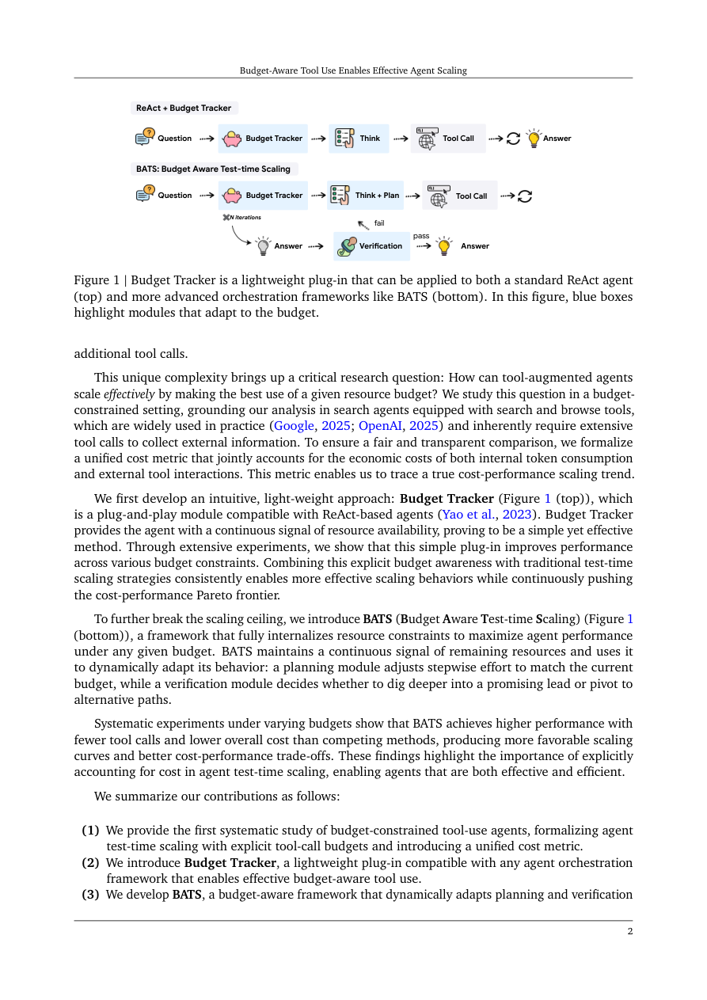
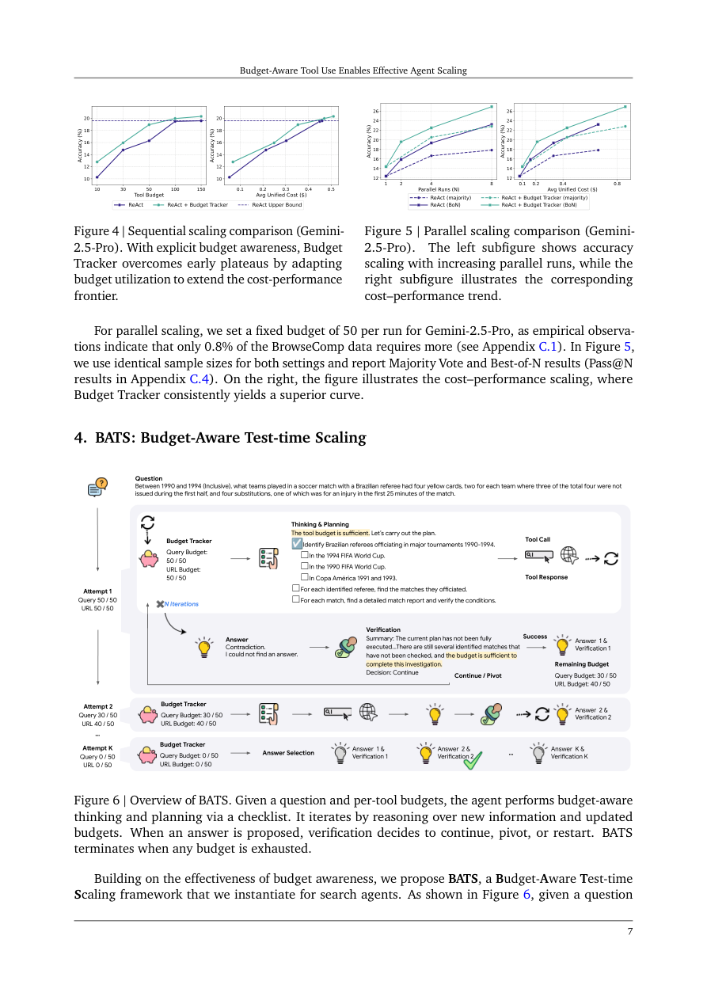
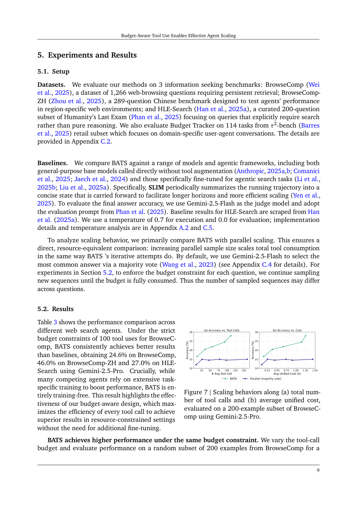
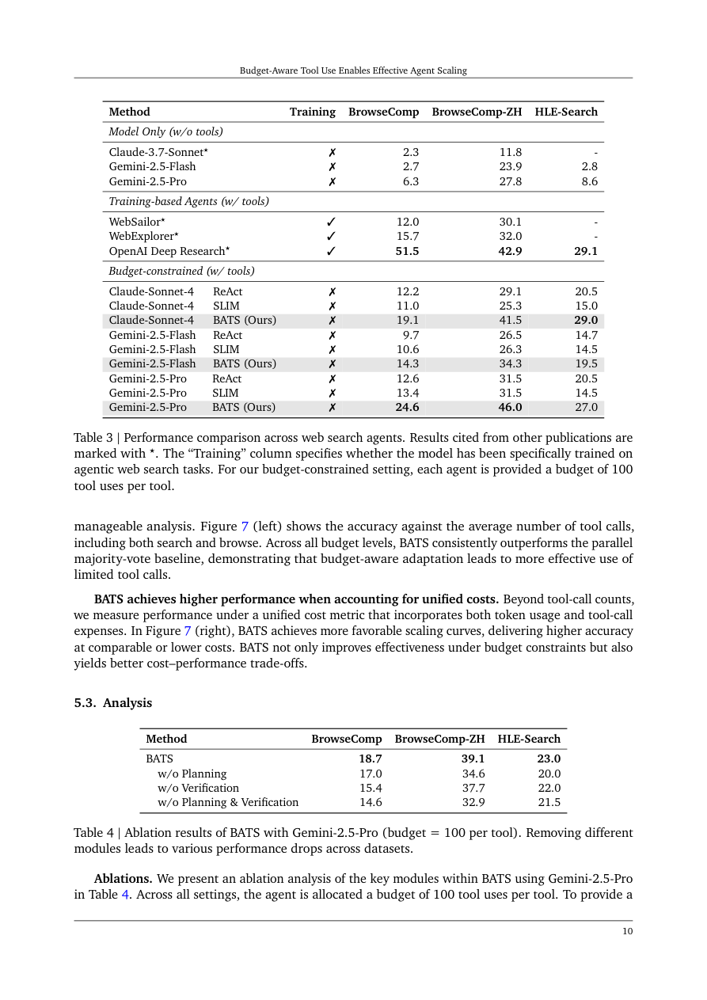

# BATS：预算感知工具调用与 Agent 扩展

作者：Tengxiao Liu、Zifeng Wang、Jin Miao等。原文：https://arxiv.org/abs/2511.17006v2 。[中文转述与译文限制](2511.17006-BATS-译文.md) · [总览](../../总览.md)。核查日2026-11-08。Zotero`5F9XKW4N`，附件`X58SSWAR`，32页，原文先归档后阅读。

## 0. 论文发表状态

COLM 2026（第三届Conference on Language Modeling）接收，作者代码的会议引用与arXiv注释均确认。初始预印本2025-11-21，采用v2；不因首次年份为2025就把会议年份写为2025。未核实会议页码，不编造。代码：https://github.com/google-research/budget-aware-agent 。

## 1. 论文提出了什么问题

给Agent更多工具调用预算不一定提升准确率，因为Agent可能不知道资源状态，也不调整规划和核验。论文问如何在明确工具上限内利用预算，并改善性能—成本前沿。这里的预算首先是搜索/浏览次数，而非单次输出长度。

## 2. 相关工作、局限性和改进

ReAct可交替推理行动，重复采样、投票和best-of-N能增加测试时计算，但更贵不意味着更高效；固定摘要能缩短历史，却不自动决定何时继续、转向或验证。Budget Tracker持续显示预算，BATS进一步将预算用于计划和验证，且无需额外任务微调。

## 3. 动机链与方案推演

作者先观察仅放宽上限会饱和，提出信息缺口：模型没有显式剩余资源状态。以最小改动向每轮加入used/remaining，看是否改善同预算表现，再扩展到预算条件化规划与验证。

搜索路线可能有希望却证据不足，也可能已被反例否定，二者不应同样继续花钱。验证器据约束核对候选答案，并选择SUCCESS、CONTINUE或PIVOT；继续或转向时总结关键事实和失败原因，避免重复低收益搜索。

因此它不仅是“再提醒一句省token”，而是把资源信号嵌入控制流。但显示已用余额仍不是预测未来需求，这是与本课题最重要的区别。

图源：Liu等，原文第2页图1，仅作方法评论所必需的图表引用；非开放改编许可，公开发布前核查转载权限。

## 4. 具体方法、数据集与详细实验操作

### 4.1 控制与计费

预算向量为各工具最大调用次数，逐题严格限制实际用量。Tracker在初始给使用建议，后续显示used/remaining。BATS规划搜索与核验，验证输出上述三类决策，并以摘要延续有价值状态。

统一成本将输入/输出token价格与搜索/浏览费用合并。因此比较既有工具次数，也有统一货币成本。调用变少、费用降低与token变少不是同一命题，还需把验证器与答案选择开销计入。

### 4.2 数据集选择与构造

| 数据 | 性质与规模 | 评测作用 |
| --- | --- | --- |
| BrowseComp | 已有公开1266题 | 需要持续检索的难题；扩展曲线用200题子集 |
| BrowseComp-ZH | 已有289题 | 中文与区域性网络信息检索 |
| HLE-Search | 从HLE筛出的200题子集 | 明确需要搜索，不是纯推理 |
| τ2-bench retail | 既有114个任务 | 补充测试领域对话工具使用 |

不是BATS原创完整benchmark。代码提供BrowseComp200 UID清单、HLE与中文题哈希清单，不直接重新分发所有题答，防污染。不能随机另抽200题却宣称严格复现论文子集，也不能把200题曲线当1266题主表。

### 4.3 模型、推理和对照

主要设置含Gemini2.5-Pro/Flash，另有其他基线模型；执行temperature0.7、判分0.0。Gemini2.5-Flash作为答案judge，判分提示沿用HLE设置。工具为搜索/浏览，须固定后端、返回数、缓存和日期，实时网页漂移会影响可比性。

ReAct、ReAct+Tracker、BATS及并行采样比较。Tracker分析中各工具初始100次，预算耗尽或回答时停止；预算档位实验和BATS具体总调用约束按相应图表设置，不把各工具100与总和100混为一谈。

### 4.4 可照做的复现流程

1. 克隆代码，记录commit；创建Python3.11环境并 `pip install -r requirements.txt`，配置模型、搜索与可选浏览凭据。命令需Linux/WSL；本机未运行付费推理。
2. `python scripts/prepare_data.py browsecomp`重建1266与200题；HLE先接受数据访问条款再运行`... hle`；中文从官方取得许可数据后`... bczh --input <路径>`。哈希核对子集，保留版本与canary，不公开解密题答。
3. 先审查并运行`bash scripts/run_react.sh`、`run_budget_tracker.sh`、`run_bats.sh`，保证同模型、同题、同工具与预算，不仅模型名相同。
4. 小预算示例可调用`python src/agent_bats.py --model gemini/gemini-2.5-flash --search_budget 20 --browse_budget 20 --temperature 0.7 --seed 10 --data_path data/browsecomp/bc200.jsonl --do_eval`。这只是可调整示例，严格复现需带上官方脚本中的全部flag，而非宣称该简写即论文设置。
5. 日志保留full trajectory、各阶段token、工具消耗和解析失败。Stage1由`src/evaluate.py`将终答对金标准判分；Stage2由`src/select_answer.py -d <evalv1.jsonl>`选候选。
6. 分开记录pass acc（至少一候选正确，上界）、select acc（judge实际选择，BATS主指标）、first ans acc。不能用oracle pass替代可部署选择准确率。
7. 运行`src/analyze.py`核对token/费用；同预算画曲线，再同成本比较。做去Tracker、去规划/验证与摘要等消融。多次重复并记录网页缓存；不要用不同日期网页结果直接归因于架构。

图源：原文第7页。

图源：第9页图7。

图源：第10页，保留指标和基线类型。图均为评论引用，未声称获得全篇翻译/转载授权。

## 5. 实验结论

主文报告Gemini2.5-Pro的BATS在BrowseComp24.6%、BrowseComp-ZH46.0%、HLE-Search27.0%，并与并行投票比较成本前沿。Tracker预算10对100的示例在相近准确率下降低工具使用和统一成本，但不同量不能都改写为token节省。

主表与扩展曲线支持预算感知的作用，但不能从单一模型/日期外推任意Agent。验证、摘要与最终选择本身也是额外计算，净效益必须包含这些部分。

## 6. 贡献

明确区分预算上限和实际成本；提出轻量预算状态模块；通过规划与验证改变搜索分配；提供成本—准确率分析。对本选题提供最基本的“只提示余额”基线，预测器必须证明优于它而非只胜过无控制。

## 7. 不足

网络动态和judge误差影响复现；工具次数粗化真实token成本；不能直接预测任务还需多少token；摘要可能丢掉关键证据；既有基线的外部报告与重新运行结果可比性有限。研究预测节省时，需固定缓存，分解生成/输入/工具/额外验证成本，并评估成功率损失。

## 8. 中文译文及未完成项

见[中文转述与短引文翻译](2511.17006-BATS-译文.md)。arXiv仅非独占分发许可，未发现开放改编授权，不能照要求直接提供未授权核心长段逐字翻译。本笔记的0—7节与图表已完成，但规范要求的长篇忠实译文仍待用户提供文本或确认授权后补齐；不将转述冒充译文。
