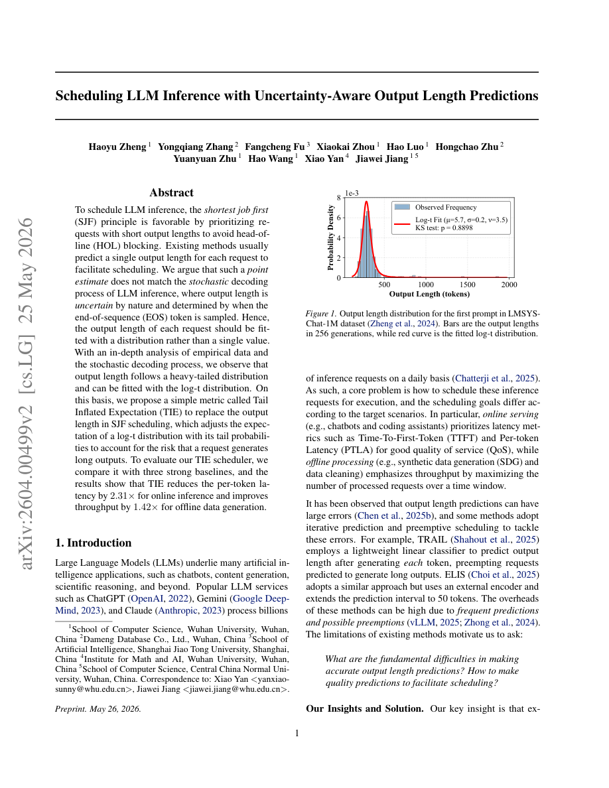
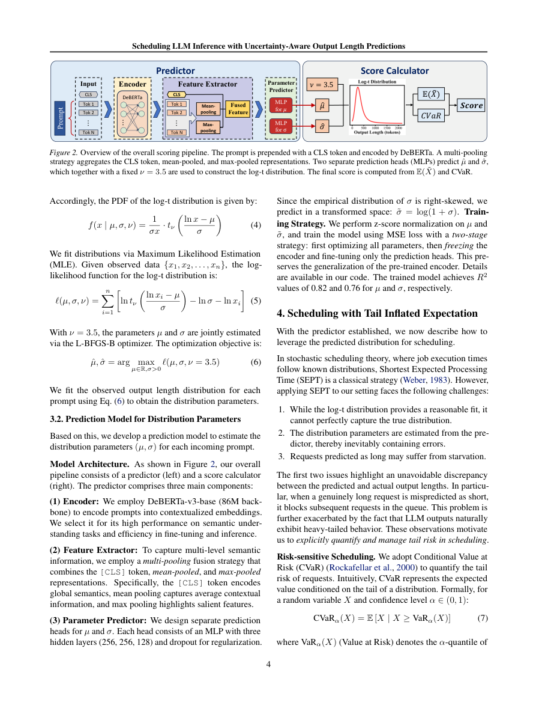
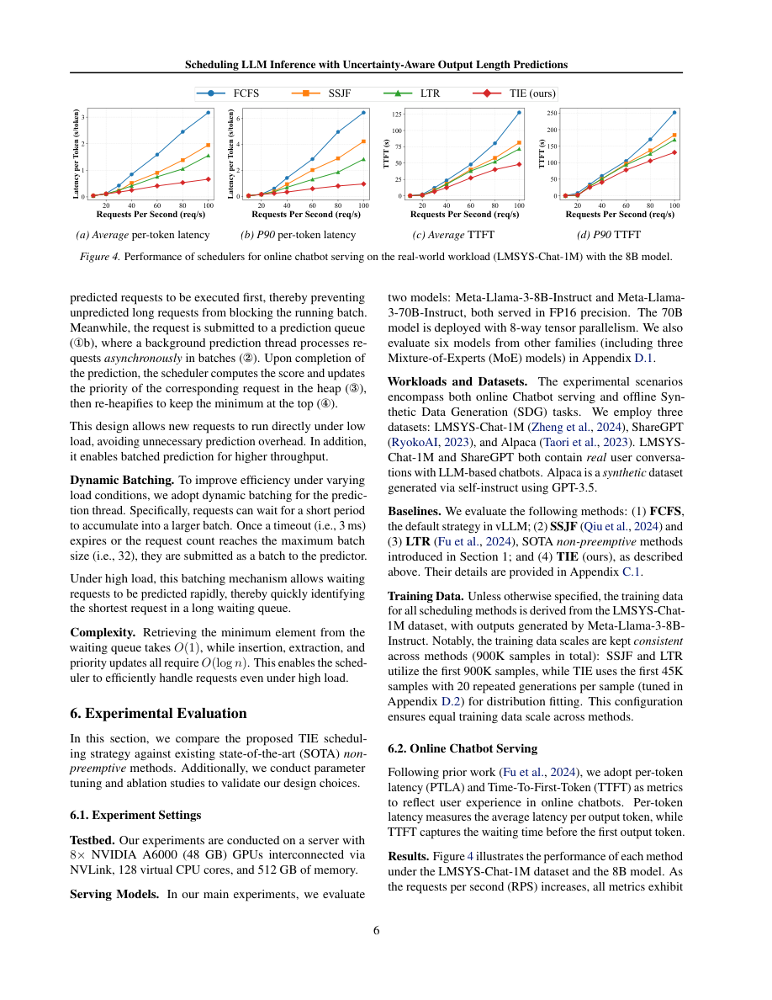
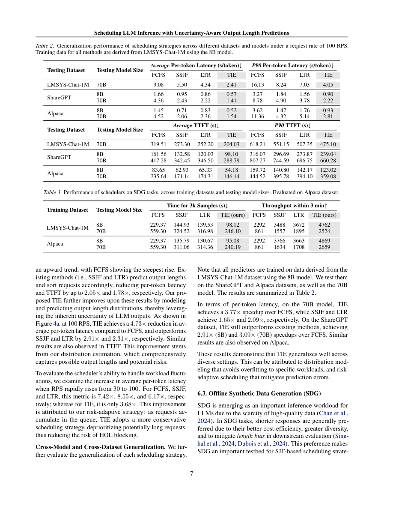

# TIE：用输出长度分布而非单点预测调度 LLM

作者：Haoyu Zheng、Yongqiang Zhang、Fangcheng Fu等。[核心译文](2604.00499-TIE-译文.md) · [总览](../../总览.md)。原文：https://arxiv.org/abs/2604.00499v2 。核查日2026-11-08。Zotero条目`RUCACT9S`，附件`Q88BF57M`，24页；复用已有条目，未重复导入。

## 0. 论文发表状态

ICML 2026（第43届）接收，arXiv初次公开2026-04-01，本笔记采用v2。作者代码给出正式会议引用与OpenReview：https://openreview.net/forum?id=I5IMkvVKd7 。未核实PMLR卷页，不编造；PDF页眉“Preprint”不应被误解为没有会议录用。

## 1. 论文提出了什么问题

短作业优先能缓解队头阻塞，但LLM实际输出长度未知，且同一输入随机解码可能生成长短不同的回答。单点长度预测可能把长尾请求当成短请求。论文问：能否预测长度分布，并把尾风险纳入排序？目标是在线延迟和离线吞吐，**不是减少生成token**。

## 2. 相关工作、局限性和本文改进

FCFS不利用长度，SSJF用代理模型回归长度，LTR学习相对顺序。它们有不同精度和代价，但点估计/排序难显式表达同prompt的随机尾部。TIE拟合log-t分布参数，以风险调整后的分数取代SJF长度，同时设计异步预测，避免预测器本身阻塞服务。

## 3. 作者如何分析问题并推演方案

首先同prompt重复采样，观察偏度、变异系数和尾部比例；再把长度定义成首次EOS时间，分析不同轨迹终止概率的混合为何可产生重尾。这是有假设的理论解释，不是证明任何模型、提示和温度必然服从log-t。

然后比较分布拟合：1000个prompt各100次，log-t三参数KS通过率93.1%，固定自由度3.5的两参数为90.6%，高于log-normal60.3%。为减少预测难度固定自由度，只预测位置与尺度。

最后考虑部署：预测分布本身还不足以排序，要将分布变为风险分数；预测也消耗时间，因此用异步线程/批处理与请求队列解耦。该动机链覆盖统计建模、决策和系统开销三层。

图源：Zheng等，原文第1页图1，CC BY4.0，整页渲染；图1是256次示例，不要与分布比较实验的每prompt100次混淆。

## 4. 具体方法、数据集选择与详细实验操作

### 4.1 建模与调度

令 `Y~t(ν)`，`X=exp(μ+σY)`。预测器读取prompt表示并输出μ、σ，固定ν=3.5。图2展示编码器与参数头。实际生成有最大长度上限，必须用论文的截尾/封顶变量处理期望与尾部风险，不能直接把未封顶log-t当成有限均值分布。

TIE使用期望和尾风险构成排序分数；原文第4节及附录B给出封顶期望、CVaR推导。风险权重与负载有关，需复现源码而非凭“分位数越大越好”替代。注意封顶 `min(X,xmax)` 与在范围内条件归一化的截断分布不同。

图源：原文第4页；框图和数学定义一起保留。

### 4.2 数据与规模

使用开源LMSYS-Chat-1M（约100万会话）与ShareGPT真实对话，测试真实服务；使用Alpaca约52k指令模拟合成数据生成。不是作者原创数据集。分布比较用1000提示×100次；主训练TIE用45k提示×20次=900k输出，SSJF/LTR用前900k样本，名义训练输出规模一致，但prompt多样性不同，不应忽略。

附录C.2/Fig6的跨数据分布分析每数据集10k样本；这不代表全部调度测试都只使用10k。跨模型测试从Llama3-8B迁至70B及其他模型，跨数据测试使用ShareGPT/Alpaca。复现前核对所用split和到达轨迹，不能把完整数据集规模直接作为测试样本量。

### 4.3 模型、硬件与推理参数

主服务模型为Meta-Llama-3-8B-Instruct和70B-Instruct，FP16；70B为8路张量并行。论文服务器8×A6000 48GB、128vCPU、512GB RAM。异步预测批超时3ms，最大batch32。生成温度、top-p、EOS、输出封顶、vLLM版本和负载档位须按发布配置逐项固定；未核实项不填默认数冒充论文参数。

补充已披露温度：附录跨解码实验明确调度预测器训练数据temperature=0.7，跨温度评估0.4—1.6。不能把“未核实其余配置”误读为论文没有提供任何温度，也不能把此项自动套给所有主表请求。

作者代码：https://github.com/Hyzheng-code/TIE 。README明确存在`xxx`路径占位。公开训练实现与图示可能有细节差异（实现含多池化），应固定commit并记录差异，不能声称拿图就完整复现。

### 4.4 复现操作

1. 获取官方代码，固定commit与vLLM依赖；下载模型和许可允许的数据。建立按prompt隔离的数据清单、随机种子和服务配置。
2. 对TIE训练提示重复生成20次，记录实际输出长度与是否触顶；不要对900k行随机拆分导致同prompt跨训练测试。
3. 固定ν=3.5拟合每prompt参数，生成CSV列`prompt,logt_mu,logt_sigma`。检查尺度为正、拟合失败与封顶样本处理；README并不提供完整的一键标签生成流程，这是复现缺口。
4. 在`train/model_train.py`填写`DATA_PATH`、`MODEL_PATH`、`BASE_SAVE_DIR`并训练；在`ua_predictor.py`配置checkpoint与encoder。不能使用占位路径直接宣布复现完成。
5. 根据README用`bash start-server.sh ua <GPU列表> <端口> <服务模型路径>`启动；`ua`为预测器预留一张GPU，应计入资源对比。
6. 重放同样在线请求与离线队列，FCFS/SSJF/LTR/TIE固定硬件、模型、封顶和请求内容；记录TTFT、PTLA、吞吐、尾延迟及预测开销。不同请求顺序可以变化，生成设置不应偷偷改变。
7. 消融分布族、预测异步、风险分数与负载参数；跨数据/模型测试不重新偷用测试标签调参。未执行这些实验，本节仅为复现指南。

图源：原文第6页。

图源：原文第7页。整页可读到负载、模型和指标，不能只截一个最大增益。

## 5. 有效性实验与结论

论文比较FCFS、SSJF、LTR，报告在线per-token latency最高2.31×改善、离线吞吐最高1.42×改善，并做跨数据/跨模型与分布消融。具体倍率是相应配置下的结果，不代表任意负载平均提高该倍数，也不是少用2.31倍token。

分布拟合和端到端调度构成两类证据：拟合更好不自动保证系统更快，异步实现和预测器开销也是收益的一部分。训练同样900k输出不意味着监督信息和prompt覆盖完全相同。

## 6. 贡献

将不确定性纳入长度预测；以log-t近似重尾并简化参数；通过风险分数与异步预测连接统计与部署。对课程选题的价值是提供分布建模启发，而非直接提供Agent净token节省结论。

## 7. 不足与可延伸点

重复采样标签昂贵，分布假设受模型/温度/提示影响；预测器需要额外资源；改vLLM部署复杂；单次长度不覆盖未来工具内容和轮数。可借鉴其风险敏感思想，但轨迹预测应重新评估分布、校准和策略反馈，不能简单相加调用分位数当成轨迹覆盖保证。

## 8. 中文译文

见[摘要与核心段落译文](2604.00499-TIE-译文.md)。保留作者、原文位置和许可；未覆盖全文处明确不称全文翻译。
