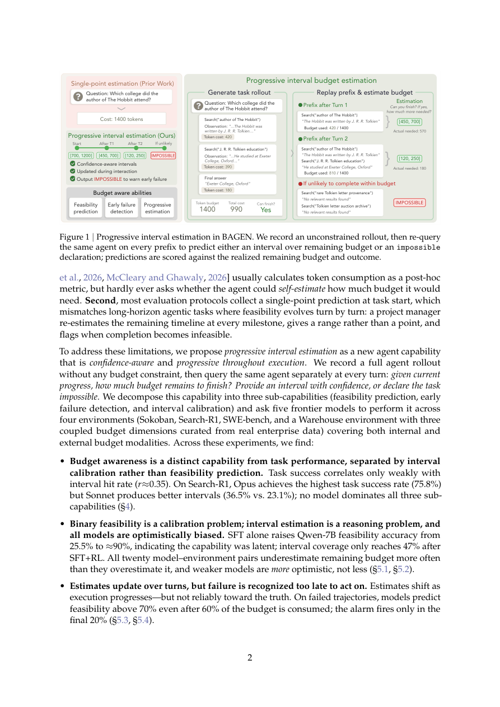
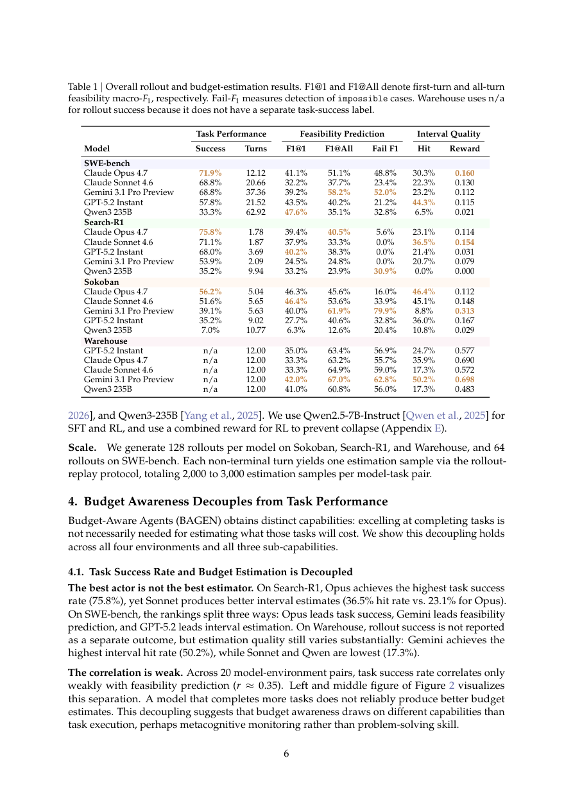
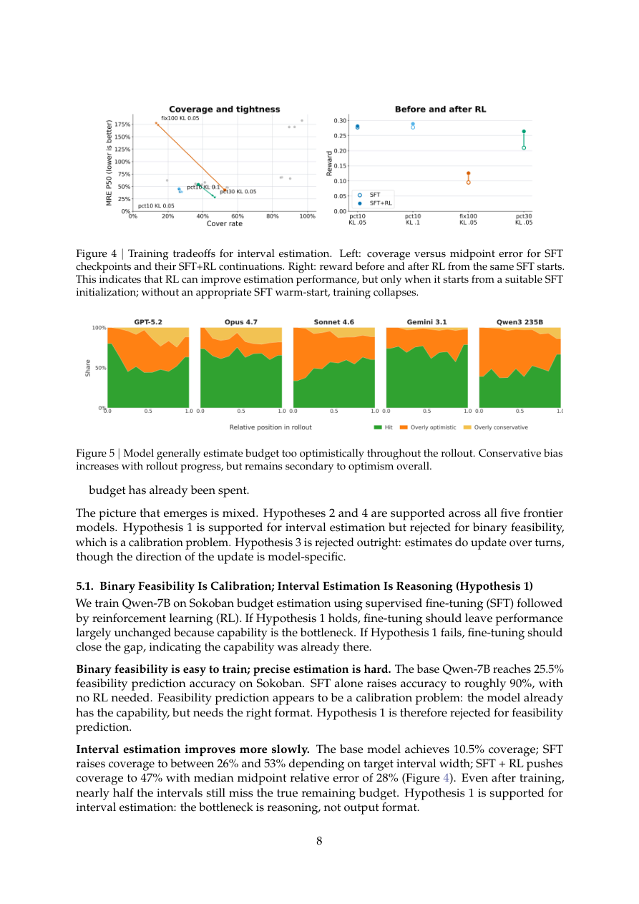
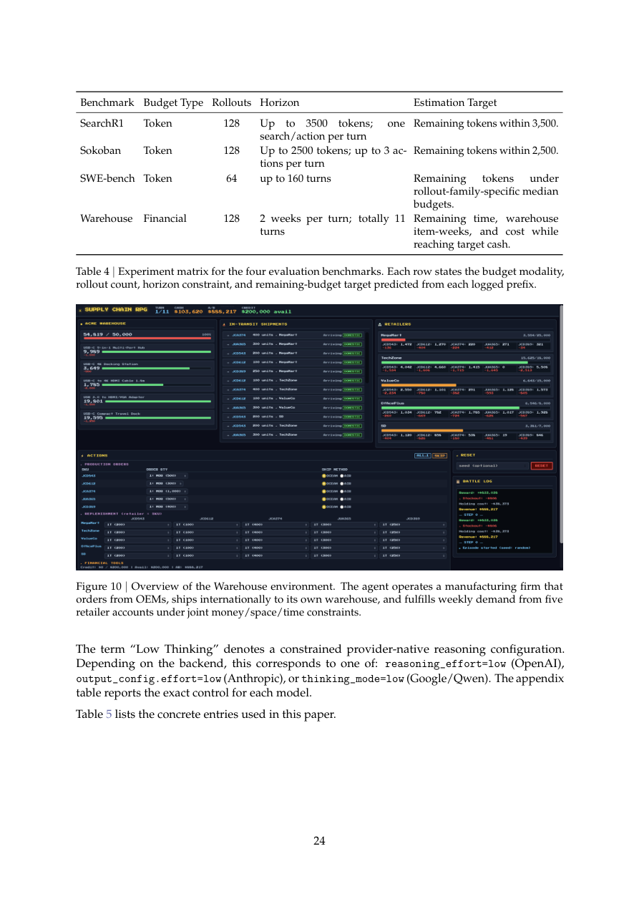
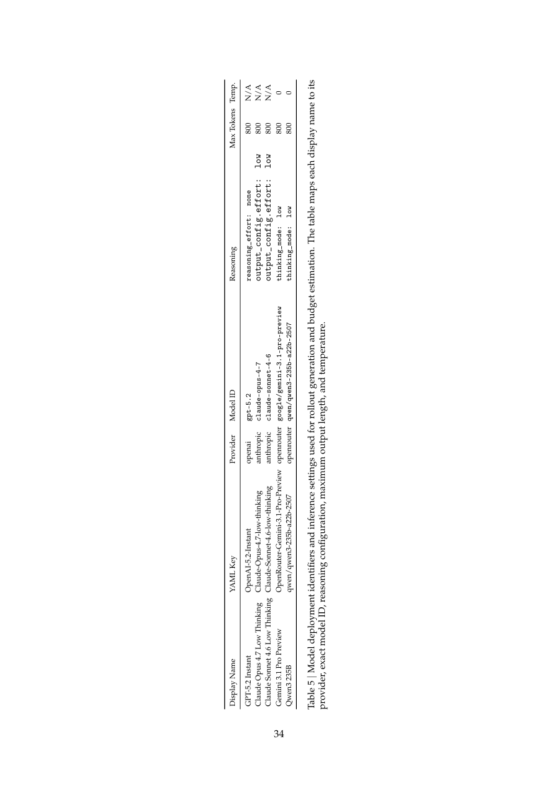

# BAGEN：Agent 是否知道自己还要花多少预算？

作者：Yuxiang Lin、Zihan Wang、Mengyang Liu 等。原文：https://arxiv.org/abs/2606.00198v1 。[核心译文](2606.00198-BAGEN-译文.md) · [总览](../../总览.md)。阅读核查：2026-11-08。Zotero：`7BB55R7S`，PDF 附件 `FAVV9CHV`，36页。先归档后做笔记；本目录不保存PDF。

## 0. 论文发表状态

arXiv:2606.00198v1，2026-05-29。官方代码/会议页确认：题为 *Towards Budget-Aware Agents* 的工作坊版本发表于 ICML 2026 的 RLxF: RL from World Feedback 与 The Second Workshop on Agents in the Wild: Safety, Security, and Beyond。**不是 ICML 主会录用论文**；所核查来源未确认期刊或主会正式发表，也无已确认卷期页码。工作坊入口：https://icml.cc/virtual/2026/78139 、https://icml.cc/virtual/2026/67798 。

## 1. 论文提出了什么问题

成本通常事后统计，但 Agent 执行中需要判断还能否完成、还要多少资源以及何时告警。论文区分模型计算产生的内部预算和动作引起的外部预算，要求在每个轨迹前缀输出剩余需求区间，或输出 `IMPOSSIBLE`。这是动态需求估计，不只是显示账户余额。

## 2. 相关工作、局限性和本文改进

预算约束决策研究给定预算如何行动；单调用长度预测处理一次输出；静态区间估计处理固定样本。本文关注未来行为依赖当前状态的剩余轨迹，结合可行性、早期失败识别与区间质量。已有预算感知工具调用与停止策略是近邻，作者并非声称首次预算控制。

需谨慎理解：沿已记录 rollout 后缀构造的标签，是该次延续的实际消耗，不是所有可能策略中最小成功成本。失败轨迹的“不能完成”也有协议定义，不能提升成数学不可解。

## 3. 作者如何分析问题并引出具体方案

动机链条为：执行变长导致预算风险 → 完成能力不等于自我监控能力 → 只预测起点总成本无法应对错误与进度变化 → 每一步要根据历史更新估计 → 点预测掩盖不确定性，改为区间和不可完成告警。

直接在执行时反复追问会改变行为、扰动评测。因此先记录完整 rollout，再把每个前缀单独交给同模型估计，用已记录后缀计算标签。该两阶段协议把行动与自估相对分离，但也意味着离线效果不自动等于闭环收益。

作者将预算能力拆成：可行性预测、失败识别、区间校准；随后测试自估能否支持早停，再使用 SFT/RL 训练专门能力。这条路线的重要性在于先诊断，再干预，不把任务成功率当预算能力代理。

图源：Lin 等，原文PDF第2页、图1，CC BY 4.0；保留原图，仅整页渲染。图中的示例数字不是实验均值。

## 4. 具体方案、数据集选择与详细实验操作

### 4.1 数据来源、规模与选择理由

| 环境 | 来源性质 | 论文运行规模 | 为什么选择 |
| --- | --- | --- | --- |
| Search-R1 | 既有搜索环境，公开派生轨迹 | 每模型128条 rollout | 检索多步、不确定证据和输出消耗 |
| Sokoban | 既有交互推箱子环境 | 每模型128条 | 可控动作与明确成功状态 |
| SWE-bench式编码 | 既有编码任务与日志，不是新造完整SWE-bench | 每模型64条 | 长程工具链和失败修复 |
| Warehouse | 企业背景的定制、匿名化多资源环境 | 每模型128条 | 时间、库存占用和资金耦合 |

每个非终止轮产生估计样本，主文报告每模型—环境组合约2,000—3,000估计样本；但附录B.2明确SWE-bench每rollout family最多512个估计前缀，不能用主文概括代替最终样本清单。编码轨迹先按assistant轮数分8个近等量桶，再seed42轮转抽样，避免长轨迹占据过多权重。这些都是相关前缀，不是独立任务。公开数据：https://huggingface.co/datasets/MLL-Lab/BAGEN ，分 `origin/`、`estimation/`，附 `manifest.jsonl`。

Search-R1 表4上限为3,500 token、每轮一次搜索/动作；Sokoban 2,500 token、每轮最多3个动作；SWE-bench至多160轮并用 rollout family 中位预算。Warehouse表4记11个交互轮、每轮2周；正文个别汇总出现12轮，复现须按日志定义核对，不自行抹平差异。

Warehouse可行性探针不是随意加噪：`half_reachable`、seed42，先打乱并半分；可行组目标现金为实现末态的0.5—1.0倍，时间等于实现轨迹，库存与费用预算为实现总量的1.0—1.2倍；不可行组从0.5—2.0倍采样直到该日志不满足约束。50/50是评测平衡，不表示实际业务失败率50%。

### 4.2 模型、参数与标签

评估 GPT-5.2 Instant、Claude Opus4.7、Sonnet4.6、Gemini3.1 Pro与Qwen3-235B；SFT/RL使用Qwen2.5-7B-Instruct。PDF第34页表5：`gpt-5.2`使用reasoning_effort=none，Claude两模型使用effort=low；这三项temperature=N/A，不应擅填0。OpenRouter的`google/gemini-3.1-pro-preview`与`qwen/qwen3-235b-a22b-2507`为low thinking、temperature=0。表中五项max tokens均800；这不等于SFT/RL序列上限。历史端点是否仍可用须复核，本笔记未运行API。

附录B.1的Sokoban为程序生成8×8、2箱子、搜索深度30，单响应上限800、历史截为2500 context tokens；Search-R1使用HotpotQA派生parquet与检索服务。原始预算上限、上下文截断和协议所称“无预算约束rollout”需要结合实际配置分别理解，不能假定日志完全没有任何上限。

训练细节：附录E的SFT为FSDP、5epochs、lr5e-6、global batch16、每GPU microbatch2；默认max sequence9216而v3 launcher覆盖为16384，须固定脚本。目标区间按真实剩余量的±10/30/50%或固定±100/500/1000构造。GRPO为8GPU、global batch64、每prompt16rollouts、lr5e-7、5epochs、max prompt8192、max response1024、entropy0，KL loss系数比较0.05/0.1；评估temperature0、response cap512。不能把这些训练目标区间误认成有覆盖保证的统计校准区间。

对每条完整轨迹记录累计成本C，前缀t的后缀消耗由终态累计减当前累计构造。估计器只能看到当前前缀、已用预算和允许信息，不能看到后缀。按其区间是否覆盖标签、可行/不可行是否符合协议评分，不能只用区间中点误差替代全部目标。

### 4.3 可以照做的离线复现流程

1. 克隆 `https://github.com/mll-lab-nu/BAGEN`（含submodules），按README创建Python3.12环境，运行 `bash scripts/setup_bagen.sh`，设置 `PYTHONPATH="$PWD:$PWD/verl"`。这些是Linux/WSL命令，不是本机已执行结果。
2. 从HF清单下载原始与估计日志，记录revision、路径、校验和；保留任务与rollout ID。核对每组128/64和终止轮，避免把缺失日志算作成功。
3. 先运行官方干跑：`DRY_RUN=1 MAX_SAMPLES=5 INPUT_JSON=/path/to/dialogues.json bash scripts/evaluation-scripts/eval/sokoban.sh`，确认提示与标签对应。
4. 设置所用供应商密钥，不写入笔记；例如 `MODEL_NAME=qwen/qwen3-235b-a22b-2507`、`MAX_CONTEXT_WINDOW_TOKENS=2500`、`INPUT_JSON=...` 后运行同脚本。Search-R1用 `searchr1.sh` 与3500，重新生成搜索需额外索引。
5. 保存前缀预测、原始响应、token计量、可行标签、区间和解析失败；复算首轮/全部轮macro-F1、Fail-F1、Hit和奖励。先核对表1，再测试早停。
6. 早停实验对成功和失败轨迹均评估，记录误终止、成功率变化和预测成本；离线停止只能节省被截去的原后缀，不能模拟改变策略后的新后缀。
7. 训练是额外阶段：先 `DRY_RUN=1 bash scripts/budget-rl/run_budget_rl_pipeline.sh prepare,sft,rl`，官方完整示例设置128轨迹、8GPU。按附录E、F固定数据和奖励，不能把课程轻量预测器实验称为复现SFT/RL。

图源：原文第6页表1。

图源：原文第8页。

图源：原文第24页表4。整页保留标题、指标和脚注便于独立阅读。

图源：原文第34页表5；与表4预算/轮数同时阅读。

## 5. 实验如何证明有效，有哪些结论

五模型四环境的比较显示任务成功与预算能力弱相关，报告r约0.35；最强执行者不总是最佳估计器。SWE-bench上Opus任务成功71.9%、预算Hit30.3%，GPT-5.2任务成功57.8%、Hit44.3%，支持能力并不一致。

训练后预算告警与停止可改善，但摘要所称区间覆盖最高47%仍表明校准困难；不能把它说成所有环境上限，因为表1Warehouse已有50.2%。早停节省28—64%针对失败轨迹，且有误终止与成功率损失，不能宣称无损全局节省。

## 6. 贡献总结

把剩余预算估计独立成能力；提出逐步区间与告警及rollout-replay协议；覆盖内部和外部资源；展示可训练性与控制价值。对本选题最关键的作用是证明“预测剩余token并早停”已存在。

## 7. 不足与本课题的可探索空间

前缀相关、环境异质、历史API漂移，影响可复现性；离线后缀标签受行为策略约束；区间覆盖与宽度需要联合看；早停会损害成功；自估有额外模型成本。可探索低开销外部预测器、任务级分割校准与同成功率净成本比较，但尚未证明这些组合新颖。

## 8. 中文译文

见[同目录译文](2606.00198-BAGEN-译文.md)，包含摘要与选定核心段落的忠实译文，明确原文位置和CC BY署名，不等于全文译本。
