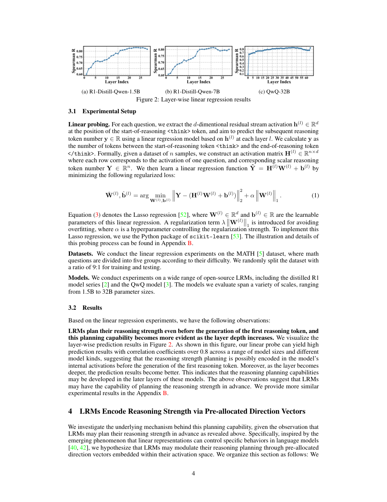
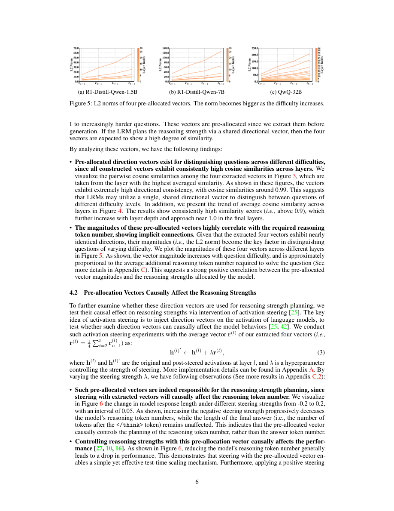
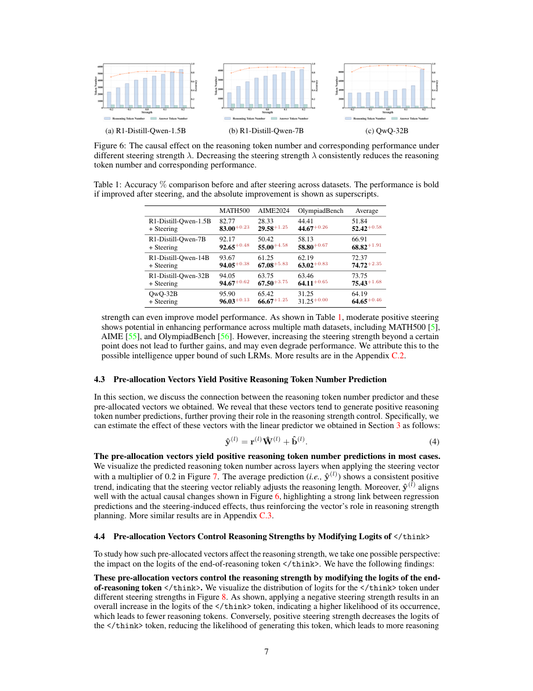
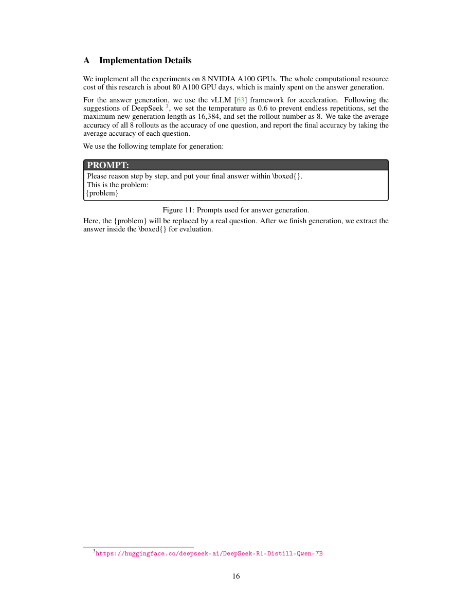

# Reasoning Strength Planning：用预测与激活干预控制思考长度

Leheng Sheng、An Zhang、Zijian Wu等。原文 https://arxiv.org/abs/2506.08390v2 。[中文转述](2506.08390-ReasoningStrength-译文.md) · [总览](../调研总览.md)。Zotero`4ASVFQ3A`/`8EIYL23P`，28页；核查2026-11-08。

## 0. 论文发表状态

当前只确认arXiv:2506.08390预印本，作者README引用也为arXiv，未确认期刊/会议，记为“未发表任何期刊/会议（当前仅确认预印本）”。不能把参考文献中出现NeurIPS2025等当成本篇会议。代码 https://github.com/AlphaLab-USTC/LRM-plans-CoT 。

## 1. 问题

推理模型能否在生成前预测将花多少thinking tokens？相关激活方向能否通过加减改变长度与正确率？这是非常接近“预测与干预”的先例，虽以机制解释为主，应用也包括过度思考检测和高效推理。

## 2. 相关工作、局限与改进

不同任务自动分配推理预算已有现象；activation steering也已有成熟方法。本文连接生成前的线性预测、按难度提取方向、因果干预和`</think>` logit变化，不等于首次所有形式的长度控制。

## 3. 动机推演

难题通常生成更长推理 → 在起始`<think>`处用层激活预测后续长度 → 按MATH难度分组作均值差 → 检查不同难度方向是否一致、模长是否递增 → 加减方向观察思考长度与任务表现变化 → 检查结束思考token的logit。

预测用Lasso，不是随口说的无正则最小二乘。难度均值差可能混入难度与内容差异，作者的干预证据增强关联解释，但不应直接概括为精确独立的“长度旋钮”。

Sheng等，PDF第4页，必要研究评论引用。

## 4. 具体方法、数据和实验操作

### 4.1 数据和构造

MATH已有五级难度，按9:1随机训练/测试做线性预测；具体抽取后有效条数应以日志记录，不拿整个MATH的名义数量替代。方向由不同难度组起始激活均值差构造，调层和幅度不能使用最终测试答案反复选择。

干预测试包含MATH500、AIME、OlympiadBench，扩展到GPQA Diamond和LiveCodeBench。应用测试从AlpacaEval抽100道原问题并每题构造一个overthink攻击题；MMLU另抽100题用于效率测试。攻击诱导额外思考是特定构造，不等同自然流量过度思考比例。

### 4.2 模型与参数

主要模型含R1-Distill-Qwen-1.5B/7B、QwQ-32B。vLLM生成T0.6、max_new_tokens16384、每题8rollouts，准确率先按题平均再跨题平均。8×A100，整个研究约80 A100 GPU-days，多用于回答生成，不是单次向量推理的成本。

探针在各层`<think>`处抽hidden state，标签为到`</think>`的token数；Lasso超参数按发布配置固定，未核对的α不编造。向量加减的层、归一化与强度决定结果，不能任意复制别的模型常数。

### 4.3 复现步骤

1. 下载官方代码，固定commit与三个模型的精确checkpoint。用原模板“Please reason step by step…final answer within boxed”生成，保存8次样本而非只留最好。
2. `bash scripts/analyze.sh`生成探针和方向分析。按题9:1分割后，训练集做探针/均值差，测试集保留预测误差和长度分布。
3. `python AnalyzeSteerFull.py`测试向量加减。按同题同采样配置与不干预基线比较，报告thinking和总token、正确率、重复与截断。
4. vLLM干预由`steer_qwen2_vllm.py`实现，设置`steering_vector_path`为正确模型/层的文件；不能把向量视为跨模型通用。
5. `python eval_overthink.py`检查100对攻击样本，`python efficient_reasoning.py`复现简单题省算；保持题ID和攻击成对。
6. α/幅度/层在开发集选，正式测试不重新挑。另比较直接修改`</think>` logits，区分激活方向是否只是粗糙终止偏置。
7. 记录原问题成功、攻击后成功和length变化，不把长度下降但答案损失写成无损节省。本轮未运行以上GPU实验。

图源第6、7、16页，保留指标、模型和设置，非自画示意。

## 5. 实验结论

问题起始激活具有推理长度预测信息，不同难度差向量方向接近，幅度与长度相关；正向/负向干预可增加/减少长度，部分设置正向增加也改善正确率。强度过大会损坏行为；不是长越好或短越好。

## 6. 贡献

连接生成前预测、方向干预与终止logit分析，展示overthinking检测和简单题高效推理应用。它直接排除了“预测后减向量缩短推理”为全新想法的主张。

## 7. 不足

机制导向、任务/难度相关、调层调强度成本高；长度干预并不提供精确预算保证。用户希望改进玩法，不必重做所有机制图；可利用公开代码做小应用，但需先确认是否优于预算提示和EOS偏置。

## 8. 中文译文与限制

见[中文转述](2506.08390-ReasoningStrength-译文.md)。arXiv非独占分发许可，未见开放改编授权，因此长段忠实译文未完成，不能将转述冒充翻译；用户提供文本后可补译。
