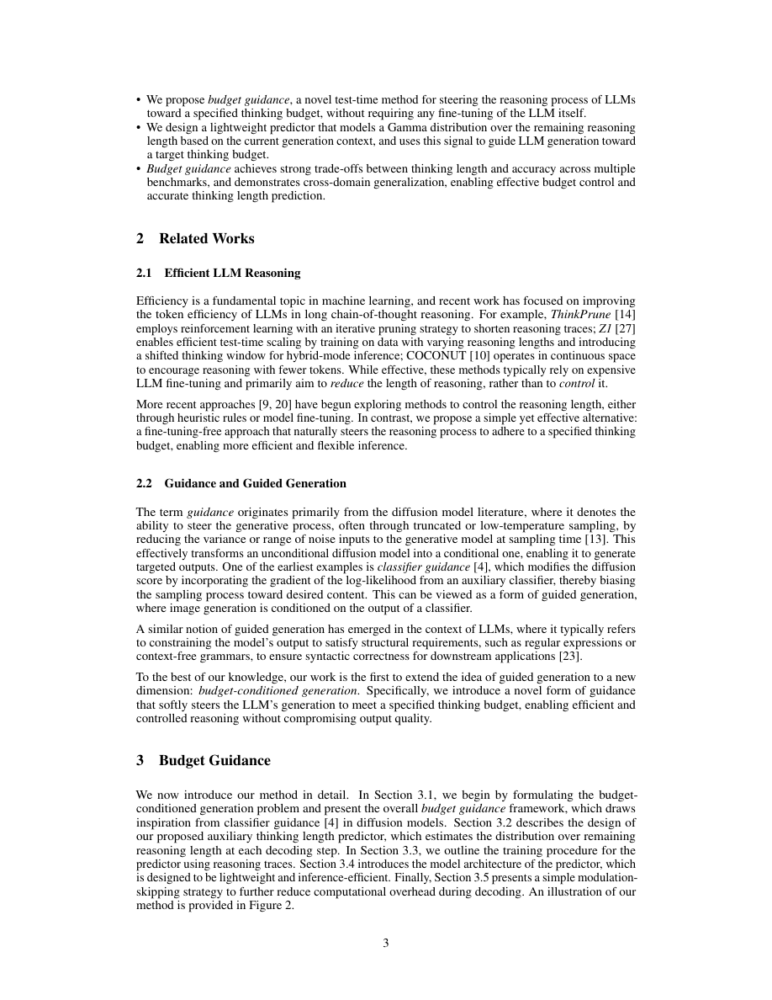
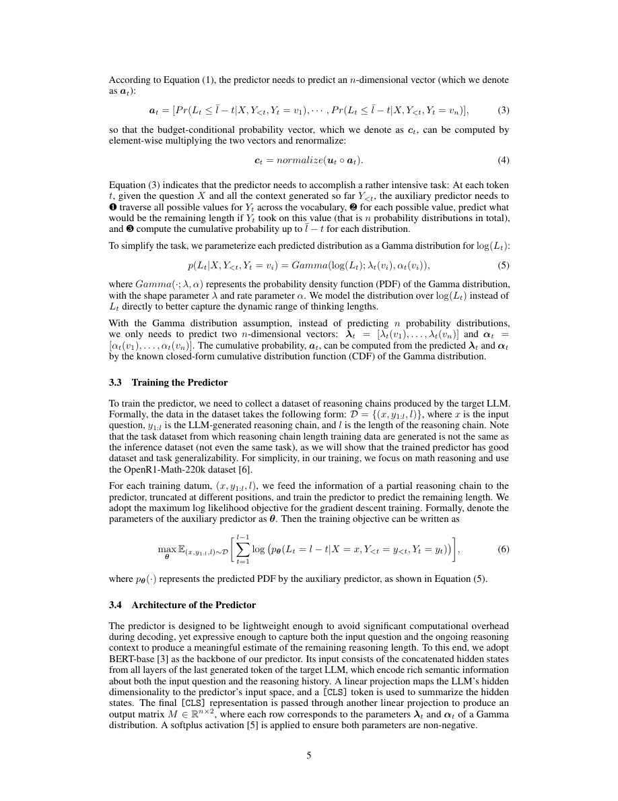
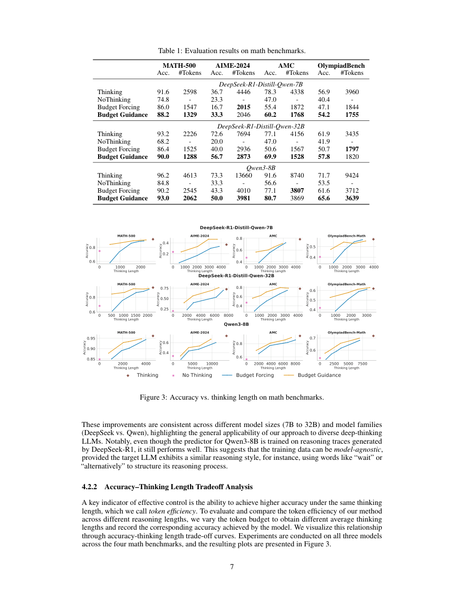
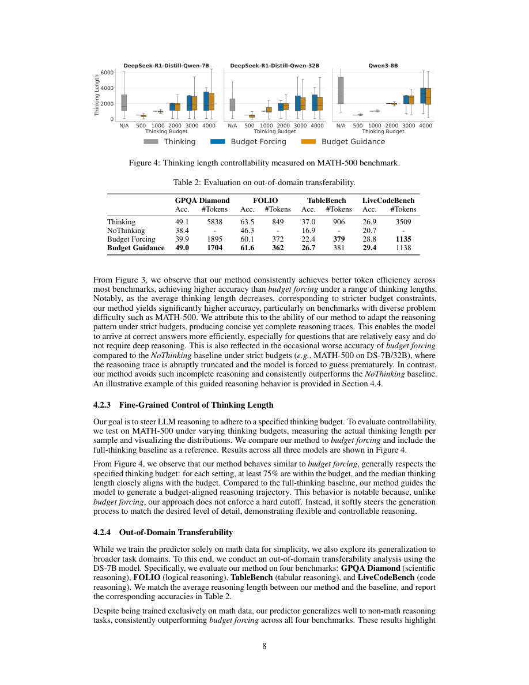

# Budget Guidance：预测剩余思考长度并软引导生成

Junyan Li、Wenshuo Zhao、Yang Zhang、Chuang Gan。[译文](2506.13752-BudgetGuidance-译文.md) · [调研总览](../调研总览.md)。原文 https://arxiv.org/abs/2506.13752v1 。阅读日期2026-11-08；Zotero`SJUYVTK4`/附件`XRVGDGHK`，15页。

## 0. 论文发表状态

arXiv:2506.13752v1，2025-06公开。本轮核查的arXiv与作者README仅列预印本，未确认任何期刊/会议发表；按当前核查记录为“未发表任何期刊/会议（仅确认预印本）”，不把代码公开视为会议录用。作者代码 https://github.com/UMass-Embodied-AGI/BudgetGuidance 。

## 1. 论文提出了什么问题

长推理成本高，硬到预算就插入结束标记可能使推理来不及形成答案。目标是在指定thinking budget内自然地引导推理，而不是只在最后截断。控制对象是思考段，不自动等于用户可见答案或总生成长度。

## 2. 相关工作、局限性和本文改进

提示预算缺少精确约束，budget forcing偏向硬截断，训练基础LLM适配预算较昂贵。本文冻结基础LLM，只训练辅助预测器；借鉴classifier guidance，用候选下一token条件下完成预算的概率修正其生成概率。无需微调基础LLM不代表完全无需训练。

## 3. 作者如何推演方案

将无预算生成分布p(token|prefix)改为给定剩余长度不超过余额的条件分布。Bayes分解说明可用原概率乘“选择该token后仍在预算内结束”的概率，再归一化。

所以只估计当前还剩多少不够：不同候选token会走向不同长度，预测器需为词表候选给出长度分布。用每词两个分布参数代替显式枚举全部长度，并利用CDF算满足余额的概率。

**精确区别：正文§3.2建模的是log(L)服从Gamma，而非直接L服从Gamma。** 摘要的简写不能替代具体公式。结束点、L=0边界和数值稳定性应按实现处理。

Li等，PDF第3页，CC BY4.0，整页渲染，仅改变展示尺寸。

## 4. 方法、数据集选择与详细操作

### 4.1 训练和参数

预测输入包括当前生成状态，输出每词Gamma形状/率参数；目标由已生成推理轨迹的剩余长度自动构造，用最大似然训练。源码修改Transformers生成流程，需本地访问解码，不是普通黑盒API功能。

训练数据为既有OpenR1-Math-220k，约220k数学问题，来自NuminaMath1.5及DeepSeek-R1轨迹；作者增强使样本规模翻倍。它不是论文新建人工标注benchmark。训练基础LLM冻结，预测器1epoch、batch8、warmup后恒定lr1e-4；8×H100，7B与Qwen3-8B约15小时，32B约35小时。不要将整套从头复现描述成低算力零训练。

模型：DeepSeek-R1-Distill-Qwen-7B/32B与Qwen3-8B。评估用greedy；不把框架示例中的max_new_tokens32768误当thinking budget。

### 4.2 为什么这些评测

数学：MATH-500（500题）、AIME2024（标准30题）、AMC2022/2023、OlympiadBench数学子集，覆盖难度；跨域：GPQA Diamond、FOLIO、TableBench数值子集、LiveCodeBench 2024-08至2025-01。后几项具体筛选后题数应以发布任务配置和日志核对，原文此处未统一列出，不把全集规模冒充有效样本数。

基线是同样不微调基础LLM的budget forcing等，另有自然长思考和NoThinking。对比应同时固定请求预算、报告实际平均长度；长一些的策略不能直接当同成本优势。

### 4.3 复现步骤（未实际执行）

1. 克隆含修改Transformers/TRL与evaluation harness的作者仓库，固定commit；创建Python3.10 CUDA环境，按README安装torch、flash-attn及本地fork。
2. 先用已发布`senfu/DeepSeek-R1-Distill-Qwen-7B-BG`，tokenizer用原始DeepSeek7B。按chat template编码，调用generate时`do_sample=False,max_new_tokens=32768,token_budget=500`。
3. 分别截取thinking与最终答复，核对thinking预算是否生效、是否自然闭合，保存全部tokenID与结束原因。用自然生成与硬预算同题比较。
4. MATH-500官方示例设置`MODEL_PATH`、`TOKENIZER`、`THINKING_BUDGET=1000`，运行`accelerate launch -m lm_eval --model hf --tasks openai_math --batch_size 1 --apply_chat_template --seed 0 --log_samples`并按README补全model_args/gen_kwargs。
5. 作者示例使用外部judge（如Azure GPT-4o-mini），需另配凭据、固定judge版本；先按确定性答案提取检查，不把judge调用成本藏进收益。
6. 每题记准确、thinking长度、总长度、超预算量与延迟。复现多预算曲线，而非只挑一个有利点；剔除题目必须列明原因。
7. 若从头训练，先运行`training/run_data_augmentation.py`再`train.sh`，核验增强与task隔离，不把使用checkpoint称为重新训练复现。

图源分别PDF第5、7、8页；保留原始指标与脚注。

## 5. 实验结论与证据

摘要报告紧预算MATH-500最高26% accuracy gain，具体百分点/相对变化应按原表核对，不能随意改写；以完整思考约63%的thinking tokens保持竞争性。三模型多任务与预算曲线支持可控性，但不代表每题无损。作者报告7B额外延迟约0.6%，限定于其配置，反而提示稀疏更新可优化空间可能很小。

## 6. 贡献

给出预算条件化的token概率重加权；训练候选条件长度分布预测器；无需改基础权重实现控制。与用户方向高度直接相关，必须作为主要竞争方案，而不是仅引用为背景。

## 7. 不足与可改进点

需要模型内部接口与预训练预测器；词表级预测与CDF有实现成本；控制思考不等于正文精确长度；政策改变后分布可能偏移。可以测试更新频率与实际收益，但需承认预测跳过优化已有其他工作，且0.6%开销可能不值得优化。不能预定“稀疏更新一定新且有效”。

## 8. 中文译文

见同目录[摘要与核心段落译文](2506.13752-BudgetGuidance-译文.md)，CC BY4.0，署名并注明选译范围，非全文。
