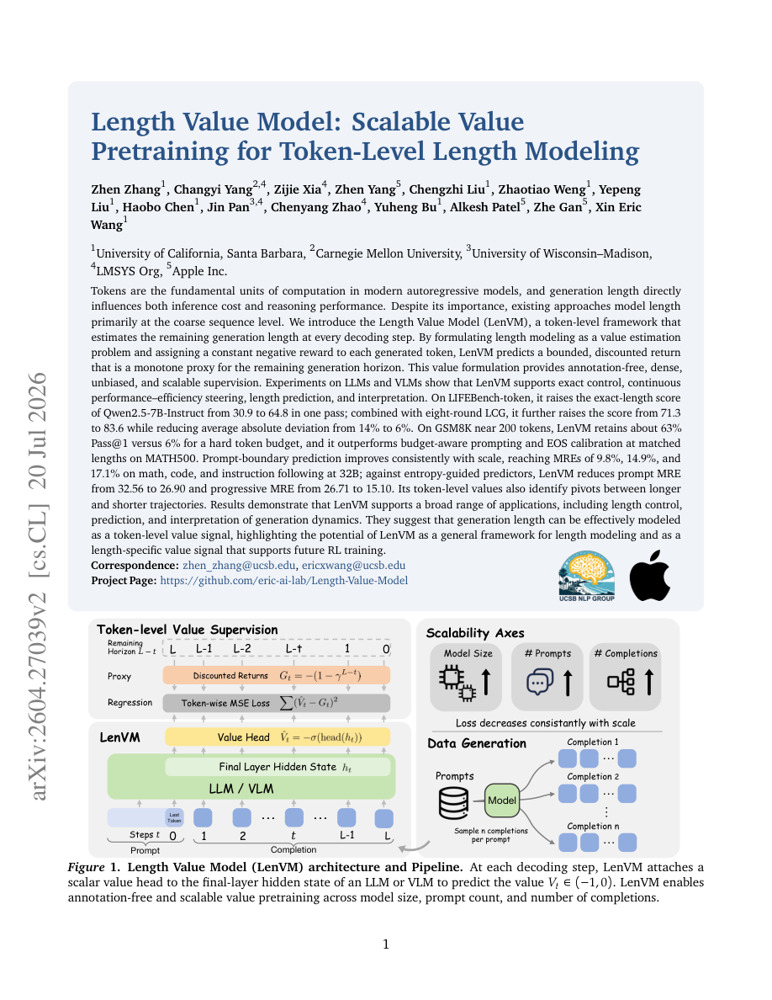
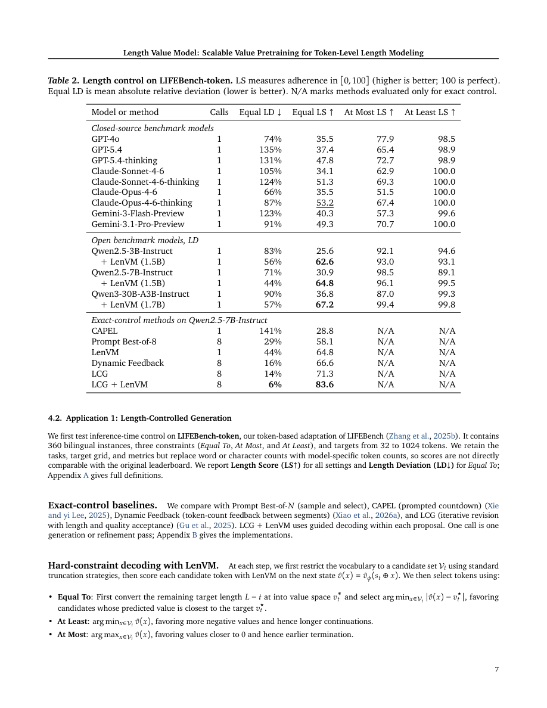
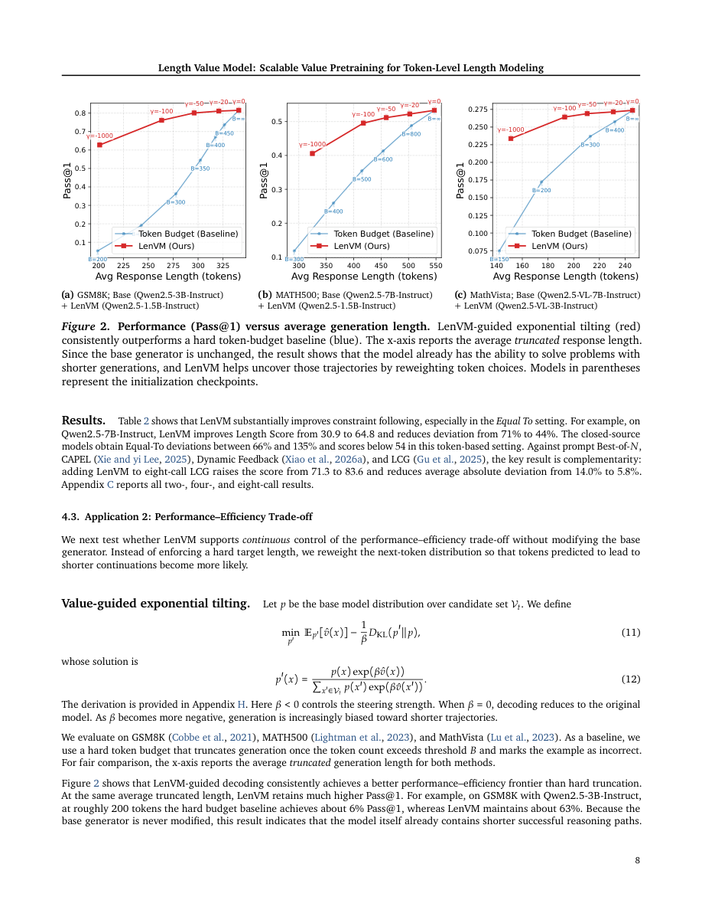
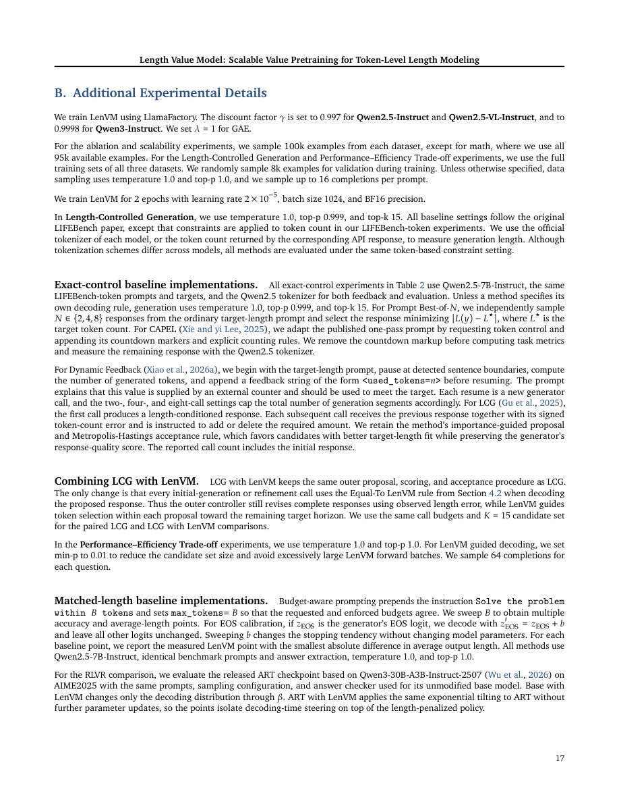
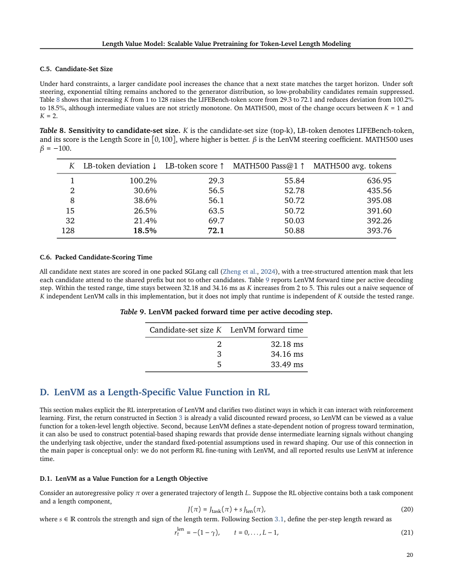

# LenVM：把剩余生成长度建模为token级价值

Zhen Zhang、Changyi Yang、Zijie Xia等。[译文](2604.27039-LenVM-译文.md) · [总览](../调研总览.md)。原文 https://arxiv.org/abs/2604.27039v2 ，本地PDF27页，v2页首日期2026-07-20。Zotero`LJXFWU4C`/`MNPBNRPT`。阅读核查2026-11-08。

## 0. 论文发表状态

arXiv预印本2604.27039v2。本轮arXiv元数据与作者README未提供已发表期刊或会议记录，记为“未发表任何期刊/会议（当前仅确认预印本）”；不根据作者机构推定录用。代码 https://github.com/eric-ai-lab/Length-Value-Model 。

## 1. 问题

在每步解码时估计距结束还要多少生成，并把信号用于精确控长、效率控制和长度预测。它已经把“预测＋干预”合并，不能再把这种组合当本课题原创。

## 2. 相关工作与改进

长度提示、训练长度惩罚、prefill预测各处理部分问题；LenVM使用密集的逐token长度监督，提供统一value信号。对照含预算提示、EOS calibration、外部计数反馈、best-of-N、迭代LCG。作者并非只与粗糙硬截断比较，设计新方法须先检查这些强基线。

## 3. 从动机到方案

原始剩余长度可从几个到数万，直接回归尺度跨度大。作者为每步赋恒定负奖励并折扣，得到`G_t=-(1-γ^(L-t))`，位于(-1,0)，是剩余长度单调代理。末层hidden state经过两层MLP、SiLU与负sigmoid输出value，以每token MSE学习。

这使每个完成轨迹自动产生密集标签；“annotation-free”是不另请人工标注，不是无成本生成。固定rollout policy时Monte Carlo回报对该policy的value无偏，不表示干预后依然校准。

长度反变换对已实现回报可恢复真实长度，对条件平均value反变换不一般等于条件平均长度，这是附录G和正文明确的限制。解码时用候选后续状态value做硬约束或指数倾斜，实现长度/质量权衡，并非直接改EOS一个概率就完事。

Zhang等，PDF第1页图1，CC BY4.0；整页渲染。

## 4. 数据、技术与详细实验操作

### 4.1 数据规模及标签构造

训练混合表列：OpenCodeReasoning-2 Python 1.42M、WildChat529k、DeepMath-103K103k，均为已有来源。附录称消融/扩展实验各域100k，数学用可用95k；主长度/效率实验用完整混合。表中的原始规模、过滤可用规模与每prompt最多16个completion不是同一个计数。

每prompt多次采样完整输出，对每token生成上述折扣标签，token平均MSE。验证8k；γ对Qwen2.5为0.997，附录Qwen3配置为0.9998，需核对base/instruct的实验用途。训练2epochs、lr2e-5、batch1024、BF16；生成训练数据T1.0、top-p1.0、最多16 completions/prompt。不能把小demo称为完整大规模预训练。

### 4.2 评测集为什么选、怎么构造

LIFEBench-token为对已有LIFEBench的token单位改编：360条底层数据×3约束(Equal/At Most/At Least)×10目标=10,800实例。目标16至8192按2倍递增，覆盖问答、摘要、推理、创作及中英。共享底层题不能按实例随机拆分以免近重复泄漏。这里的score不能直接与原字/字符单位榜单比较。

LD为实际与目标之差/目标；Equal汇总平均绝对相对偏差，LS为0—100指数惩罚分。另以GSM8K、MATH500评估质量—实际长度，数学答案需与原checker一致。主表LS不是“完全精确命中百分比”。

### 4.3 模型、控制与对照

Qwen2.5-Instruct/VL与Qwen3等初始化对应LenVM。LIFEBench解码T1.0、top-p0.999、top-k15；效率曲线T1.0、top-p1.0，候选min-p0.01，每题64 completions。不要把64样本平均Pass@1写成best-of64。

同长度比较预算提示、EOS logit偏置及LenVM：按平均实际长度最接近点匹配。8次LCG调用与一次LenVM不同开销，主表Calls列必须保留。逐候选打分有额外forward，packed scoring和entropy skipping已是作者方法的一部分。

### 4.4 可执行复现路径（未运行）

1. 克隆代码及其LlamaFactory/SGLang fork，按README用Python3.12、uv、CUDA配置分开的train/infer/eval环境；固定commit和checkpoint。
2. 优先`bash scripts/download_data_and_model.sh`下载已发布资源，避免课程项目从头生成百万数据；核对checkpoint与generator匹配。
3. 按`docs/workflows.md`修正路径、端口、并行与显存比例；从`bash scripts/inference/demo_length_prediction.sh`和`demo_lifebench.sh`小样本启动。
4. 完整demo按`env_config_uv.sh → data_generation/demo.sh → training/demo.sh → inference/demo_*.sh`执行，官方描述两H100约1小时仅指紧凑demo。
5. README明确完整论文结果脚本尚未全部提供，不能声称运行demo即可严格复现每张表。对缺失的样本/seed/配置留缺口清单。
6. LIFEBench固定Qwen tokenizer计数，逐例计算LD、LS并分约束汇总；同时检查内容质量和自然结束，避免只优化长度分。
7. 跑`demo_tradeoff.sh`记录正确率、平均总token、候选数与延迟，对照matched-length而非matched标签；再消融候选K、entropy skipping与packed评分。

图源分别原文第7、8、17、20页，保留原表脚注与评价方向。

## 5. 有效性与结论

Qwen2.5-7B的Equal LS从30.9到64.8，结合8轮LCG到83.6；不是64.8%精确命中。GSM8K约200token时Pass@1约63%对硬预算6%，指指定设置而非普遍提升。预测任务也报告prompt边界/渐进预测改进，不能拿预测MAE替代干预质量。

## 6. 贡献

长度value的统一建模、密集监督与扩展性；同时演示预测、精确控制和性能效率权衡；分析候选评分和跳过优化。是本题必须正面对照的近邻。

## 7. 不足与候选改进风险

训练和部署不轻、需开放内部解码、policy相关、额外forward可能抵消省token。已做entropy skipping，故“只在少数步干预”不能自动宣称全新。对用户任务可选小范围稀疏策略对比，但先检查其优化是否已有等价实现。

## 8. 中文译文

[摘要及核心选段译文](2604.27039-LenVM-译文.md)，CC BY4.0，非全文翻译。
