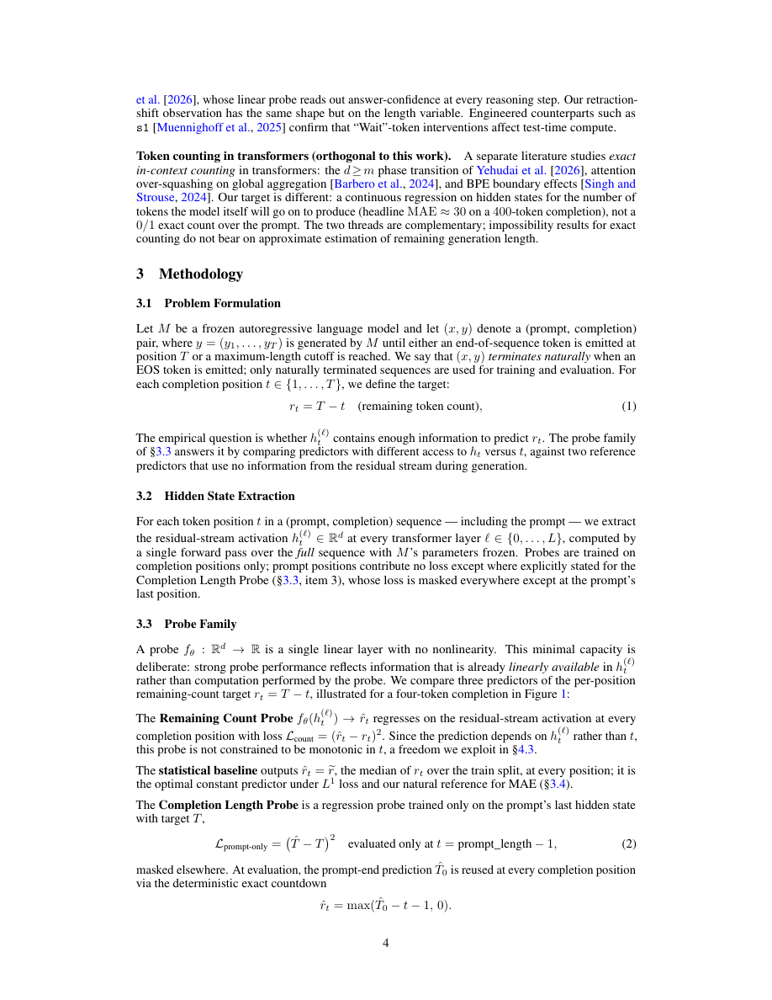
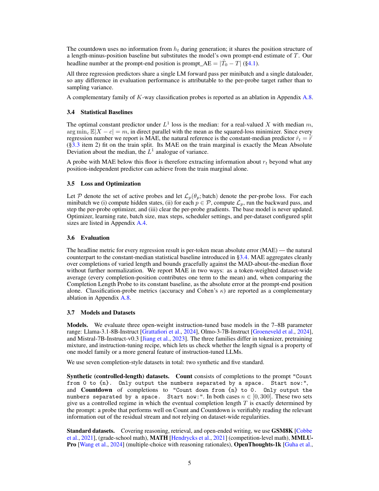
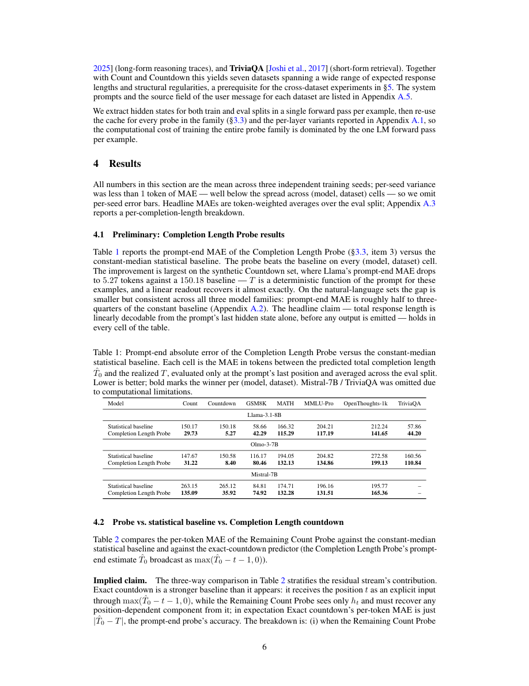
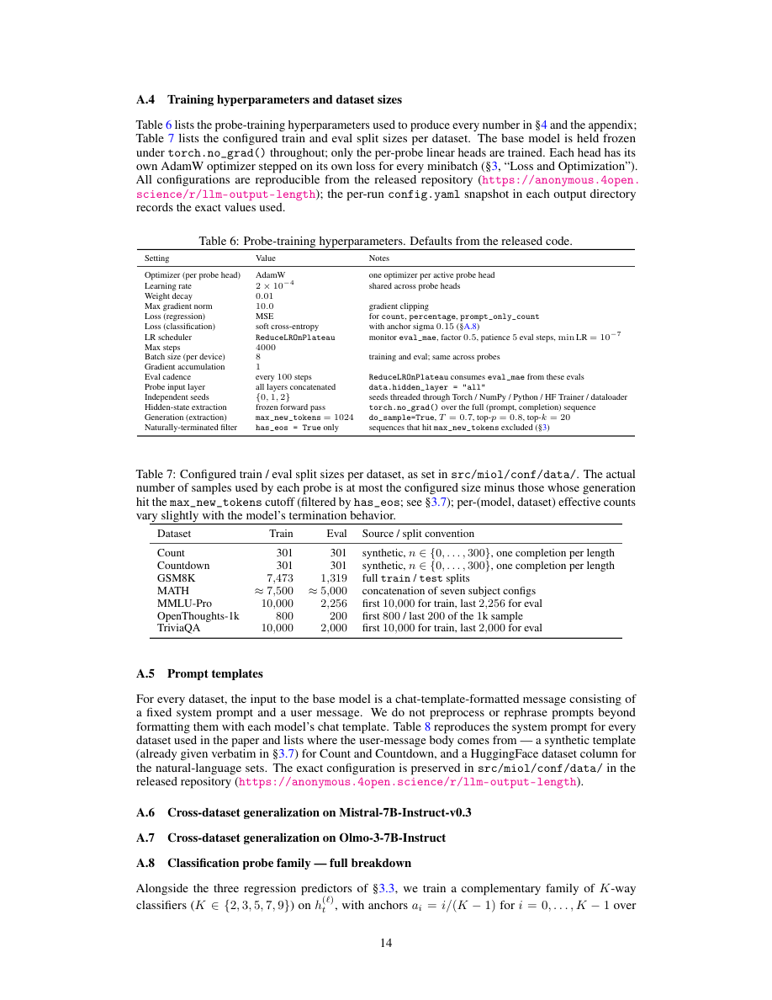

# How Much is Left?：剩余回答长度能否线性读出

原文 https://arxiv.org/abs/2607.05316v1 。Merzouk等。[中文转述与许可限制](2607.05316-HowMuchIsLeft-译文.md) · [总览](../调研总览.md)。核查2026-11-08。Zotero`2JEWARF8`/`2BVRY64H`；实际归档18页，arXiv comment写21页，本文以附件实际页码为准。

## 0. 论文发表状态

arXiv:2607.05316v1，2026-07；当前仅确认预印本，未确认期刊/会议发表，按本轮记录为“未发表任何期刊/会议（仅确认预印本）”。匿名代码入口不代表已获会议录用：https://anonymous.4open.science/r/llm-output-length 。

## 1. 问题

在prompt结束前是否已有总长度信息，生成中是否有剩余长度信号？用低容量线性探针区分内容信息和单纯位置/数据长度先验。本文不提出长度控制器，不能把可读出直接解释为可干预。

## 2. 相关工作与改进

服务预测器侧重排序与误差，精确计数理论侧重能否严格计数。本文考察近似的、跨数据可迁移的长度表征，明确不是精确倒计时能力的证明。使用统计中位数和位置基线避免将简单数据分布误当表示能力。

## 3. 动机与推演

若最后prompt状态能预测长度，说明长度信息不只来自已经走了几步；若跨域仍有效，就不只是训练集均值；若反思重启位置预测上调且不是位置基线能解释，则支持状态追踪。但后者是挑选案例中的定性证据，不是整体因果实验。

探针读出总completion长度、剩余count与进度比例，比较单层和全层拼接。冻结基础模型、只训线性头，将探针容量保持很小；仍应防止全部token随机拆分造成同轨迹泄漏。

原作者PDF第4页，必要研究评论引用；未主张开放转载许可。

## 4. 数据、参数与复现操作

### 4.1 数据集与样本构造

| 数据 | 配置train/eval条数 | 来源/目的 |
| --- | --- | --- |
| Count、Countdown | 各301/301 | 合成0—300长度模板，严格控制结构 |
| GSM8K | 7473/1319 | 标准train/test，数学 |
| MATH | 约7500/5000 | 七学科配置汇总 |
| MMLU-Pro | 10000/2256 | 前10000与后2256 |
| OpenThoughts-1k | 800/200 | 1k样本前后拆分 |
| TriviaQA | 10000/2000 | 指定首/尾子集 |

这些是配置数，不是EOS筛选后的有效数。生成达到max_new_tokens1024且无自然EOS的样本被过滤，因此最长尾部可能被选择性排除，应重新报告每模型有效数和比例。

### 4.2 模型与训练

Llama-3.1-8B、Mistral-7B-Instruct-v0.3、Olmo-3-7B-Instruct；模型名称按原文表记录，不能擅改base/instruct。抽取时do_sample=True、T0.7、top-p0.8、top-k20、max_new_tokens1024。

冻结模型`torch.no_grad()`；线性头AdamW lr2e-4、weight decay0.01、梯度裁剪10、batch8、4000steps、每100步评估、seed0/1/2，ReduceLROnPlateau。全层拼接会增加内存与抽取成本，不能把线性头参数小等同于完整系统免费。

### 4.3 照做流程

1. 获取匿名仓库，固定版本与`src/miol/conf/data/`配置；若入口失效，记录不可复现项，不编造git命令。
2. 按模型chat template生成completion，保存题ID、tokenID、EOS/截断状态和随机seed。
3. 对完整prompt+completion冻结前向提取hidden states，构造当前位置剩余token及总长度/进度标签；按题/轨迹分train/eval，不能按token分。
4. 运行对应探针设置，配置快照保留在每run的`config.yaml`，用作者超参数训练三seed。
5. 比较训练中位数、位置基线与探针；报告prompt MAE、逐token MAE、相对基线比值及按长度分层误差。
6. 跨数据train×eval矩阵区分七数据全集与部分模型仅五数据的完整矩阵；定性重启案例不能替代整体统计。
7. 本题若加入任何干预，必须重新生成并检查质量；这不是原文已经证明的结果。

图源原文第5、6、14页，整页保留基线、指标和有效数说明。

## 5. 结论

总长度在prompt边界已可线性解码，自然语言训练的探针可跨数据迁移，合成到自然方向较弱。重启时剩余估计上升为定性观察。作者明确“decodable, not necessarily used causally”，不能转写成模型已有可直接操纵的精确计划。

## 6. 贡献

通过低容量探针与多基线展示长度信息，区分prompt预测与逐步预测，并提供跨域与长尾诊断。对本选题最有用的是预测评测设计，而非新干预方法。

## 7. 不足

只做探针、不保证因果；截断过滤削弱长尾覆盖；逐token平均偏向长轨迹；全层抽取成本大；匿名资源持久性未知。最终课程项目不建议以重复这些机制发现为主要创新。

## 8. 中文译文限制

同目录文件提供中文核心转述，不冒充忠实长段译文。原文arXiv非独占分发许可，未见开放改编授权；用户提供待译文本后可补译。该项未完全满足README的长段译文要求。
