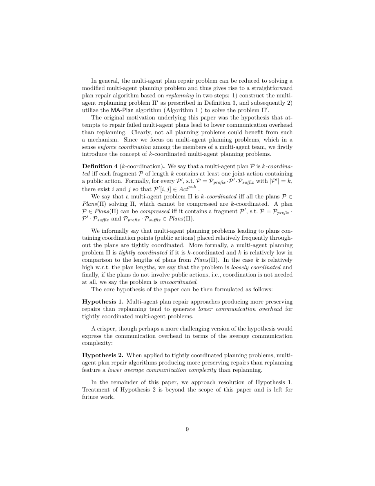
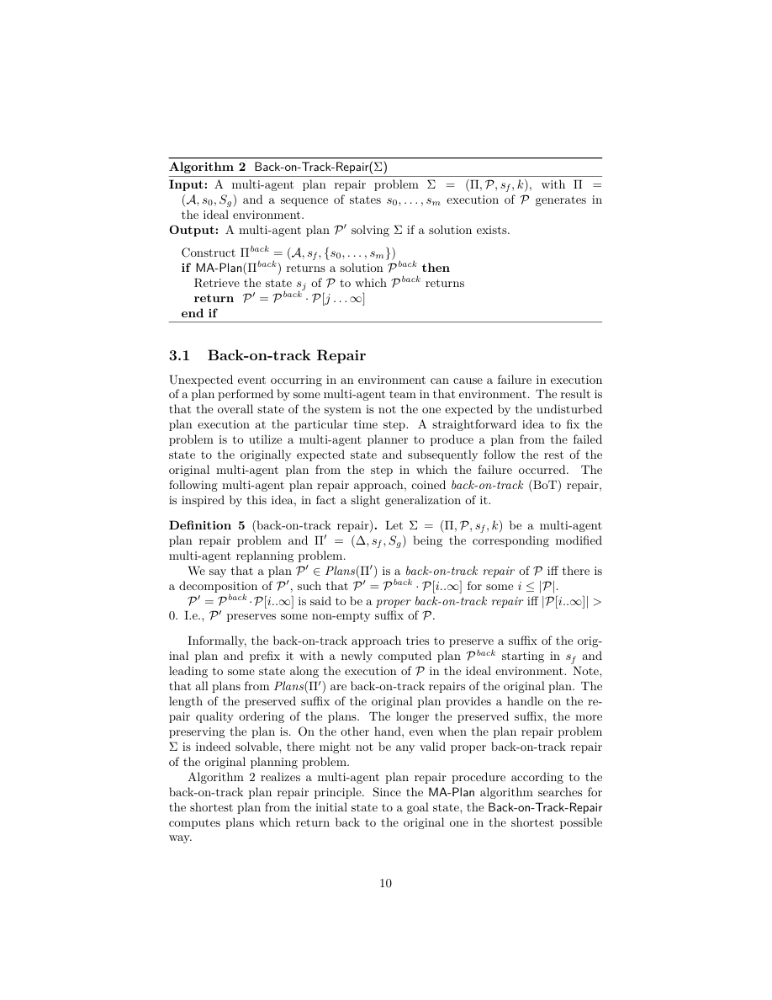
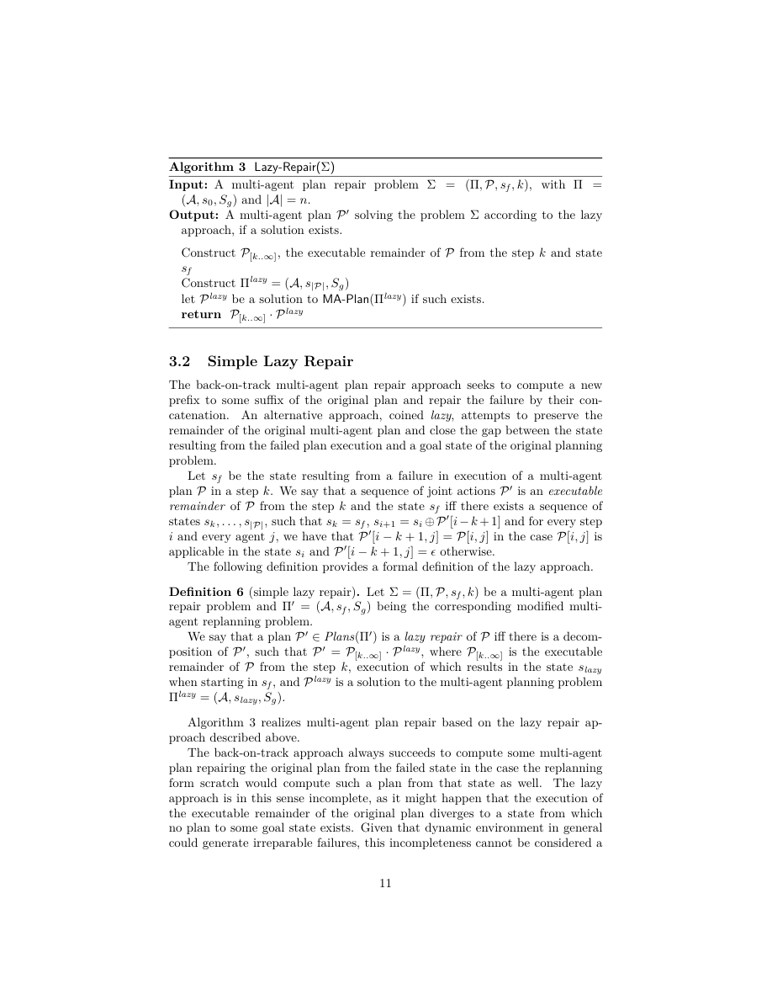
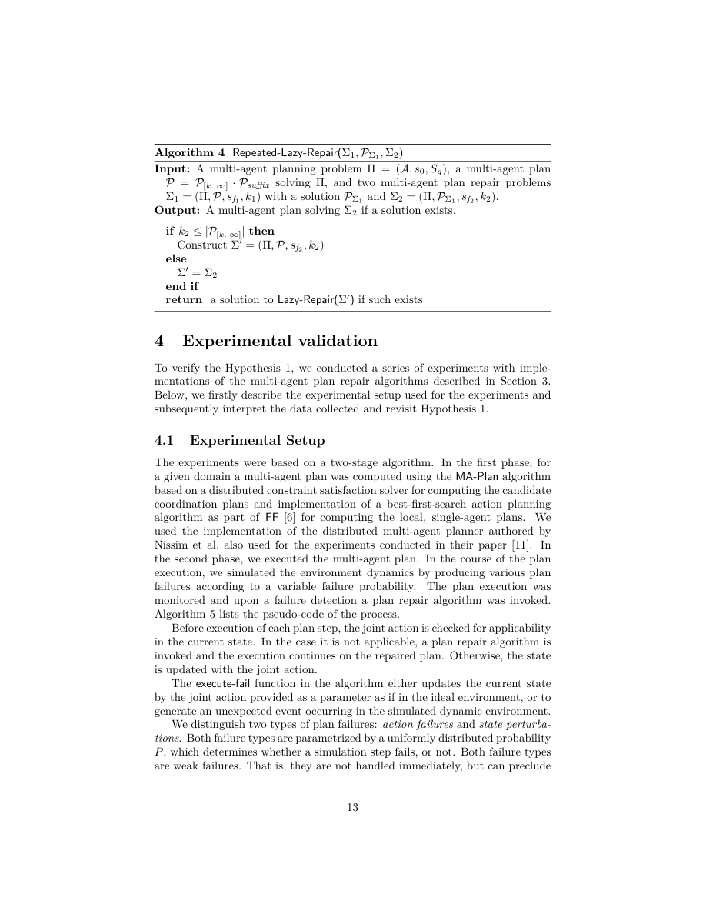
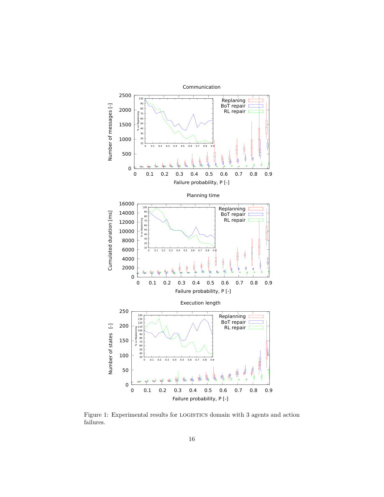
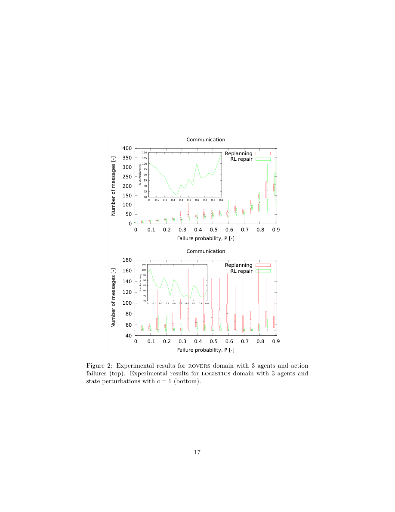
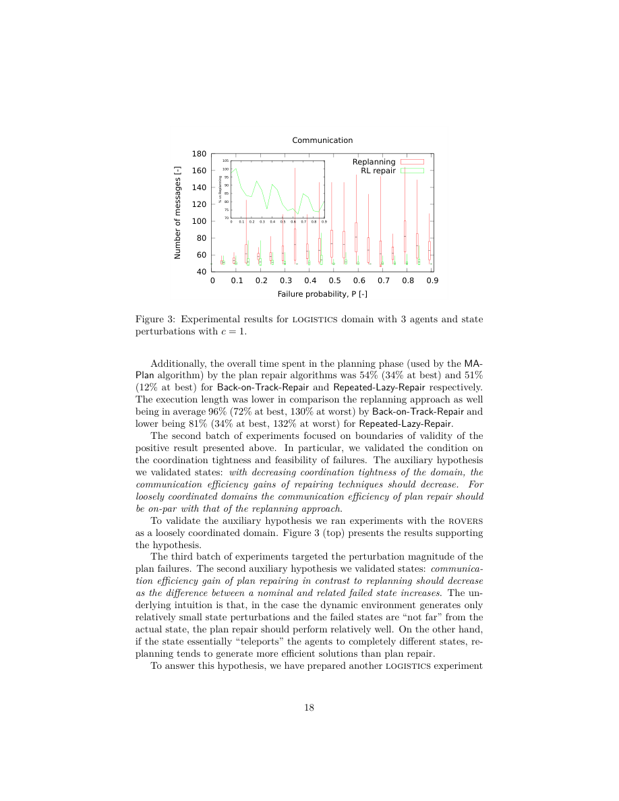

# Decentralized Multi-agent Plan Repair in Dynamic Environments

[核心中文译文](1202.2773-PlanRepair-译文.md) · [arXiv 原文](https://arxiv.org/abs/1202.2773) · 阅读日期：2026-11-09。作者：Antonín Komenda、Peter Novák、Michal Pěchouček。原文先归档 Zotero，PDF 附件目录 I4HK2FA3；本文依据 21 页 v1 全文，重点核对第 3、4 节。

## 0. 论文发表状态

第 11 届 AAMAS，2012 年 6 月 4–8 日，西班牙瓦伦西亚，扩展摘要。arXiv:1202.2773v1 是对应的 21 页完整版，不是 AAMAS 21 页长文。扩展摘要页码本轮未核实，不补造。它是经典符号多 Agent 研究，不含 LLM。

## 1. 论文提出了什么问题

动态环境中，联合计划执行途中出现动作失效或状态扰动。团队可以从故障状态重新规划，也可以保留旧计划的部分结构。单 Agent 中修复未必具有更低的最坏时间复杂度；多 Agent 的关键区别是跨 Agent 协调需要通信，因此研究重点变成：复用旧计划是否减少重新协调的消息开销。

问题对象是 MA-STRIPS 下的联合行动序列，不是生成文本的 token，也不是学会何时反思。作者并没有证明所有环境中修复都比重新规划更好。

## 2. 相关工作、局限性和本文的改进

经典计划复用、计划适应与局部修复主要关心单 Agent 搜索代价；多 Agent 规划把公共动作协调与本地私有动作规划分离。本文沿用 MA-Plan：先以分布式约束满足求公共协调，再以 FF 的 best-first-search 补本地计划。改进不是新语言模型，而是把修复问题归约到特殊的多 Agent 规划实例，以保留原有协调结构。

与我们的关系：它直接否定“只要局部修复就一定是新方法”的表述；但没有解决 LLM Agent 的语义承诺、自我评估或相互建模。

## 3. 作者如何分析问题并引出具体方案

### 3.1 为什么通信比局部搜索更值得关注

一次全量重规划会重新寻找公共动作的兼容组合，即使故障只发生在某个局部执行阶段，DisCSP 仍可能产生大量协调消息。旧联合计划已经包含可用的跨 Agent 安排，因此复用它的价值不仅是少搜几步，也是避免重复协商。

### 3.2 三种修复对应三个不同决策

**Back-on-track**：先找到一段恢复前缀，让故障状态重新接入旧计划的某个可执行后缀。适合希望尽早恢复原协调结构的情形。接回点的选择影响新搜索难度。

**Simple lazy**：不立即恢复旧状态，而是尽量执行旧计划剩余部分；当前不可执行的个体动作以空动作替代。执行完可保留部分后，再规划通往原目标的尾段。

**Repeated lazy**：再次故障时，若还处于保留的原计划部分，丢弃此前尚未使用的修复尾段；只有已经进入新增尾段时，才以当前修复计划继续修复。这样避免每次故障都把越来越多尾段累积到计划里。

### 3.3 为什么需要边界实验

若各 Agent 根本没有耦合，就没有大量公共协调消息可省；若任意状态扰动已摧毁原计划结构，复用也可能无益。因此作者不仅测紧耦合 logistics，也测松耦合 rovers 和无协调 satellites，并对比动作失败与任意状态扰动。

## 4. 作者的具体方案、数据集与详细实验操作

### 4.1 形式化与执行机制

计划修复实例写作 Σ=(Π,P,s_f,k)：Π 为原规划问题，P 为原联合计划，s_f 为故障后状态，k 为失效执行位置。目标仍是满足 Π 的目标集合，而不是最小化文本编辑距离。可执行剩余计划逐步检查每个 Agent 动作的适用性，并以空动作替代不可执行动作。

执行监控先检查当前联合动作的前提；若不满足，调用修复器并从修复计划第一步继续。环境异常可能先造成弱故障，直到后续动作前提被破坏才成为强故障并触发修复，不能把异常发生次数等同于修复调用次数。

### 4.2 数据选择与样本来源

使用 IPC 规划域改造出的多 Agent 实例：logistics 为 3 个 Agent，紧耦合；rovers 为 3 个 Agent，松耦合；satellites 为 2–5 个 Agent，基本无协调。不是作者采集的大型数据集，也不是 LLM benchmark。所读版本没有列出完整实例文件名清单与总任务数，不能把三个 domain 当成三条样本。

每个问题实例在不同故障概率下重复 6–10 次。原文图的横轴覆盖 P=0 到 0.9，但未提供足以恢复所有实验组合的机器可读清单。受规划器效率限制，实验计划最多两个 landmark/协调点。

### 4.3 干扰与对照如何构造

动作失败：每一仿真步按失败概率 P 决定是否异常，再随机选择个体动作不执行，其他动作继续更新状态。状态扰动：从状态中随机删除 c 个项、添加 c 个项；正文关键对照包含 c=1。选取项和失败动作采用均匀抽样。

三种主要比较为从头重新规划、Back-on-track、Repeated lazy。Simple lazy 是方法组成，但不能把它说成所有主图均单列的第四个基线。每个 Agent 独立线程、异步推理，消息由中心环境模拟器转发；“中心仿真”不意味着规划是中央规划。

### 4.4 参数、指标与复现步骤

硬件为 Phenom Quad Core 9950 2.6GHz；Java VM 内存限制 2.5GB。无 LLM、无温度或解码参数。评价三项：累计联合动作数、初始及修复规划累计时间、DisCSP 产生的消息数。后者不是所有网络字节，也不是 token。

复现顺序：准备 MA-Plan 与 FF/DisCSP 依赖 → 转换三种 IPC 域 → 生成初始联合计划 → 为各方法复用同一实例和随机故障配置 → 每步检查前提并注入故障 → 记录每次调用和消息 → 按 P 与域聚合。严格复现还缺完整实例、原代码版本及随机种子；这些是需补材料，而不是本文已经跑通的步骤。建议复现时配对随机种子属于我们的建议，不冒称原作者已披露。

## 5. 作者如何设计实验及实验结论

logistics 动作失败实验最支持核心假设：Back-on-track 平均消息为重新规划的 59%，最好 36%；Repeated lazy 平均 43%，最好 11%。这里是“剩余比例”，不能误写为分别减少 59% 和 43%。消息节约并不保证执行路径最短。

rovers、satellites 与随机状态扰动用于检验边界：耦合弱或复用结构被破坏时，收益不再像紧耦合动作失败那样明显。原文没有证明跨所有规划域的统一优势。

## 6. 总结论文的贡献

形式化分散式多 Agent 修复；提出三类可归约到既有规划器的算法；通过耦合程度与故障类型对照，证明协调消息是区别于单 Agent 搜索复杂度的重要成本。

## 7. 论文的不足与对我们研究的启示

MA-STRIPS 对真正联合效应、并发资源竞争表达有限；实验规模受最多两个协调点限制；重复次数较少；Back-on-track 的析取目标被顺序枚举，影响公平性能；任意环境故障可能不可修复，lazy 还可能走向不可恢复状态。

对本课题，它是思想来源与应尊重的历史近邻，不是 LLM 多 Agent 元认知的直接实现。可继承“通信与计划稳定性分开测”的原则；不可把其消息节约结果换算成 LLM token 节约，也不能称“局部修复首次用于 Agent”。

## 8. 中文译文

见[摘要与核心内容中文节译](1202.2773-PlanRepair-译文.md)。译文覆盖问题、方法、数据构造、实验与结论；不含本笔记的创新建议。
