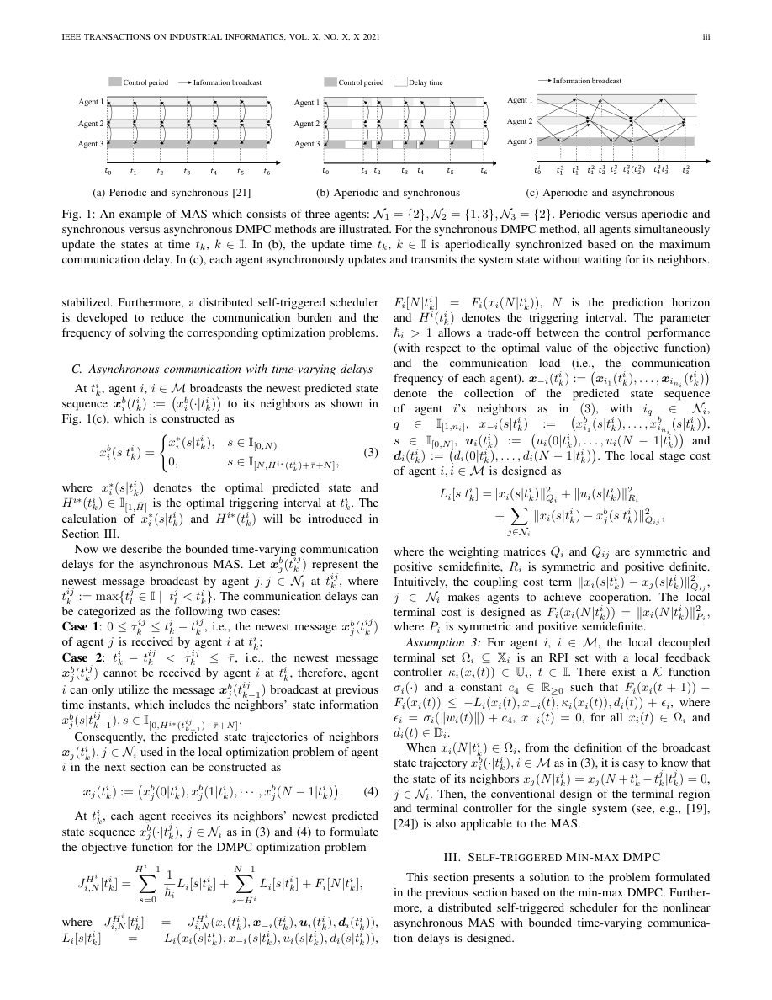
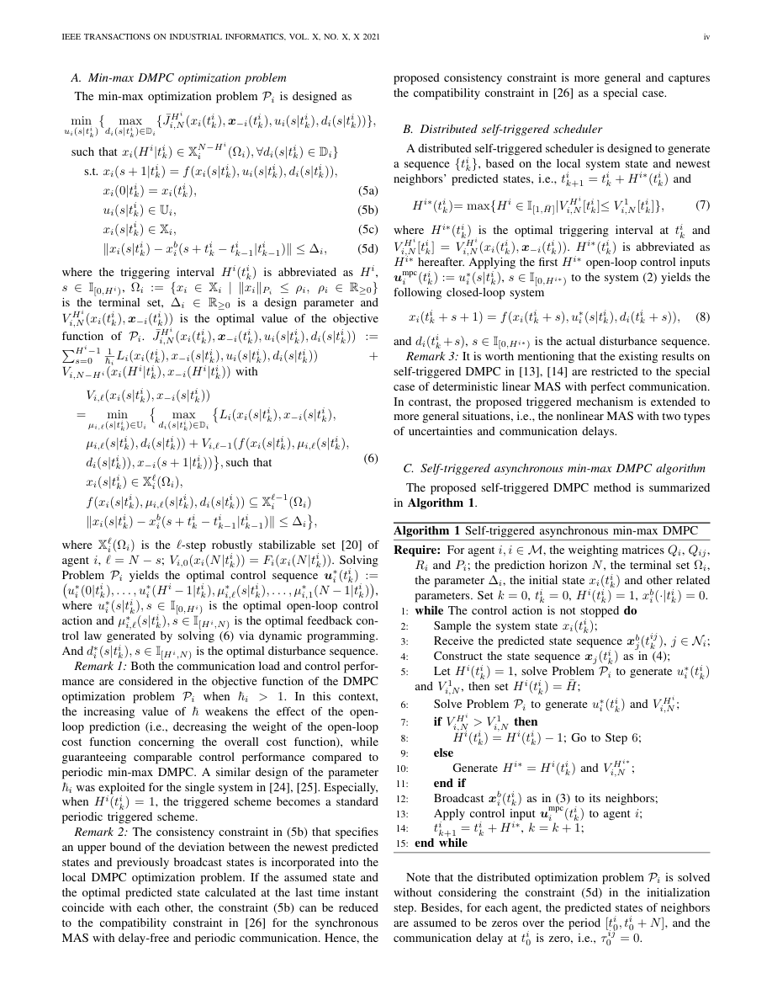
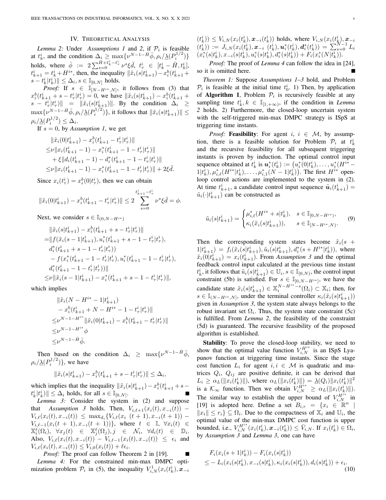
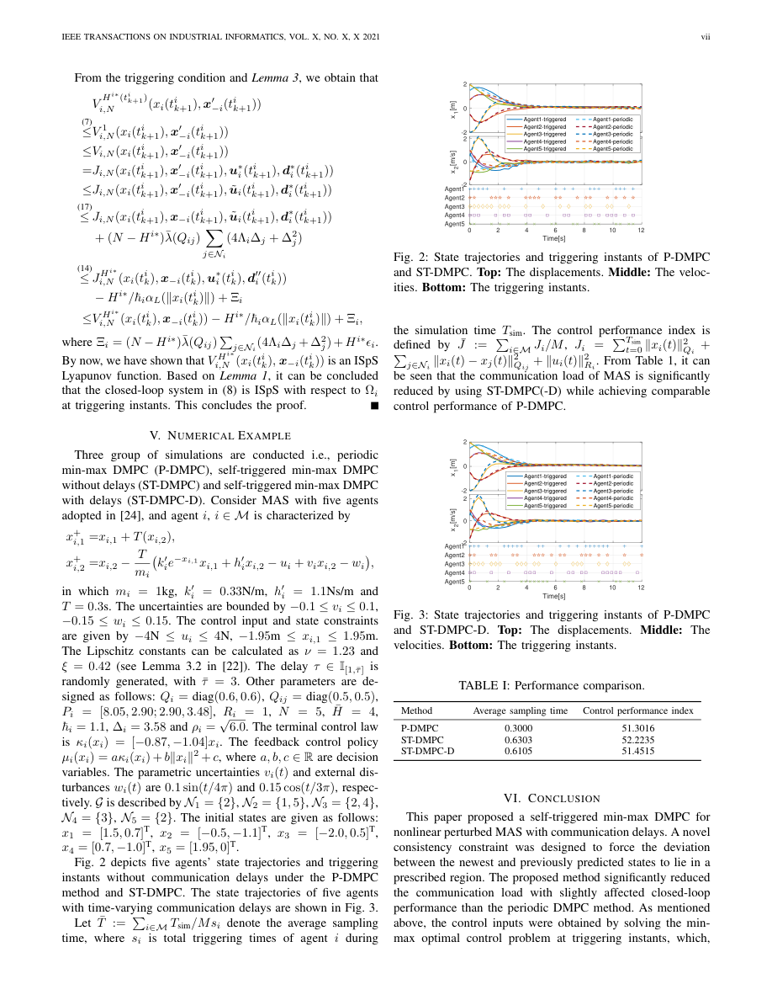

# Self-triggered Min-max DMPC for Asynchronous Multi-agent Systems with Communication Delays

[核心中文译文](2106.05358-DMPC-译文.md) · [arXiv v2](https://arxiv.org/abs/2106.05358) · [正式 DOI](https://doi.org/10.1109/TII.2021.3127197)。作者 Henglai Wei、Kunwu Zhang、Yang Shi。2026-11-09 阅读，8 页原文 PDF 先存 Zotero：storage/YYNKCU6X。

## 0. 论文发表状态

正式发表于 IEEE Transactions on Industrial Informatics，2022，18(10)：6809–6817，DOI 10.1109/TII.2021.3127197；卷期与页码通过 Crossref 核实。所读 arXiv:2106.05358v2 是 2021 年预印本，页眉仍有卷期占位符，不能据此认定未发表。本文 MAS 是控制系统中的动态子系统，不是 LLM Agent。

## 1. 论文提出了什么问题

非线性多 Agent 系统同时受参数不确定、外部扰动、异步更新及有界时变通信延迟影响。每步都通信和求解代价高，但少更新又会使邻居采用过时轨迹，破坏协作。目标是在约束内稳定系统，减少触发与广播，同时给出可行性和闭环性质分析。

## 2. 相关工作、局限性和本文的改进

周期 DMPC 更新频繁；自触发 MPC 可在当前时刻计算下次更新时刻，但异步且有延迟时，邻居轨迹不一致仍会影响优化。本文将 min-max 鲁棒优化、自触发间隔选择和预测一致性约束结合，限制新预测相对于先前广播预测的偏离，使邻居在收到新消息前仍有可用近似。

它与“承诺”的相似之处是可依赖的外部预测边界，不是社会承诺、自然语言意图或元认知。不能说作者已经研究 LLM 的履约决策。

## 3. 作者如何分析问题并引出具体方案

### 3.1 不确定性与异步误差分开处理

真实动力学的不确定性需要最坏情况鲁棒控制；邻居信息的陈旧性则需要限制计划变化与误差。若只增加重规划频率，通信开销高且延迟依然存在；若只延长开环执行，状态误差又可能失控。

### 3.2 为什么一致性约束不是简单预测

Agent 在当前触发时刻生成新预测，但邻居可能仍持有旧版本。让优化器自由选择偏离很大的新轨迹，会让邻居的成本估计失真。因此直接把新旧轨迹偏差限制在预设区域，不只是说“我估计自己不会变”。该约束为误差界与价值函数分析提供条件。

### 3.3 自触发的推演

当前时刻同时考虑未来 H 步不重新优化的效果，选择满足设计条件的执行间隔，H 不超过上界。触发后求最坏情况优化并广播，随后执行所计算的控制策略直到下次触发。终端集、终端控制律和成本下降条件用于构造下一次候选解，进而证明递归可行及触发时刻的输入到状态实用稳定性 ISpS。

“实用稳定”并非任意扰动下精确收敛到零；证明范围是原文假设和触发时刻，不能升级为所有时刻的全局渐近稳定。

## 4. 作者的具体方案、数据集与详细实验操作

### 4.1 系统与数据性质

没有监督学习数据集；使用一个五 Agent 非线性系统的数值算例。令状态 x_i=(x_i1,x_i2)，采样 T=0.3s：x_i1 的下一步为 x_i1+T x_i2；x_i2 的下一步为 x_i2−T/m_i×(k_i exp(−x_i1)x_i1+h_i x_i2−u_i+v_i x_i2−w_i)。原文模型见第7页；复现时应逐项核对符号而非用线性系统替代。

m=1kg，k=0.33N/m，h=1.1Ns/m；参数扰动 v∈[−0.1,0.1]、外扰 w∈[−0.15,0.15]；具体时间序列 v(t)=0.1sin(t/(4π))、w(t)=0.15cos(t/(3π))。控制输入 −4≤u≤4N，位置约束 −1.95≤x_i1≤1.95m。

### 4.2 拓扑、初值及优化参数

邻居：N1={2}、N2={1,5}、N3={2,4}、N4={3}、N5={2}，不擅自补成全连接或对称图。初始状态依次为 (1.5,0.7)、(−0.5,−1.1)、(−2.0,0.5)、(0.7,−1.0)、(1.95,0)。第三个初始位置 −2.0 与正文所写 −1.95 下界存在表面不一致，严格复现需核实，不能静默改为 −1.9。

Q_i=diag(0.6,0.6)，Q_ij=diag(0.5,0.5)，R_i=1，P_i=[[8.05,2.90],[2.90,3.48]]；预测时域 N=5，最大触发间隔上界 4，ℏ_i=1.1，Δ_i=3.58，ρ_i=√6。终端律 κ_i=[−0.87,−1.04]x_i。反馈策略形式 μ_i(x)=aκ_i(x)+b||x||²+c，其中 a,b,c 是优化变量。Lipschitz 常数 ν=1.23、ξ=0.42。

### 4.3 干扰与基线

三组为 P-DMPC、无通信延迟的 ST-DMPC、有延迟的 ST-DMPC-D。延迟以步计随机取 1…3，不能误写为 1…3 秒。这里没有 LLM、训练集或解码温度。正文没有给出统计样本总数、随机种子和多种初值重复次数，不能把一组五 Agent 轨迹当作大规模随机验证。

### 4.4 指标与复现步骤

平均采样时间按各 Agent 的仿真总时长与触发次数聚合；控制性能为状态、邻居差异与控制输入的累计二次成本。复现：编码动力学与约束 → 固定拓扑/初值/扰动 → 实现周期 min-max 基线 → 加自触发 → 加延迟缓存与一致性约束 → 对同一扰动运行 → 保存状态、输入、触发时间、平均间隔和成本。min-max 求解器、随机延迟种子及容差未在所读算例段完整交代，精确复现需补充；本笔记未实际运行数值优化。

## 5. 作者如何设计实验及实验结论

| 方法 | 平均采样时间 | 控制成本 |
| --- | --- | --- |
| P-DMPC | 0.3000 | 51.3016 |
| ST-DMPC | 0.6303 | 52.2235 |
| ST-DMPC-D | 0.6105 | 51.4515 |

平均采样间隔约翻倍而成本接近周期基线，支持减少更新的效果。由间隔计算的触发频率近似下降约 52% 和 51%，这是按表值估算，不是作者测出的字节流量，也不是 token 降幅。该实验没有单独去掉一致性约束的消融，不能把全部收益都归因于它。

## 6. 总结论文的贡献

面向异步、延迟与扰动构建自触发 min-max DMPC；引入新旧广播预测的一致性约束；在条件下证明递归可行及触发时刻 ISpS；通过数值算例说明通信触发与控制性能的折中。

## 7. 论文的不足与对我们研究的启示

min-max 计算困难，数值验证规模小；通信延迟和扰动需有界；缺少随机统计与一致性模块独立消融；模型、约束和全局可用常数在 LLM 场景通常不存在。不能把其证明直接迁移成语言 Agent 的安全保证。

对我们最有价值的是区分“内部可以更新”与“外部可依赖范围”。LLM Agent 的承诺若可随意反悔，只广播置信度未必足够；但如何用语义证据维护依赖，需要独立设计和验证，本文没有回答。

## 8. 中文译文

见[摘要及核心中文节译](2106.05358-DMPC-译文.md)。
