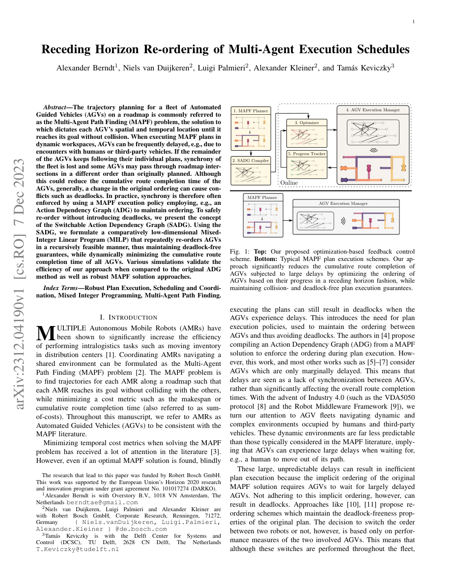
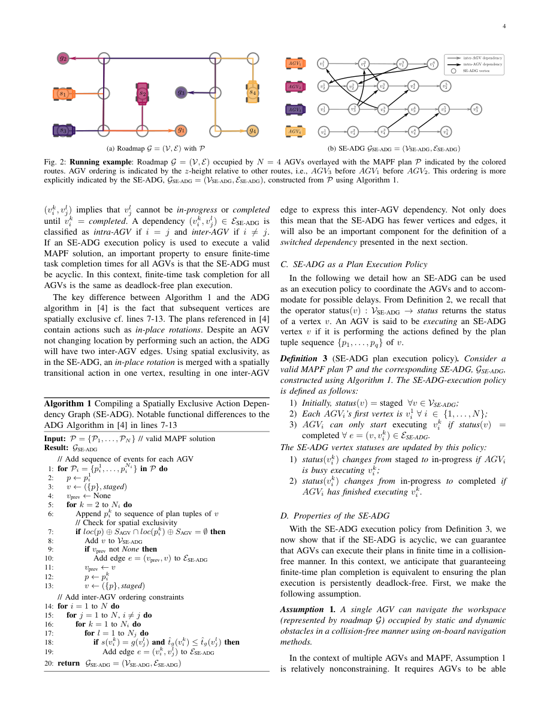
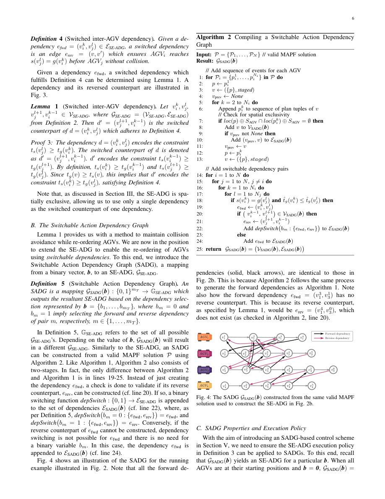
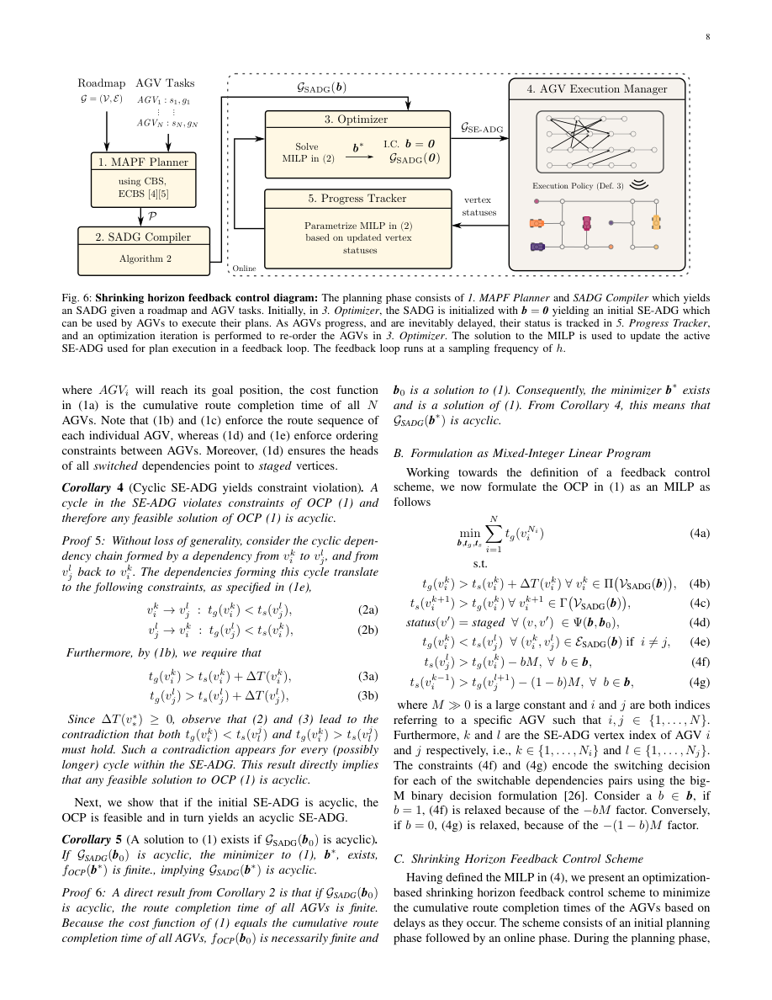
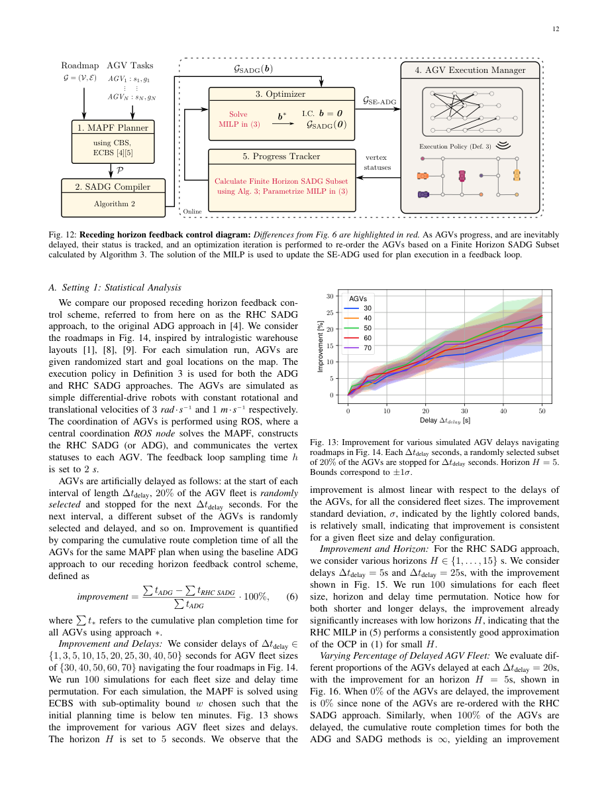
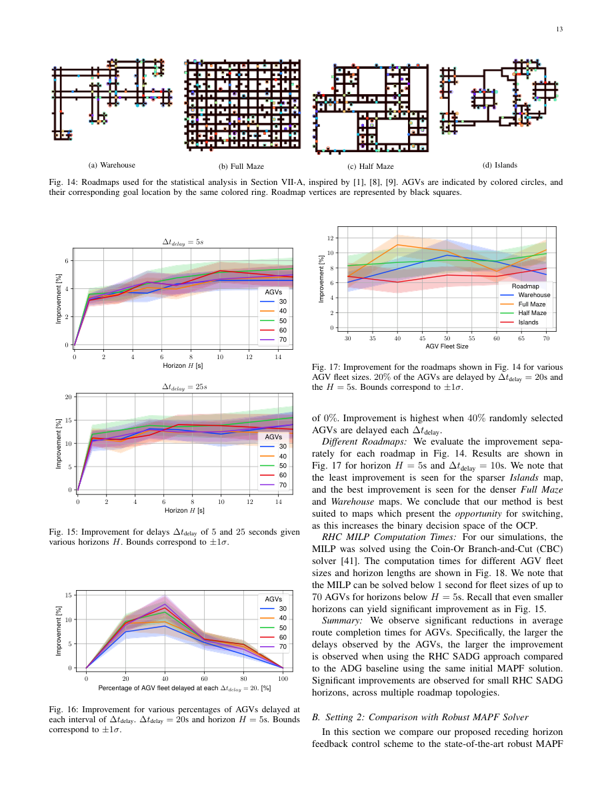
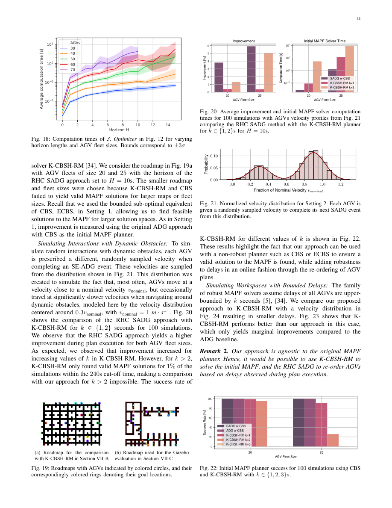
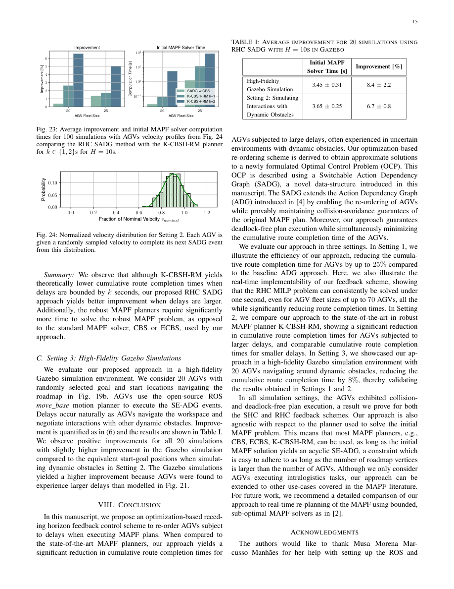

# Receding Horizon Re-ordering of Multi-Agent Execution Schedules

[核心中文译文](2312.04190-SADG-译文.md) · [arXiv](https://arxiv.org/abs/2312.04190) · [正式 DOI](https://doi.org/10.1109/TRO.2023.3344051) · [作者代码](https://github.com/alexberndt/sadg-controller)。作者：Alexander Berndt、Niels van Duijkeren、Luigi Palmieri、Alexander Kleiner、Tamás Keviczky。2026-11-09 阅读，原文先存 Zotero；所读为 17 页 arXiv v1。

## 0. 论文发表状态

正式发表于 IEEE Transactions on Robotics，2024，40：1356–1372，DOI 10.1109/TRO.2023.3344051，卷页通过 Crossref 核实。arXiv:2312.04190v1 发布于 2023-12-07。预印本年份和正式卷期年份不同。本研究是 AGV/MAPF 执行调度，不含 LLM Agent。

## 1. 论文提出了什么问题

初始 MAPF 计划即使最优，也可能在机器人遇人、遇障碍而延迟后变得低效。保持原通行次序可避免冲突，却可能让未延迟机器人长时间等待；直接交换通行次序又可能造成死锁。研究问题是：能否在执行中滚动改变冲突处的先后次序，同时保留碰撞与死锁保障。

目标主要是累计路线完成时间，即所有机器人完成时间之和，不是 makespan，也不是重新生成全部路径。

## 2. 相关工作、局限性和本文的改进

原 ADG 将无碰撞 MAPF 计划编译成动作依赖图，通过依赖前驱完成后才执行后继来维护次序，但次序固定。鲁棒 MAPF 如 K-CBSH-RM 对有界延迟提前留裕量，遇到大延迟时保守或难求解。本文引入 Spatially Exclusive ADG、可切换依赖 SADG、分组二元变量，以及有限时域 MILP 反馈优化。

与 LLM 研究的关系：它已经把滚动优化与动作依赖结合，不等于已经实现 LLM 自我认知、语义承诺协商或对他人意图的自然语言建模。

## 3. 作者如何分析问题并引出具体方案

### 3.1 不重算路径，只改变可改变的顺序

MAPF 给出空间路线，ADG 给出共享位置的通行次序。延迟主要改变谁先到达、谁等待，因此无需每次重算空间路径；只重新选择冲突区的进入顺序，就可能恢复效率。相较全量 MAPF，优化变量规模更可控。

### 3.2 为什么要先改造 ADG

在原始 ADG 中，原地旋转等动作可能被拆成多个相邻事件，却占用相同空间。若简单反向依赖，可能破坏安全推理。SE-ADG 把必要的连续占用动作合并为具有空间排他性的事件，形成可论证的切换基础。顶点状态为 staged、in-progress、completed，正在执行和已完成的部分不能任意反悔。

### 3.3 从图切换变成优化

在合法的前后事件之间定义一对可切换依赖，用二元变量选择一种先后关系。事件开始/结束时间、执行时长与依赖关系组成约束；目标为累计完成时间。依赖分组降低二元变量数。可行时间安排与无环执行结构结合，支撑无死锁与递归可行性论证。

### 3.4 为什么采用滚动而非一次优化

新延迟不断到来，一次优化很快过时。每次利用实际完成进度与剩余时长更新优化，再执行一段；有限时域子图还要保留与时域外的依赖边界，不能任意剪断可能导致环的结构。保留可行旧安排作为后续候选，是递归可行的关键，而非“LLM 自信就多执行几步”。

## 4. 作者的具体方案、数据集与详细实验操作

### 4.1 算法流程

初始 MAPF → SE-ADG/SADG 编译 → 跟踪顶点状态 → 根据 horizon H 取有限时域子图 → 求 MILP 决定未执行事件先后 → 更新执行依赖 → 机器人按前驱完成条件推进。在线反馈采样 h 与优化时域 H 是不同参数；论文并非学习每个 Agent 的承诺深度。

### 4.2 实验数据与环境选择

使用作者构造的仓储路网与随机起终点，不是一个固定条数的监督数据集。分为统计仿真、与鲁棒 MAPF 比较、高保真 Gazebo 三组。主要统计图使用四种仓储路网；不同扫描实验各有重复，不能把所有组合简单相加当独立任务数。

**Setting 1**：车队 {30,40,50,60,70}，延迟间隔 Δt 为 {1,3,5,10,15,20,25,30,40,50} 秒；每个车队规模和延迟配置运行 100 次，路网分配应以作者代码确认，正文不能据此随意乘四。每隔 Δt，随机选 20% 车辆停 Δt 秒。机器人平移 1m/s、转速 3rad/s，反馈采样 h=2s，主要延迟扫描 H=5s。

时域扫描 H=1…15s，对照 Δt=5s、25s；每个车队/时域/延迟配置 100 次。另扫描被延迟车辆比例，检验收益是否只是特定阻塞比例造成。

**Setting 2**：20、25 辆车，H=10s，与 K-CBSH-RM 的 k=1、2s 比较，每配置 100 次。按每个事件抽样速度，构造大延迟和有界较小延迟两种分布。k>2 时，鲁棒求解器在 240s 截止内仅约 1% 仿真找到方案，不能只比较幸存成功轨迹而隐藏求解失败。

**Setting 3**：20 辆车，ROS move_base + Gazebo，H=10s，20 次仿真；行人与动态障碍引起自然延迟。它是高保真仿真，不是真实机器人实验。

### 4.3 参数、指标与复现

所有设置使用依赖分组。初始规划器为 CBS 或 ECBS，Setting 1 调 ECBS 次优界 w 使初始规划低于十分钟，不能假定一个统一 w 已覆盖所有设置。硬件 Xeon E5-1620 3.5GHz、64GB RAM。没有 LLM 参数。

改进率=(ADG 的累计完成时间−RHC SADG 的累计完成时间)/ADG 累计完成时间。还测在线优化时间、初始 MAPF 时间和初始求解成功率，不能只报执行阶段收益。

复现：获取作者仓库并记录 commit → 配置 ROS、地图、初始 MAPF 和 MILP 后端 → 对固定起终点只改变执行策略 → 按相同随机延迟序列执行 ADG 与 SADG → 扫描 H/车队/延迟 → 汇总完成时间、优化时延和失败率 → 最后运行 Gazebo。当前笔记未运行仓库；依赖版本、地图文件及种子需要从仓库固定，不编造安装命令。

## 5. 作者如何设计实验及实验结论

与静态 ADG 相比，作者报告累计完成时间最高约减少 25%；不是所有配置平均减少 25%。车队不超过 70 且 H<5s 时在线 MILP 可在一秒内求解；不能推广为任意路网与时域实时。

大延迟时 SADG 优于所测鲁棒规划器；在符合鲁棒规划假设的较小有界延迟下，K-CBSH-RM 表现更好。这一反例必须保留。Gazebo 的 20 次实验改善为 8.4±2.2%，对应低保真 Setting 2 为 6.7±0.8%。

## 6. 总结论文的贡献

提出可安全切换执行次序的 SADG；建立 MILP 和有限时域反馈求解；分析执行安全、无死锁和递归可行性；通过规模、延迟、时域及 Gazebo 验证性能与适用边界。

## 7. 论文的不足与对我们研究的启示

主要优化固定空间路线上的次序，并非一般任务/角色重分配；依赖准确事件时长与拓扑模型；MILP 随时域与冲突增加而变贵；集中 ROS 优化不是独立 Agent 元认知；没有实机与自然语言承诺实验。理论保障依赖原文假设，不能当作不受环境影响的绝对安全。

它提醒我们：不要只比较固定计划与重规划，应加入“结构化依赖 + 局部滚动调整”强基线。但“谁已经依赖我的语义承诺”在 LLM Agent 中如何识别和决策，仍不是本文直接回答的内容。

## 8. 中文译文

见[摘要与核心中文节译](2312.04190-SADG-译文.md)。
