# Stronger-MAS：协作LLM的多Agent强化学习

[中文译文](2510.11062-StrongerMAS-译文.md) · [实验借鉴](../StrongerMAS实验方法借鉴.md) · [arXiv v5](https://arxiv.org/abs/2510.11062v5) · [ICLR正式条目](https://openreview.net/forum?id=IdF6JqXWzx) · [代码](https://github.com/pettingllms-ai/PettingLLMs)。阅读核验：2026-11-12。

阅读顺序：先确认Zotero已运行，通过connector创建书目（201），再将PDF直接从内存上传Zotero（201），随后读取Zotero内34页PDF及HTML全文。PDF只保存在`C:/Users/15085/Zotero/storage/DCB65HWU/`，未复制到本仓库。本文图片是该PDF原页提取，不是重绘或生成图。

## 0. 论文发表状态

Yujie Zhao、Lanxiang Hu、Yang Wang、Minmin Hou、Hao Zhang、Ke Ding、Jishen Zhao：**Stronger-MAS: Multi-Agent Reinforcement Learning for Collaborative LLMs**。正式会议：第十四届International Conference on Learning Representations，**ICLR 2026 Poster**。OpenReview条目的venue、venueid及BibTeX均已核实，forum为IdF6JqXWzx。

预印本arXiv:2510.11062，2025-10-13首发，本文精读v5（2026-01-29）。该PDF页眉仍写Preprint，不能据此否认正式录用。以下页码和表号以v5为准，未声称逐字比对OpenReview最终PDF。当前仓库还包含MetaAgent-X等后续工作，不能把现在的main当成2025年实验原始代码快照；本次查阅main commit为`a054fb18b83f4dc7c1d49aba3b71669d1f93ca71`。

## 1. 论文提出了什么问题

多Agent通过角色分工改善任务完成，强化学习通过环境奖励改善模型参数。但把原本用于单Agent的GRPO直接搬到多Agent，比较组可能不成立。

GRPO要比较的是“同一个输入下，哪个回答更好”。在Coder–Tester系统中，写代码与写测试的提示不同；第二轮又包含第一轮结果。来自不同角色、不同历史的回答，不能只因处理同一道题就归为同一比较组。

另一方面，训练系统必须同时运行多Agent任务、保存各角色轨迹，并将轨迹送回真正生成它的模型。多个角色共享模型和每个角色单独使用模型，都应得到支持。

## 2. 相关工作、局限性和本文的改进

- GRPO等组相对优化：提供比较候选并更新策略的基础，但原始问题分组不适合直接覆盖不同角色和轮次。
- GiGPO：将分组推进到交互状态层面；本文进一步处理多角色及轮次的上下文。
- AutoGen、MetaGPT等提示式协作：能组织角色，未必在协作环境内共同训练策略。
- MAPoRL、MARFT、MARTI、CURE：各自覆盖部分政策共享、角色和多轮设置。论文附录A的比较有版本限定，尤其MARFT使用作者完成工作前的v3，不能据此评价所有后续版本。

AT-GRPO增加三件事：在同一角色的同一轮输入处分支采样；在该组内计算优势；结合团队奖励和角色奖励训练。系统支持共享参数或按角色分别更新。

与我们工作的关系：这是一篇**训练方法**论文，不是通行承诺协调协议。它不能直接证明我们的分布式协商有效，也不要求我们现在训练模型。最值得借鉴的是把“角色、交互、训练和预算”的贡献拆开验证。

## 3. 作者如何分析问题并引出具体方案

### 3.1 为什么从起点并行采样还不够

对同一道题，从起点生成4条完整对话。第一轮输入相同，但第一轮输出不同后，第二轮输入就分叉了。如果仍按题目聚合，比较的不是相同上下文。如果按完整输入细分，后面经常只剩一个样本，无法获得有意义的组内相对优势。

因此作者不是只给数据加一个角色标签，而是在每个当前输入处重新采样K个回答，保证这K个回答共享相同环境历史、角色和轮次。

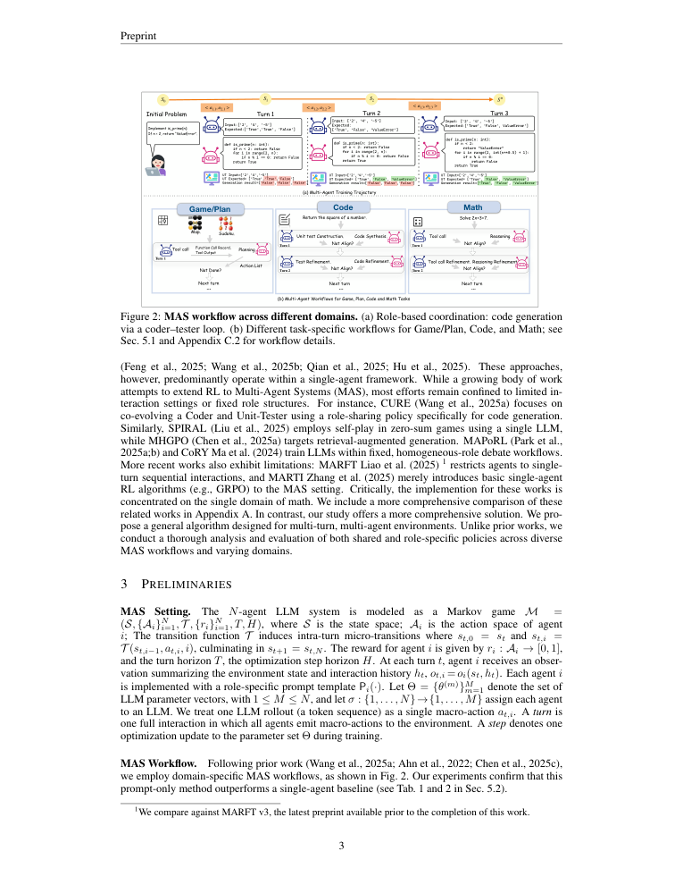

### 3.2 怎样形成可比较的组

每个环境e、角色i、轮次t构成组键`hash(e,i,t)`。从这个具体输入采K个候选，评估奖励，在组内标准化：

`优势 = (该候选奖励 − 组内平均奖励) / 组内归一化量`。

组键成立的前提是这些候选确实来自同一分支节点的完整输入，不能只匹配角色和轮号而忽略历史。

### 3.3 “树采样”不是把整棵树全部展开

每个节点采K个动作并评分，将这些数据保留用于训练，但只选择奖励最高的一个动作推进当前环境。到了下一角色或下一轮，再从新状态分支。因此它是沿一条选定主干不断产生局部分支，不是展开K的T次方条完整轨迹。

选择最高分依赖环境可验证反馈。对于在线没有正确答案的任务，不能假定有同样的评分器，更不能把训练时的奖励读取误当成部署时的信息权限。

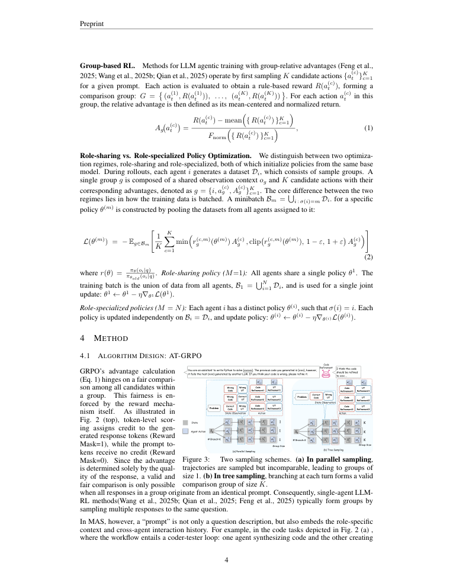
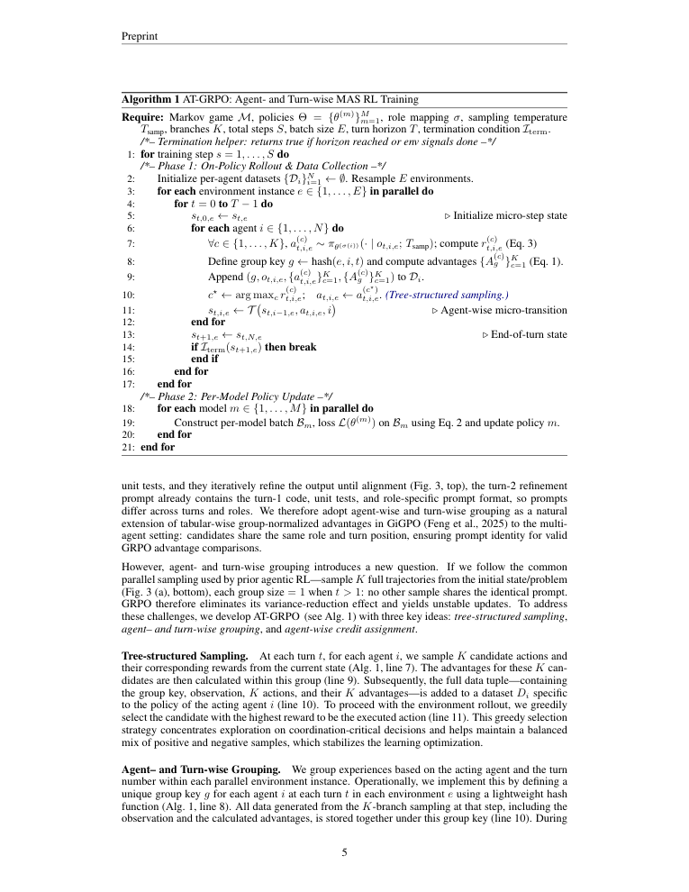

### 3.4 为什么需要团队和局部奖励

仅奖励最终成功，角色可能难以知道哪里做好了；只奖励局部表现，又可能出现自己格式正确但团队失败。作者采用`r(t,i)=α·r_team(t)+r_local(t,i)`，α固定1。

代码任务中，团队看程序通过标准测试的情况，Coder看代码构建、运行和测试通过，Tester看生成测试的有效性等。Plan-Path还使用合法动作和最短路相关信号。它们不是“免费知道协作贡献”，而是需要额外检查器、参考答案或环境工具。

### 3.5 共享模型和角色专用模型怎样更新

共享模型：把不同角色已经正确分组的数据汇总，更新同一个模型。角色专用模型：各自数据送到各自模型更新。相同代码框架不等于必须拥有不同模型权重；角色专用模型也不天然更好。

GPU负责推理与更新，CPU环境池负责沙箱执行、奖励和日志。Router按角色到模型的映射发送轨迹，避免把一个策略采的数据误用于另一个策略的on-policy更新。

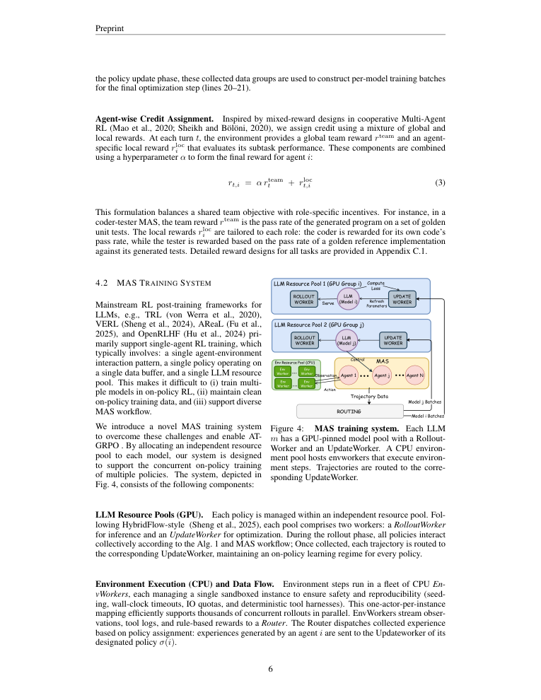

## 4. 具体方案、数据集选择与详细实验操作

### 4.1 任务与数据：哪些是现有数据，哪些是生成实例

| 类别 | 来源与规模 | 为什么选 | 实际操作与检查 |
| --- | --- | --- | --- |
| Sudoku | 参考CodeSteer/SymBench设置生成4×4实例；论文未明确披露实际训练/验证条数 | 规则明确、容易自动核验 | 不同种子生成训练验证，检查无重复；核验行列和子块约束 |
| Sokoban | 参考上述设置生成6×6实例；实际条数未明确披露 | 需要多步行动，错误推箱可能不可逆 | Tool与Planner协作，检查合法移动、箱子目标和死锁 |
| Plan-Path | 10×10网格生成实例；训练/验证总条数未明确披露 | 可以核验路径合法性，研究长程工具与规划协作 | 起终点、障碍、动作U/D/L/R；不同种子并去重 |
| Code训练 | 1.7B用APPS训练集introductory子集；8B用CodeContests；实际筛选后条数未明确披露 | 代码与测试角色互补，结果可执行检查 | 程序用golden tests评分；生成测试用golden reference验证 |
| Code评测 | APPS、LiveCodeBench-v6、CodeContests；正文未给出各最终评测样本数和完整筛选清单 | 覆盖面试与竞赛代码 | 报告正确率或Pass@1，固定沙箱与超时 |
| Math训练 | Polaris-Dataset-53K，名称标示约53K；论文未逐项列最终读取条数 | 数值答案可验证 | 使用数学解析器与容差比较 |
| Math评测 | AIME24、AIME25、OlympiadBench；实际使用子集/重复采样数未在正文完整披露 | 检验推理与代码工具互补 | Math-Verify解析，数值比较容差10^-6 |

不能把原数据集的公知全量规模当作本文实际样本数，也不能由99.5%反推评测条数。代码当前版本的`load_sokoban.py`实际是数独生成脚本，注释说每种尺寸400条；它不是证明论文Sokoban有400条。当前`load_code.py`有APPS前500条候选及过滤逻辑，也不等于原论文最终评测500条。

### 4.2 各任务怎样交互

- Code：Coder生成程序，Tester生成测试；后续轮根据对方输出和执行结果修订，达到对齐或轮数上限结束。最终质量必须用独立标准测试检查，不能只看自己写的测试全通过。
- Math：Reasoner直接推理，Tool-User写代码计算；互相检查并迭代。输出一致是停止条件之一，不等于答案必然正确。
- Game/Plan：Tool生成工具调用或代码，Planner检查执行输出并决定动作。观察包含当前环境状态，达到目标或预算耗尽结束。
- SA：相同基础模型与任务定义，但没有另一成员提供的输出。Code/Math另做多轮单Agent对照，防止把“多想几轮”错当多Agent贡献。作者也说明该SA多轮交互没有额外外部信号，仍不是完全等计算对照。

### 4.3 训练和评测参数

| 参数 | v5披露值 |
| --- | --- |
| 模型 | Qwen3-1.7B、Qwen3-8B，no-thinking |
| 主实验硬件 | 单节点8×H100 |
| 每节点候选K、轮数上限T | 4、4；Code/Math常规SA主对照是单轮，另有多轮消融 |
| α | 1，不再调参 |
| 训练更新 | 150步 |
| 全局batch / PPO minibatch | 128 / 64 |
| 学习率、weight decay、梯度裁剪 | Adam 10^-6、0.01、1.0 |
| 采样 | 温度1，top-p=1，top-k=-1，每输入4条 |
| 验证 | 温度0，do_sample=False |
| 最大输出 | 4096 tokens |
| 最大输入 | 数学和代码8192，其他符号任务16384 |
| γ、λ、熵正则 | 1、1、关闭 |

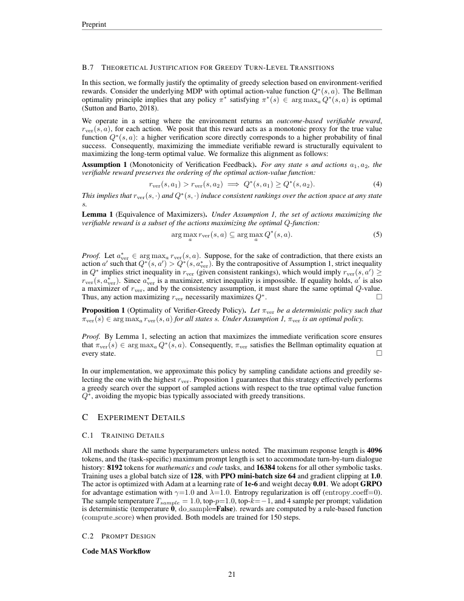

### 4.4 可以照着做的复现顺序

1. 下载论文对应代码并固定commit；当前main有后续工作，先检查与v5配置的差异，不能直接声称严格复现。
2. 准备训练与验证清单，分别保存种子、实例内容哈希、题目来源和筛选原因。补齐论文没有给出的实际数量；生成题检查合法性与重复。
3. 按附录C、D配置角色提示、历史、工具权限及输出解析。对SA和MAS说明哪些信息完全相同，哪些因交互产生。
4. 配好沙箱、标准答案、标准测试和奖励函数；调试格式错误、超时、非法动作与提前结束的统计。
5. 从同一基础权重分别运行SA、SA+GRPO、提示MAS、MAS+普通GRPO、共享AT-GRPO、专用AT-GRPO。每个设置固定训练与采样预算。
6. 每个节点采4个候选，检查组内完整输入相同；记录组键、奖励、选择分支和模型归属，训练150步。
7. 温度0验证，按任务正确性报告最终结果；另记录轮数、token、工具次数与墙钟，不把对齐当作正确。
8. 做独立训练后组合、交换角色策略、多轮SA、稀疏奖励和Agent数量等消融，报告所有任务的改善与退化。

原README入口：`bash setup.bash`；数据脚本位于`scripts/dataprocess/`，训练和评测位于`scripts/train/`、`scripts/evaluate/`。README所列部分旧训练文件在当前commit已不存在，不能将入口示例当成无需调整即可运行的完整复现。本笔记未训练或复现论文得分。

## 5. 作者怎样验证，有哪些结论

### 5.1 主结果要按模型和任务读

| Qwen3-8B | SA | SA+GRPO | 提示MAS | MAS+GRPO | AT共享 | AT专用 |
| --- | --- | --- | --- | --- | --- | --- |
| Sudoku | 48 | 54 | 72 | 99 | 99.5 | 99 |
| Sokoban | 9 | 14 | 16 | 30 | 96 | 98 |
| Plan-Path | 12 | 47 | 71 | 96 | 93 | 96 |
| LiveCodeBench | 22.8 | 25.7 | 28 | 24.2 | 30.28 | 33.1 |
| AIME24 | 18.3 | 18.3 | 36.6 | 33.3 | 50 | 57 |

AT在很多任务有明显增益，但不是每项都超过普通MAS+GRPO，例如8B Plan-Path共享AT为93，普通MAS+GRPO为96。1.7B Sokoban专用AT也只有11.5，不能将摘要96—99.5%的范围当作所有模型所有任务的成绩。

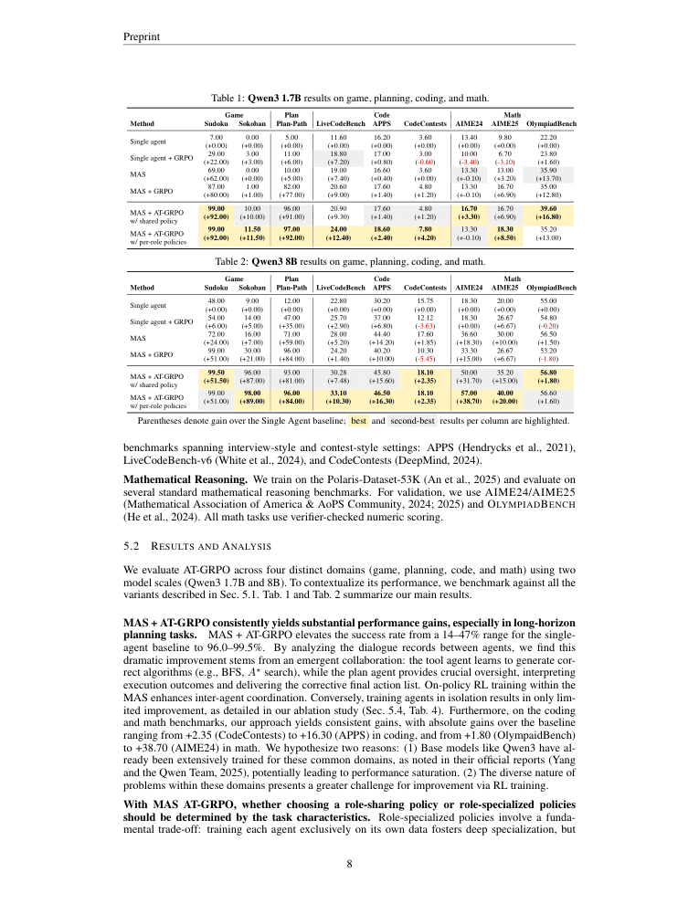

### 5.2 独立训练再拼起来，是否等于在协作中训练

Plan-Path、Qwen3-1.7B：SA为5；单独训练工具角色11，单独训练代码角色14.5；独立训练后放入MAS为16；在MAS中联合训练为96；交换专用策略后为6。

这个对照说明该设置下，提升不能仅由“每个人单独变强”解释。交换策略则暴露角色专门化，但交换后角色提示和策略失配本来就可能损害表现，不能证明所有团队都只能和原队友合作。

注意同页表4的96与主表专用Plan-Path的97不完全一致，应分别引用，不能擅自统一。

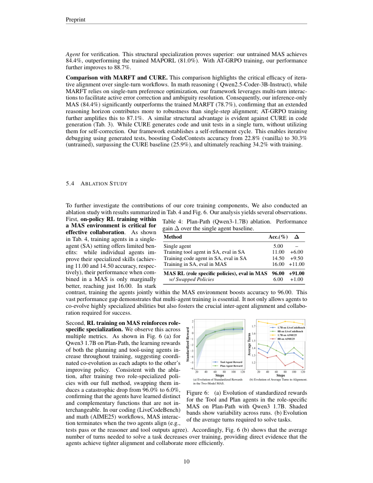

### 5.3 奖励、更多轮数与更多Agent分别检查

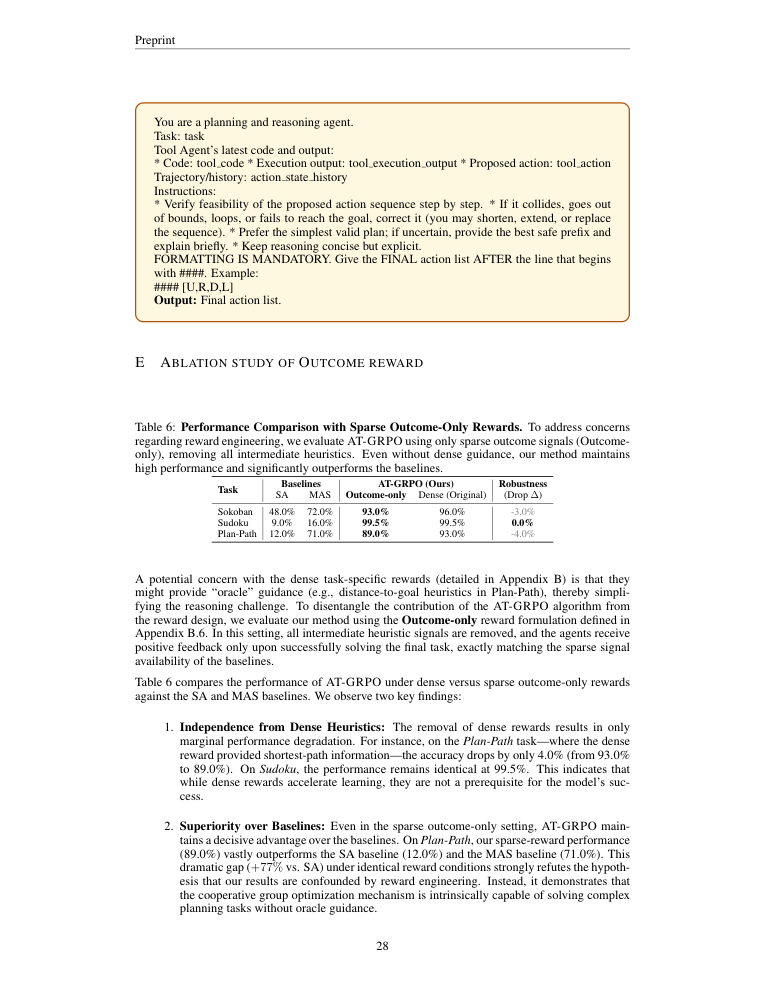

附录E去掉稠密任务提示，仍保留结果奖励和合法格式奖励。因此“outcome-only”不等于完全没有辅助奖励。表6报告Sokoban93、Sudoku99.5、Plan-Path89，对应稠密96、99.5、93。

**表6有疑似行名错置：** 其Sokoban基线48/72对应主表Sudoku，Sudoku基线9/16对应主表Sokoban。这里忠实列出作者报告，同时提示读者核对，不将错位基线继续传播为确证。

附录F多轮SA在Code/Math未稳定改善，因此不能只靠增加迭代解释MAS收益。图5扩大AIME24的Reasoner、Tool-User及Judge数量，考察协作规模；这不等于固定token预算的扩展性证明。

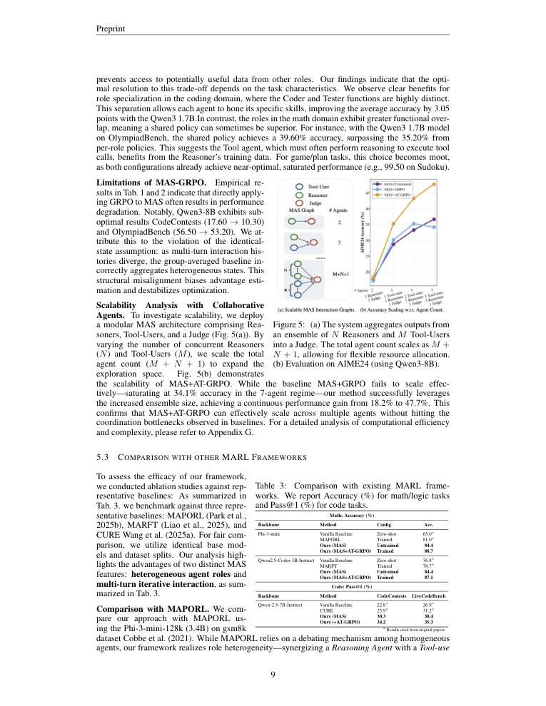
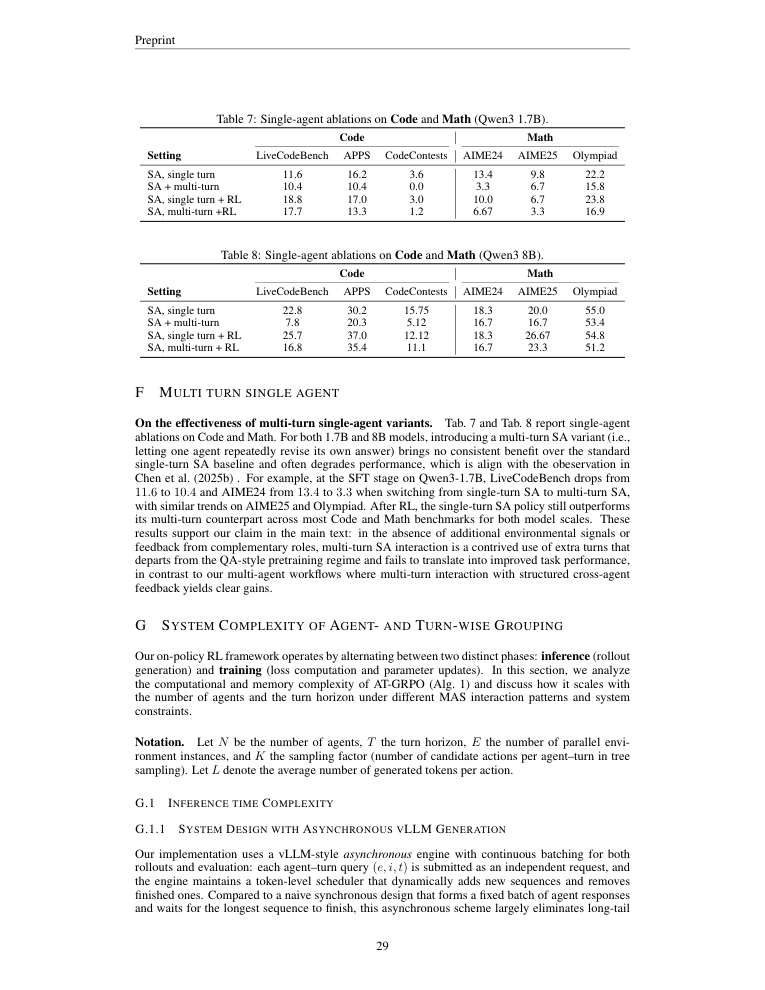

### 5.4 是否更高效，要看实际任务轮数

附录G在4×H100、有效解码batch为32×8的特定配置下分析延迟。Code一次迭代，SA rollout约4分钟、更新1分钟；MAS约8分钟、2分钟。Game rollout则从SA约2.8分钟变为MAS约1.5分钟，作者解释为成功更早、提前结束，少耗费无效轮次。

因此，多Agent并非每一步更便宜，而可能通过减少失败迭代降低整局成本。这一判断需要同时报告成功率与轮数，避免“失败早停所以更快”的混淆。

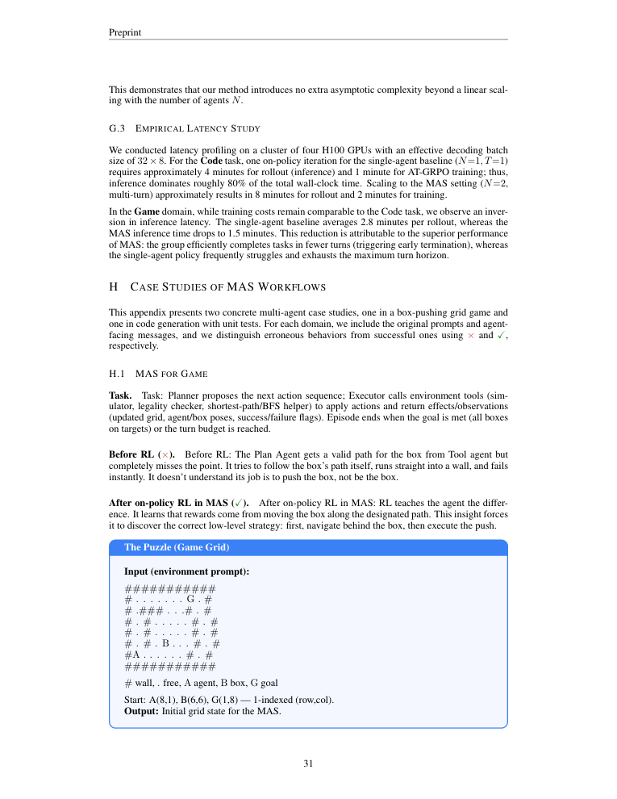

## 6. 总结论文贡献

1. 将“相同输入才可比较”的GRPO原则落实到多Agent的角色、轮次与历史节点。
2. 用逐节点分支和组内学习，避免整轨迹并行后比较组退化。
3. 支持共享模型和角色专用模型的协作环境on-policy训练。
4. 跨游戏、规划、代码和数学展示训练后的协作收益，并用独立训练、交换策略等实验分析来源。

对我们最重要的是实验拆解方法，而不是照搬其训练规模或把双角色工具工作流当作分布式资源协调的同类基线。

## 7. 不足与需要核查之处

- 实际样本量、完整数据清单、重复种子和部分预算口径不足，影响严格复现；当前仓库又有明显演进。
- 多轮、多个角色、工具权限和训练开销同时变化，尚不能将全部收益归为纯粹协调能力。
- 主要是双角色任务工作流，不直接覆盖至少三个自主执行者的共享资源冲突、未来承诺及故障恢复。
- 参考解、最短路信号和评分器可能昂贵，或部署时不可获得；去稠密奖励实验有帮助，但不是取消全部辅助条件。
- 对齐不是正确，局部奖励改善也不等于团队安全；规模实验不等于固定预算扩展性。
- 附录B.7的贪心最优性论证需要更强条件。仅有`r(a)>r(b) ⇒ Q*(a)≥Q*(b)`，不能处理奖励并列但长期价值不同的动作。例如两动作奖励都为1、Q*分别0与10，原假设不被违反，但任选最高奖励并不保证选到最优。有限采样也可能没包含最优动作。不能将这段理论直接作为我们短视代价选择的保证。
- 附录G写SA样本量`ETK`、MAS为`ENTK`时，相除应为N；其后写NT需要不同的SA单轮口径。阅读复杂度结论应先统一T，不能照抄为通用上界。
- 表4与主表数值及表6行名存在上述不一致。本笔记保留原结果并明确标注，不自行修正。

## 8. 中文译文

完整摘要及问题设定、方法、数据、实验和主要结论的中文译文见[单独译文](2510.11062-StrongerMAS-译文.md)。译文不替作者修正原表，额外分析已放在本笔记第7节。
