# Falsifiable Commitment Planning for Self-Correcting Web Agents

[核心中文译文](2607.24167-FCPAgent-译文.md) · [arXiv v1](https://arxiv.org/abs/2607.24167) · [全文及附录](https://ar5iv.labs.arxiv.org/html/2607.24167)。2026-11-09 阅读；先在 Zotero 创建书目条目，后读取全文 HTML。PDF 请求超时，尚未成功归档 PDF，不以摘要代替全文。

## 0. 论文发表状态

未发表任何期刊/会议（截至本轮能核实的状态）；公开形式 arXiv:2607.24167v1，2026-07-27。本轮未核实正式接收或出版。该工作是单个 Web Agent 的自纠错，不是多 Agent 共同承诺或协议。不要与 SyncPlan 的 RL 基线 FCP 混淆。

## 1. 论文提出了什么问题

网页 Agent 的轨迹可能在最终失败之前已偏离用户目标，但每一步局部看起来仍合理。普通计划、技能复用与反思通常没有明确写出“出现什么证据应继续信任/否定当前步骤”。研究问题是：把计划转换为可证伪承诺，并在执行前后检查，能否更早发现漂移且局部修复。

## 2. 相关工作、局限性和本文的改进

ReAct 等边行动边推理，Reflexion 提供反思；AWM 等复用流程；AgentOccam、WebDART、WALT、ColorBrowserAgent 提供更强执行/工作流设计。本文的区别是把子目标、技能、支持证据、证伪证据、置信度封装成 FCU，再用快筛+慢验证与分范围修复连接成闭环。不能把所有测试归因于“多写反思提示”。

## 3. 作者如何分析问题并引出具体方案

### 3.1 计划首先需要可检验接口

“找到最低价商品”只说明目的，不说明当前筛选步骤何时失效。成功经验提供操作程序与成功条件；失败经验提供应警惕的反例。将二者转换成观察得到的支持/证伪信号，才能在执行中检测错页、错误技能适用条件及目标约束遗漏。

### 3.2 检查必须覆盖动作之前和状态之后

危险提交动作可在执行前发现；隐蔽页面变化往往要执行后才能观察。两级检测针对不同风险，不能互相替代。快检测只决定是否升级给 LLM，不直接把语义相似度当最终违约判据。

### 3.3 为什么区分修复范围

工具错误可能只需改下一步；技能不适用需要换技能；子目标与用户条件冲突则应重规划承诺。所有错误都全量重新规划很贵，所有错误都局部重试又可能陷入循环。诊断的价值在于选择最小但足够的修复范围。

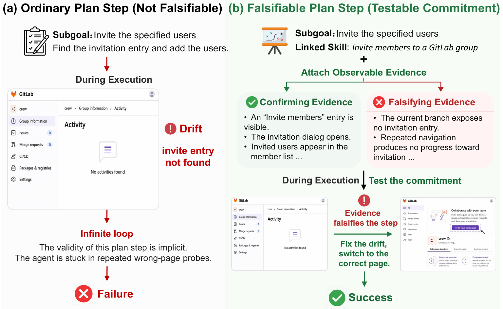
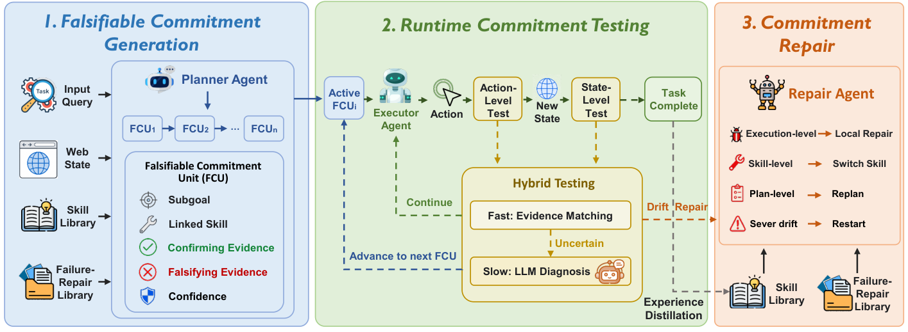

## 4. 作者的具体方案、数据集与详细实验操作

### 4.1 FCU 与两类离线经验

FCU c_i=(g_i,s_i,E_i+,E_i−,κ_i)：子目标、可选技能、支持证据、证伪证据、置信度。技能库从成功训练轨迹抽取，每任务最多五个技能，去掉 DOM id、坐标等任务特有信息。失败修复库来自失败/修复轨迹。测试时二库冻结，不把测试轨迹回流入库。

技能检索为 min-max 归一化 BM25 的0.4与 BGE-M3 余弦相似度的0.6加权；top K=3，并扩展同源前置/后继技能。失败经验 P=2。规划器每个 FCU 至多链接一个提供的技能；同一任务的技能上下文固定。

### 4.2 快慢测试的可复现细节

状态测试 α±=λNLI(T,E±)+(1−λ)ITM(I,E±)，λ=0.8。文本为 nli-deberta-v3-base，图文为 SigLIP2；长文本分块取最大蕴含分。先做动作解析失败、页面错误、应变化却未变化等规则检查。

基础确认阈值0.65、证伪阈值0.55，按 κ 以 η=0.1 调整；低信号阈值0.5；完成与风险证据差阈值分别0.18、0.25；近阈值不确定边界0.08。低置信承诺更容易升级。连续 continue 后还有周期慢检查，但所读实现说明没有明确给出统一周期步数。

动作前测试只使用文本部分，并过滤必须执行后才能判断的证伪项。快筛发现风险时交慢验证，不独立阻止动作。LLM 最终返回 continue、advance 或 repair，并诊断执行、技能或规划层次。修复可局部改动作、换技能、重规划，必要时回退或重启。

### 4.3 数据集、数量和评测划分

公开基准 WebArena 共812任务，作者划分191条用于离线经验，621条测试，逐域如下。

| 域 | 经验构建 | 测试 |
| --- | --- | --- |
| Shopping | 48 | 139 |
| Admin | 41 | 141 |
| GitLab | 41 | 139 |
| Reddit | 21 | 85 |
| Map | 29 | 80 |
| Cross | 11 | 37 |
| 合计 | 191 | 621 |

每方法在同一测试集运行三次并报平均，不能把191条经验来源都理解为成功轨迹数。为什么选 WebArena：存在页面状态变化、长流程和可程序检查目标；额外用更长、更繁琐的 WebChoreArena 做零样本跨基准测试，保持二库不变。后者本轮核对段落未列出完整使用任务数，不补造。

### 4.4 模型、执行与公平性

统一骨干 Qwen3.5-397B-A17B API，temperature=1；BrowserGym+Playwright；观测包括 Set-of-Marks 截图与 accessibility tree；动作空间参考 AgentOccam；交互上限20步。离线经验不等于微调模型，本文不训练该 LLM 权重，但依赖已有 NLI、图文和检索模型以及离线轨迹构建。

需要离线经验的基线获得相同数据预算，避免把额外训练数据误当架构收益。指标主项为成功率；成本分 LLM 调用耗时与端到端耗时，不能混为 token。Map 使用真实 OpenStreetMap 网站，属性可能随时间与参考答案偏离。

### 4.5 复现顺序

部署 WebArena/BrowserGym 与网站快照 → 固定论文 split 的任务 ID → 用191训练任务构建二库并冻结 → 统一骨干/观测/动作空间/20步上限 → 接入检索、FCU JSON 和执行器 → 加前后快测试及慢验证 → 实现分范围修复 → 对621测试任务运行三次 → 使用程序判定器统计域内及总体成功率 → 另做零样本和消融。

精确复现还需作者任务 ID 列表、生成库、提示模板、API版本、采样参数与随机种子。正文给数量不意味着全部工件已公开；本笔记未完成运行，也不将上述路线伪称开箱即用脚本。

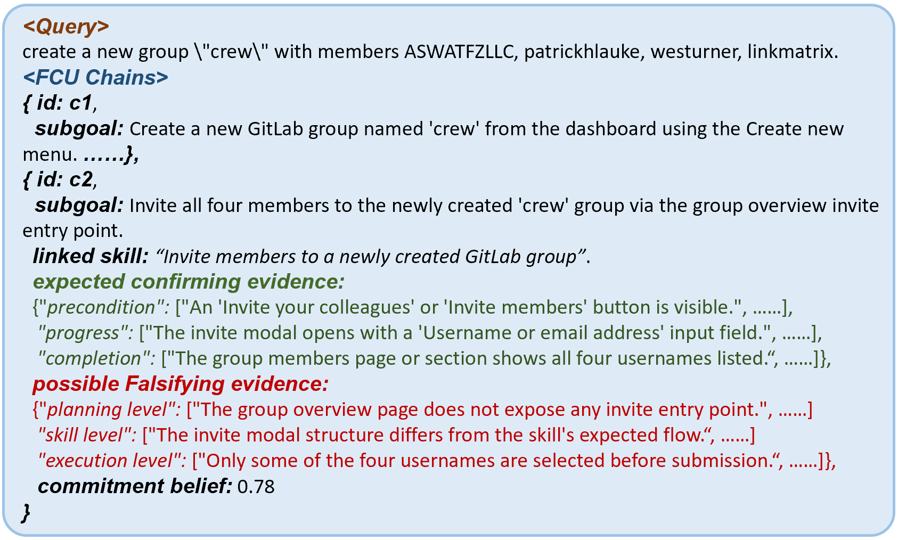
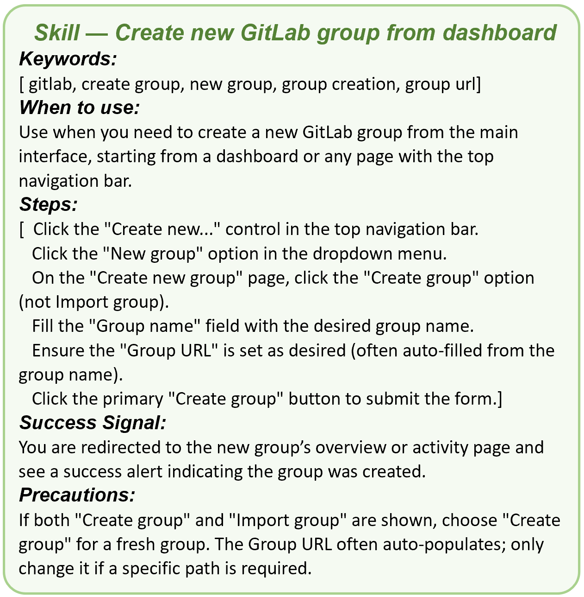
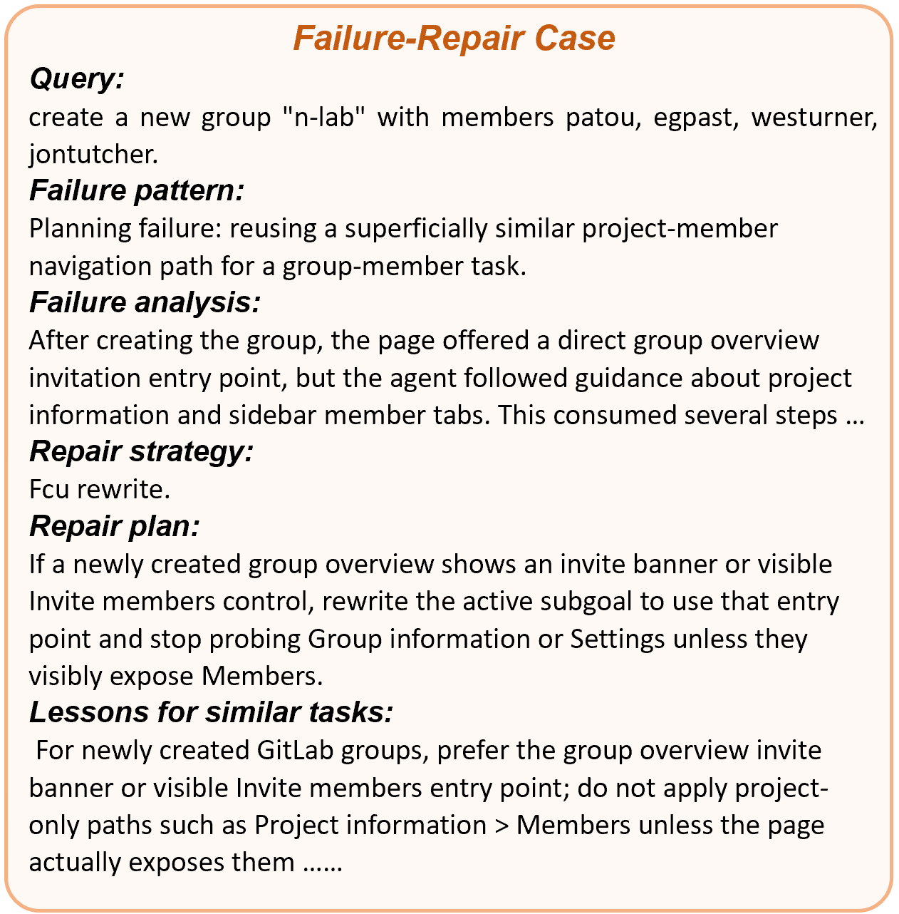

## 5. 作者如何设计实验及实验结论

下列为原文 HTML 表格的本地排版渲染，并非 PDF 截图；保留原表数值、标签与比较范围。

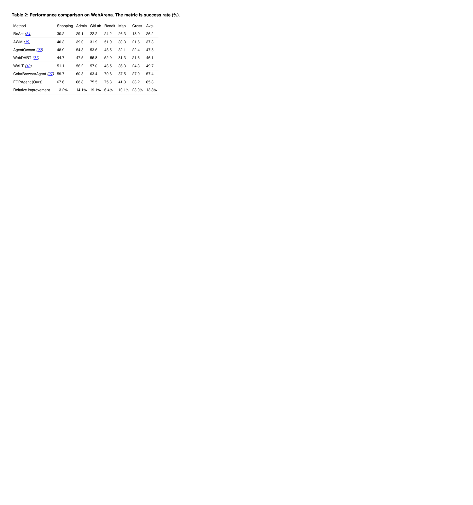
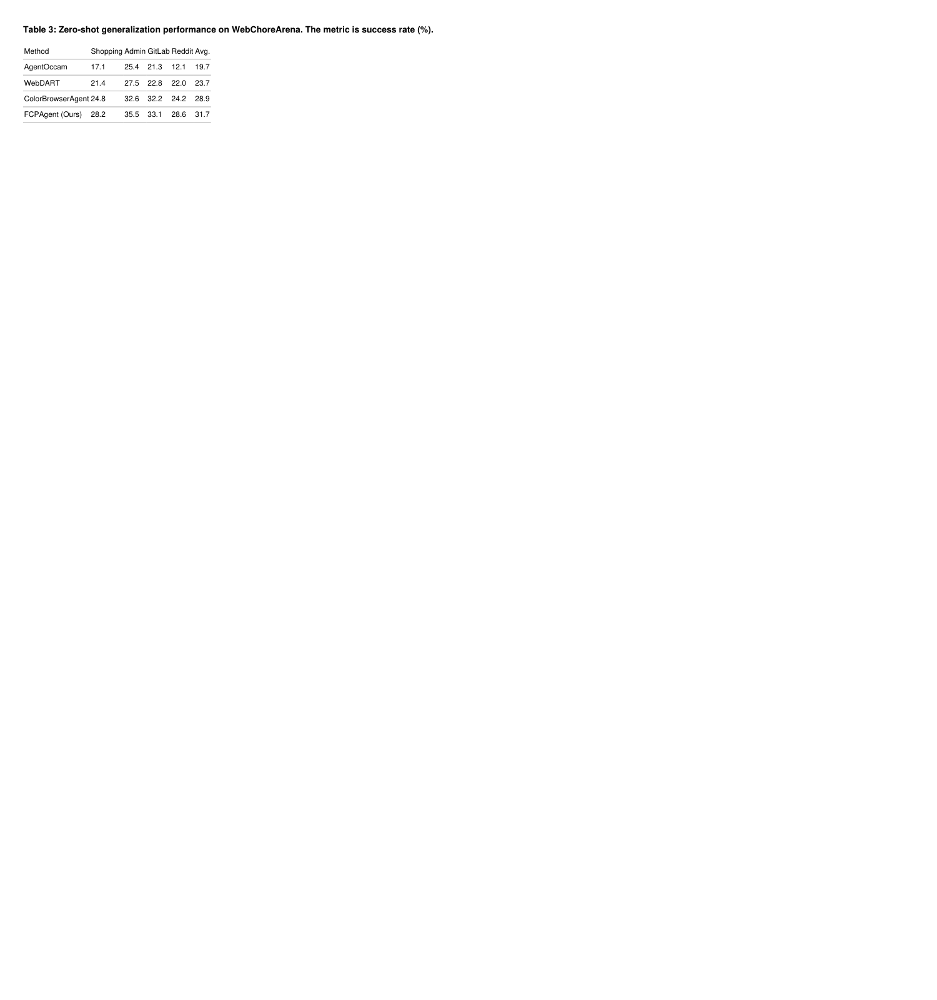
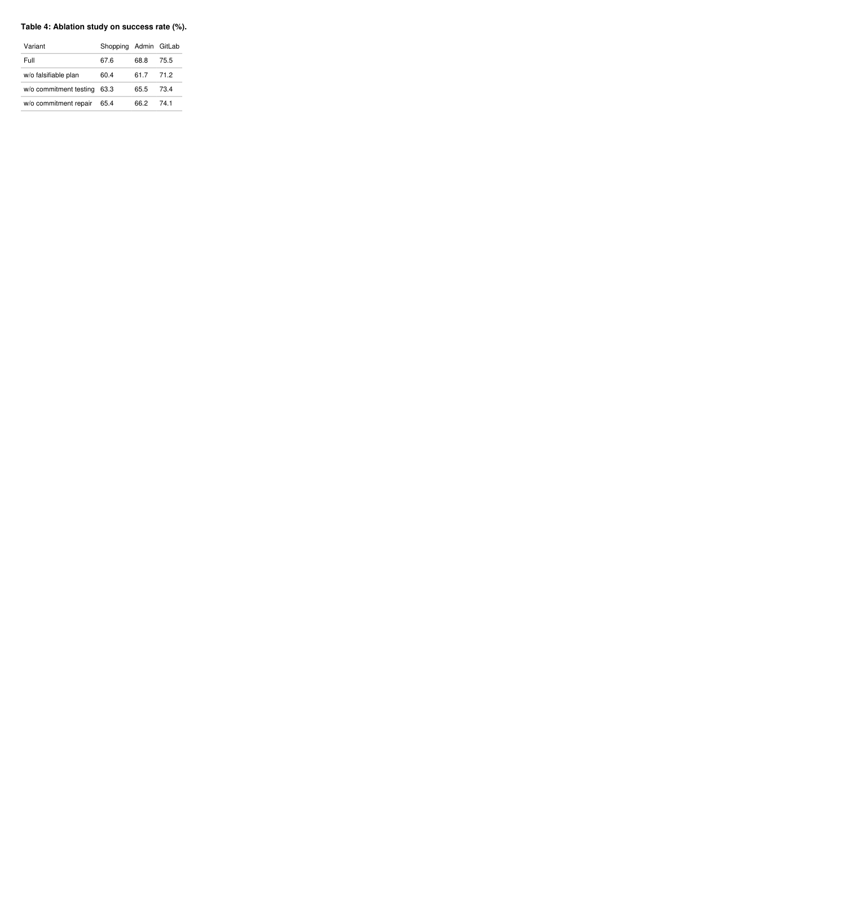
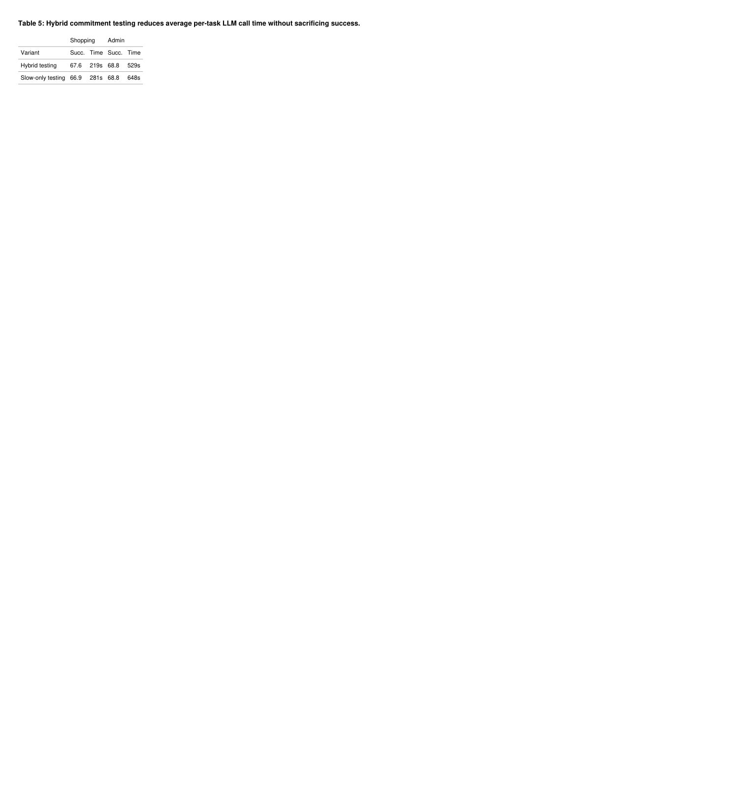

主结果总体成功率从最强比较基线 ColorBrowserAgent 的57.4%提高到65.3%，绝对+7.9个百分点、相对+13.8%；不是绝对提高13.8个百分点。GitLab 为63.4%→75.5%。WebChoreArena 总体为28.9%→31.7%，论文报相对约9.6%，应尊重其未四舍五入的原值，不能强行用显示值重定结论。

Shopping/Admin/GitLab 三域消融平均：完整70.6%；去可证伪规划64.4%；去混合测试67.4%；去修复68.6%。这不是六域主表65.3%的同一平均口径。

混合测试相对仅慢验证，两域平均 LLM 调用耗时464.5s→374.0s，减少19.5%；不代表端到端也同降19.5%。人工检测评估仅30条轨迹，13条有漂移；TP10、FN3、FP2、TN15，precision83.3%、recall76.9%、F1 80.0%。

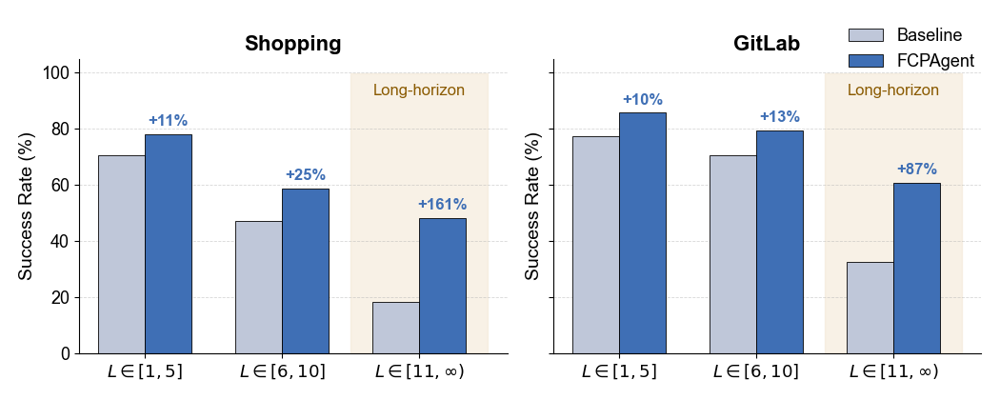
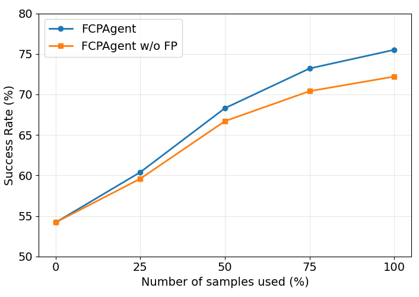
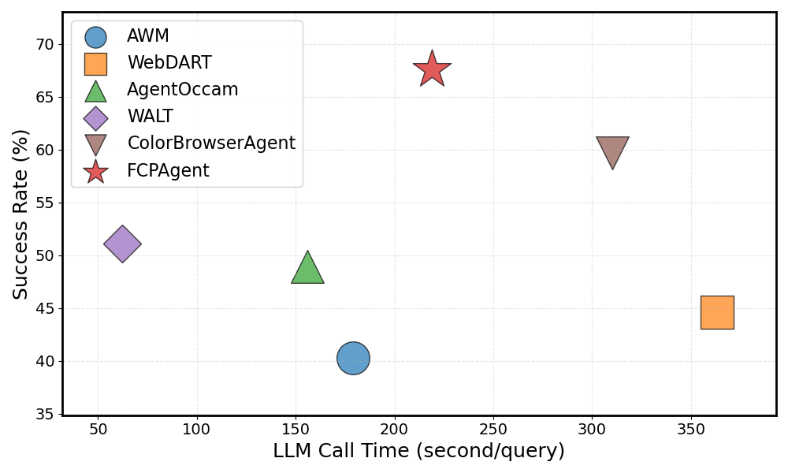
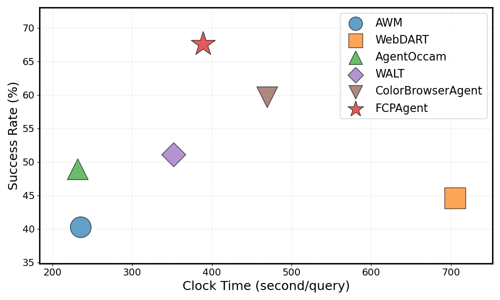

慢验证仍占总运行时间43.1%，快测试仅2.4%；执行器34.5%，规划11.2%，修复8.8%。局部修复55%、重规划33%、换技能7%、回退/重启5%，说明“总是局部修复”并不是本文结论。

## 6. 总结论文的贡献

提出具有支持与证伪证据的计划接口；结合技能和失败经验构造承诺；以混合测试降低验证负担；把诊断层次映射到修复范围；通过主评测、泛化、长度、消融、检测准确率与成本分析验证。

## 7. 论文的不足与对我们研究的启示

单 Agent 的承诺是关于自己子目标有效性的认知承诺，不是向队友保证未来行为的社会承诺；无法据此推断解决了团队承诺振荡。依赖大型 API 模型及多个辅助模型；慢验证仍贵；NLI/图文得分并非逻辑证明；人工漂移样本小；真实网站变化削弱复现；三次平均不替代跨模型及统计显著性。

对我们可借鉴的是“承诺必须可检查，反思要进入行动决策”。若要扩展多 Agent，应新增对他人依赖与外部履约的判断，并与单 Agent 自检加简单通信的组合比较，而非仅把同一 FCU 发给队友。

## 8. 中文译文

见[核心中文节译](2607.24167-FCPAgent-译文.md)。辅助案例与统计图：

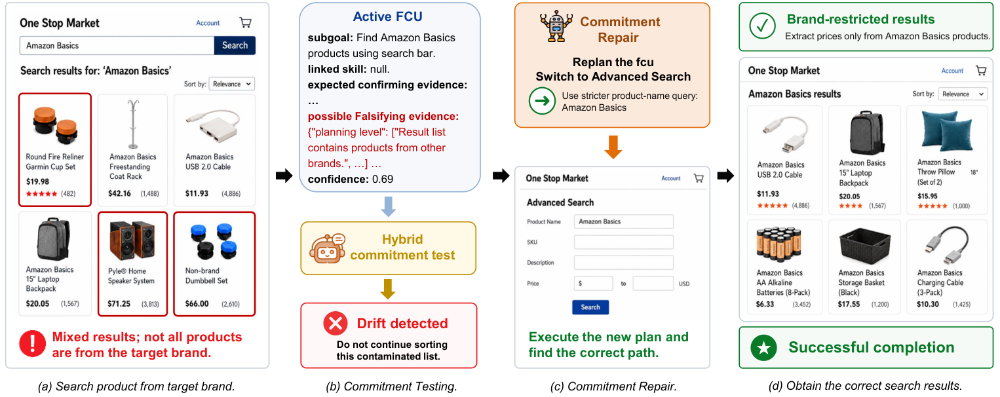
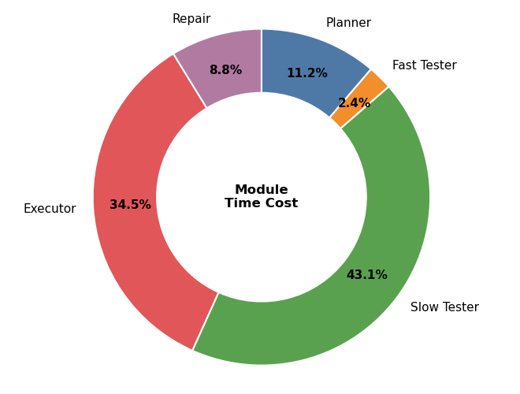
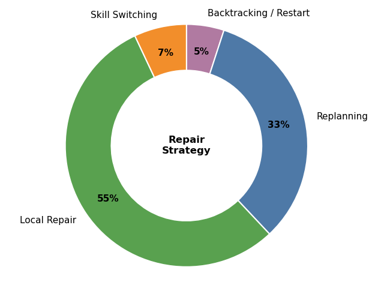
