# SyncPlan: Long-Horizon LLM Coordination with Explicit Synchronization and Adaptive Correction

[核心中文译文](2608.01652-SyncPlan-译文.md) · [arXiv v1](https://arxiv.org/abs/2608.01652) · [全文及附录](https://ar5iv.labs.arxiv.org/html/2608.01652)。2026-11-09 阅读。先在 Zotero 创建完整书目条目；PDF 请求持续超时，依据全文 HTML 阅读，不伪称 PDF 已归档。原图下载至 figures/。

## 0. 论文发表状态

未发表任何期刊/会议（截至本次核查可确认的状态）；公开形式为 arXiv:2608.01652v1，2026-08-03。未核实正式录用或出版。原文称代码和数据将公开，不等于已找到可运行仓库。它是直接相关的 LLM 多 Agent 协调工作，但采用中央协调器，不是多个独立 LLM 各自做承诺协商。

## 1. 论文提出了什么问题

逐帧或固定频率调用 LLM 能适应变化，却造成高时延；一次生成长计划节省调用，但易因环境与队友变化而过时。自然语言中的“等队友到位再行动”又缺少可执行同步语义。本文要在低调用开销、长程依赖执行与动态纠错之间取得平衡。

## 2. 相关工作、局限性和本文的改进

相对 Collab、Adaptive-ToM 等对话/反复决策方法，SyncPlan 把多 Agent 行动链集中生成，使用可检查的等待原语管理依赖。相对一次计划到底，增加逐帧死锁检测及轻量 Plan Staleness Detector（PSD）。它还通过 SFT 与规划导向 RL 改善协调器，不能简单称为纯提示、无需训练方法。

本文引用的 Overcooked FCP 是强化学习基线，不是本目录另一篇 FCPAgent，二者不能混淆。

## 3. 作者如何分析问题并引出具体方案

### 3.1 规划负责语义，运行时负责同步

LLM 擅长从任务和状态生成行动安排，但不应每帧负责检查队友是否到达。于是中央协调器一次给出 N 条动作链；运行时维护各链指针，只推进已满足条件的部分。这样把昂贵语义决策与便宜状态检查分开。

### 3.2 显式等待使协作关系可执行

Wait_agents 等待另一个 Agent 达到指定里程碑；Wait_entity 等待环境对象满足条件。等待只阻塞对应 Agent，不阻塞其他链。自然语言依赖变成逐帧可判定谓词，但错误等待仍可能构成环，因此维护有向等待图，检测到循环后重新规划。

### 3.3 为什么还要检测计划过时

无死锁不代表计划有效：手里的洋葱掉落、锅内材料改变、英雄血量下降，都可能使剩余链失去前提。PSD 同时输入实体当前状态、相对于过去的变化，以及剩余链究竟依赖哪些实体，判断是否需要再调用 LLM。检测关注未完成部分，已经执行的前缀被遮蔽。

### 3.4 训练与架构贡献需分开

SFT 教协调器输出合法、有意义且含同步原语的行动链；RL 用任务进展、效率、长度、成功及错误惩罚优化。论文用不同训练阶段叠加架构消融，避免将训练收益全算作运行时协调收益。我们若只复用结构不训练，应对齐其 w/o SFT 行，而不是直接声称复现完整最优系统。

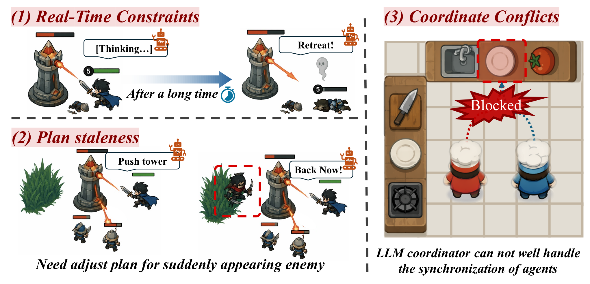
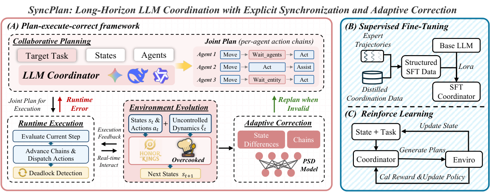

## 4. 作者的具体方案、数据集与详细实验操作

### 4.1 动作链与运行时

联合计划 Π_t=D_θ(s_t,e)={π_t^1,…,π_t^N}。每个 Agent 维护头指针 h_i：普通动作交给低层执行，完成后前进；等待谓词未满足时输出 no-op。每帧检查等待图环，必要时触发中央重规划。它不等于独立 Agent 持续更新其对外承诺期限。

Overcooked 动作含 Interact、Move_to、Face；HoK 含 Kill、Move、Push、Clear、Back，另有同步原语。需保留作者环境适配，不能把行动链直接当 primitive 按键序列。

### 4.2 PSD 输入、样本和标签构造

当前实体状态 X_t∈[0,1]^(M×F)，变化 Δ_t 与 3 帧前比较；剩余链关联张量 C_t∈{0,1}^(N×M×L)。HoK 根据自身/目标附近的空间实体构造相关性；Overcooked 根据动作引用对象类别绑定。关联规则是人工启发式，不是由 LLM 自动学出。

Overcooked 正例为脚本事件注入帧，负例来自干净轨迹，正负采样比 1:5。HoK 离线降低相关友军血量或移动敌军靠近目标，人工复核计划确实变得不合理后作为正例。两环境 PSD 数据分别收集，与各自 SFT 池独立，训练/验证为 8:2。PSD 阈值在 {0.3,0.5,0.7,0.9} 搜索，选 0.7。总帧数与完整轨迹清单在所读段落未明确，不能由采样比例推算。

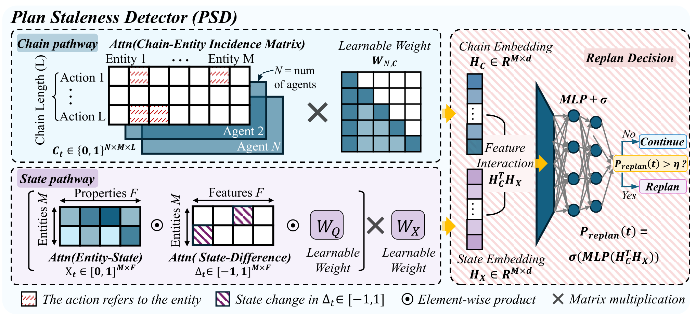
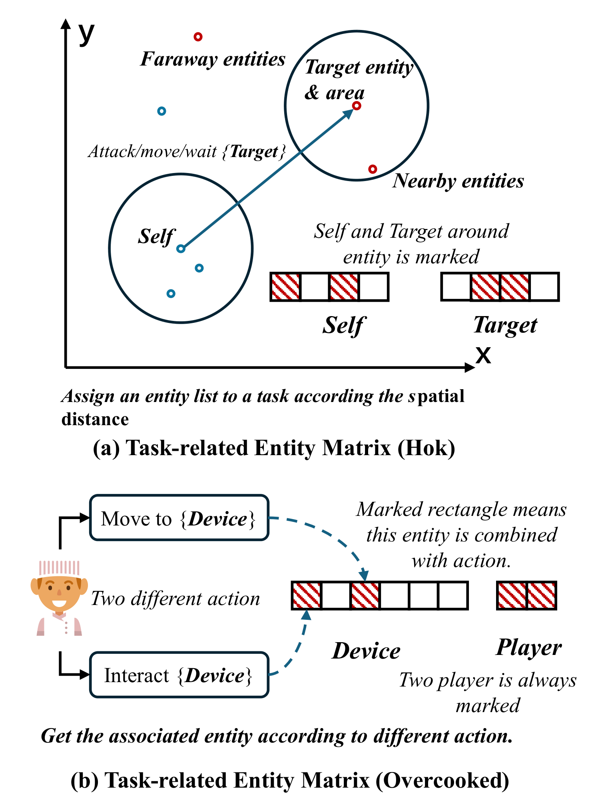

### 4.3 为什么选两个环境，如何制造干扰

Overcooked-AI 是公开双人协作环境，任务为制作并交付洋葱汤。采用 Coordination、Ring、Symmetric 三张布局，包含标准与动态设置。动态干扰由带种子的脚本复用 Collab-Overcooked 注入接口：持物掉落、锅内部分材料散落并重置计时、Agent 位移。各方法复用同一事件序列。附录没有在已核对段落提供足以独立重建全部事件时刻的配置表，需要代码/补充材料。

HoK 为 5v5 环境，Commander 模式协调最多五名己方英雄击杀指定敌人；未控制的英雄继续采用内置策略。正式评估不注入脚本事件，变化来自其自然行为；不能把 PSD 训练时的合成扰动说成 HoK 测试协议。

SFT：Overcooked 从 Gemini 蒸馏，HoK 来自匿名实战记录。两类数据规模与授权可复用性仍需作者数据发布才能核实。三个布局不是三条测试样本；本次未核实各表完整独立试验总数及随机种子表，不能编造。

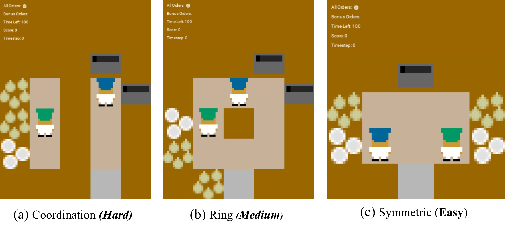

### 4.4 模型、训练和指标

RL 基础模型 Qwen2.5-7B-Instruct，序列上限 4096，bfloat16，LoRA rank32/alpha64；GRPO 每批10提示、每提示10响应，clip0.2、KL0.02、熵系数0.001，学习率5e−5，1 epoch，seed42。SFT 使用 LoRA rank32/alpha64/dropout0.05，学习率2e−5、4 epochs、5%验证、cosine schedule。它们是训练参数，不是推理温度；未核实的推理温度不填默认值。

论文基础设施为双路 AMD EPYC 9K84、8×H20 96GB；Python3.11.6、CUDA12.8、PyTorch2.10.0 等是作者披露环境，不意味着最低复现需要全部硬件。PSD 提供约 6.9万、26万、74.5万参数三档。

指标：两环境 TAR；Overcooked 另报 AED、AAS、RT 与死锁率；HoK 另报 RTR、动作超时率 ATR。时延不等于 token，更不能把“wall-clock 降低”写成同等比例 token 减少。

### 4.5 可照做的复现路线及缺失项

先安装公开 Overcooked 与对应行动适配 → 固定三布局及任务终止 → 实现动作链解析与 wait 谓词 → 接入中央 LLM → 加循环等待检测 → 按作者定义采集 PSD 事件帧并分离训练/验证 → 训练 PSD、验证阈值 → 固定配对事件序列 → 对比无 PSD、固定重规划、完整方法 → 再加 SFT/RL。原论文代码/数据尚未确认可用，无法声称上述步骤已精确复现。HoK 私有接口使其不适合作为我们快速起步的必选环境。

## 5. 作者如何设计实验及实验结论

下列为原文 HTML 表格的本地排版渲染，数值与行列来源于原表，不是 PDF 截图；HTML 数学箭头可能保留 LaTeX 文本，方向以本笔记指标说明为准。

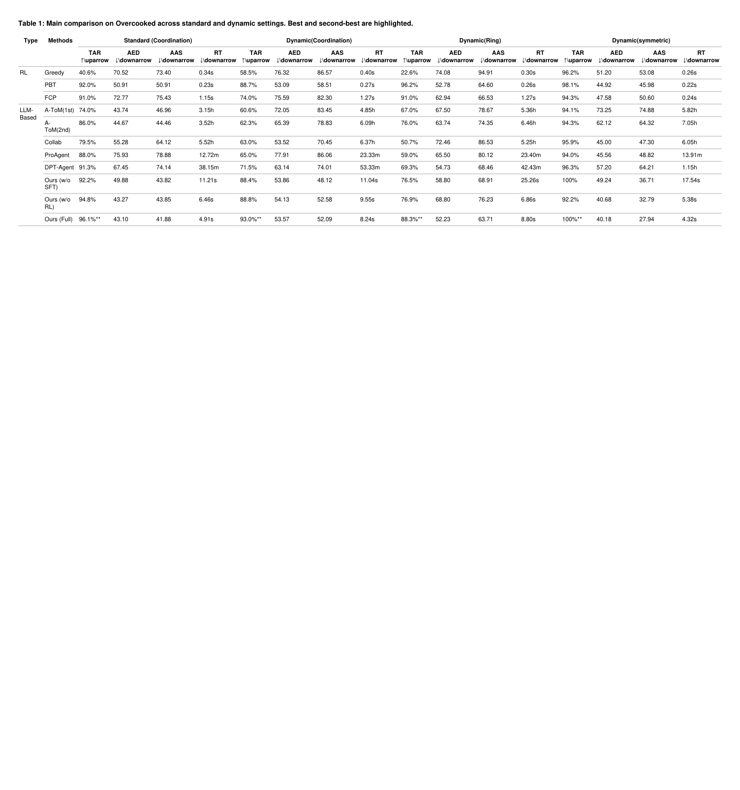
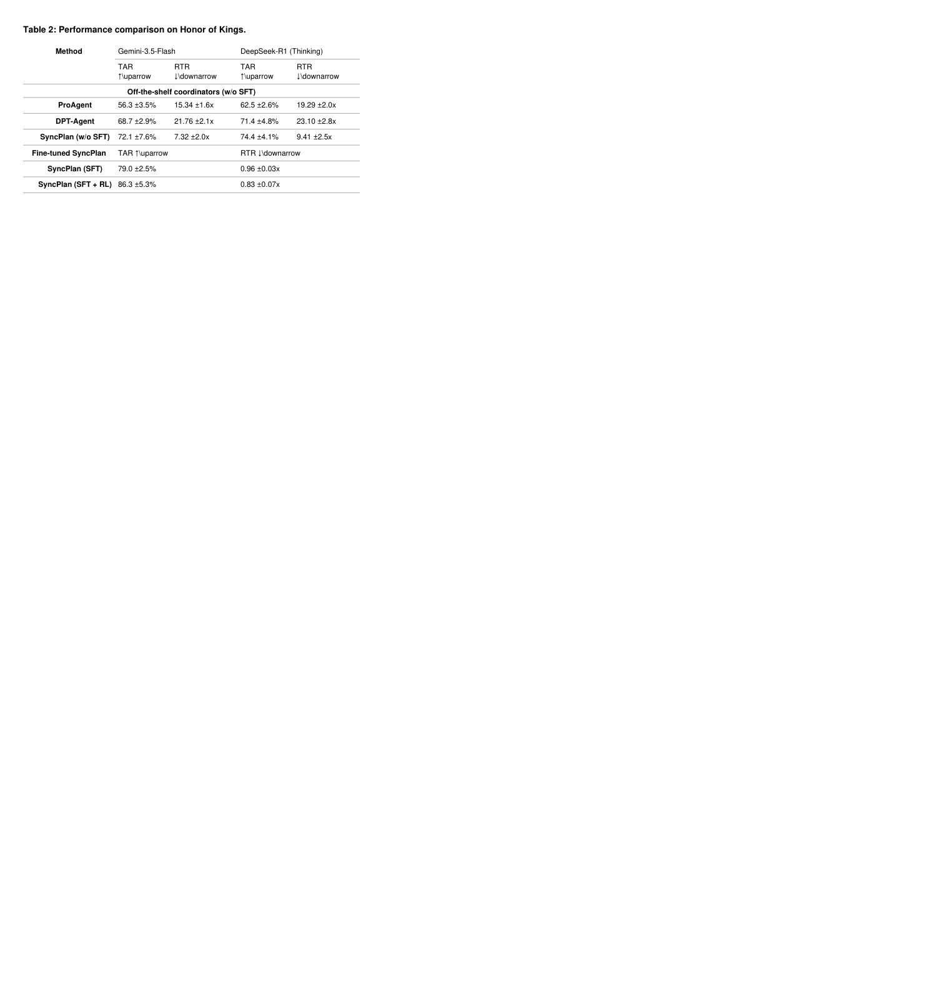
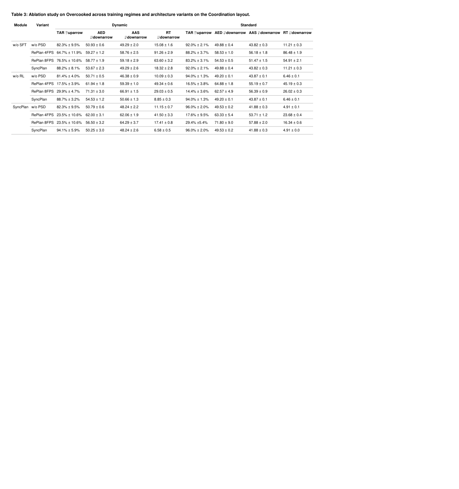
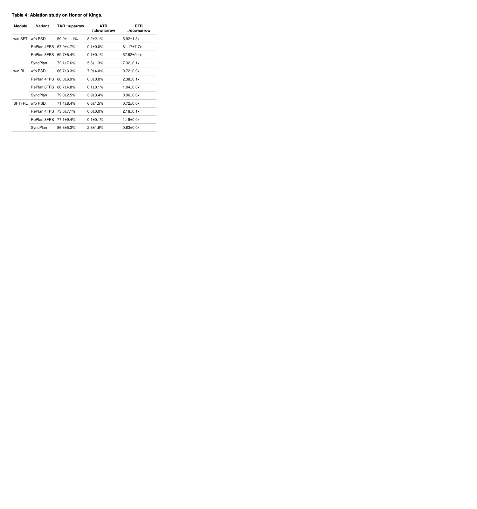

动态 Ring 的 TAR 为 88.3%，优于所比 LLM 方法，但低于最佳 RL 基线。HoK TAR 为 86.3%，所比最佳基线为 68.75%。不能扩大为全面胜过所有 MARL。

Coordination 消融：未做 SFT 时，动态条件完整结构为 88.2±8.1%，去 PSD 为 82.3±9.5%；完整训练后分别为 94.1±5.9% 与 82.3±9.5%。标准条件完整训练下两者同为 96.0%，说明动态纠错不是在所有设置都增加成功率。误差条重叠不能当作已做显著性检验。

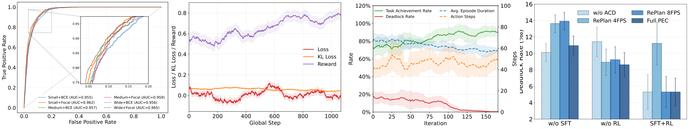
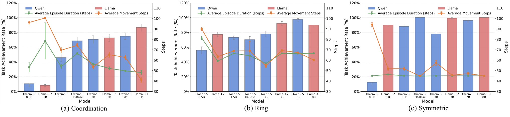
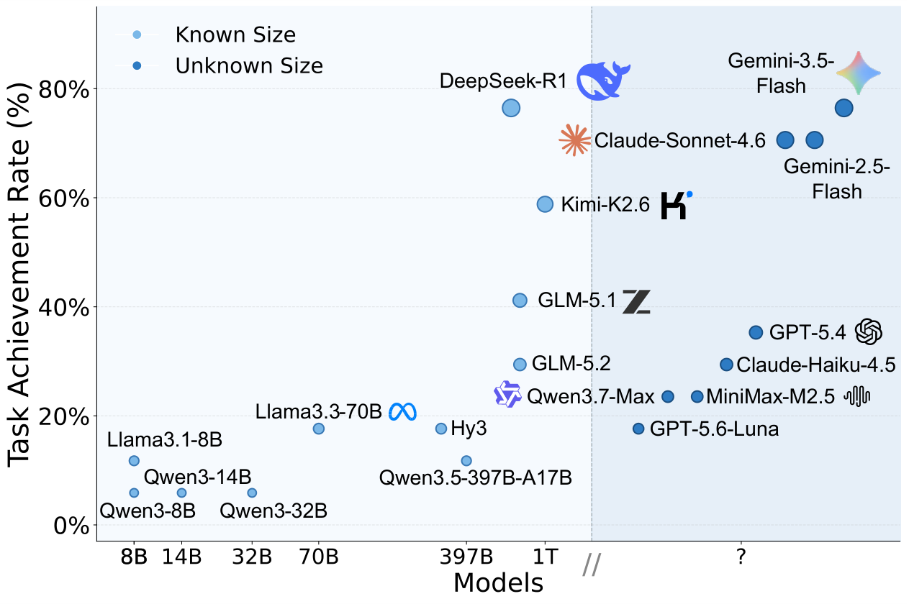

原文摘要“少于已有方法0.05%的运行时”属于作者特定比较下的强表述；正文主比较又概括为两到三个数量级。引用时应核对具体表格分母与设置，不当成所有方法的统一加速比。

## 6. 总结论文的贡献

把长链规划、机器可检查同步与事件驱动纠错整合为 LLM 多 Agent 系统；提出利用链—实体相关性的轻量失效检测；结合 SFT/RL 提升规划；在双人协作与更动态的游戏协调任务验证。

## 7. 论文的不足与对我们研究的启示

依赖中央协调器和可访问结构化状态；wait 检测为运行时协调，不是队友承诺期限协商；PSD 需领域标签与规则；人工注入事件可能使检测任务更容易；代码、数据、事件细则及完整试验规模尚不足以确认独立精确复现。HoK 可访问性尤其受限。

它是我们的直接近邻：不能说“没有与 Agent 融合”。但它没有据本文证据显式研究每个独立 LLM 如何判断“队友正在依赖我的哪些承诺”、如何修订外部承诺而不重做全局计划。这个差异是后续设计比较入口，不是已证明的空白。

## 8. 中文译文

见[核心中文节译](2608.01652-SyncPlan-译文.md)。其他原图已归档，额外训练和案例见：

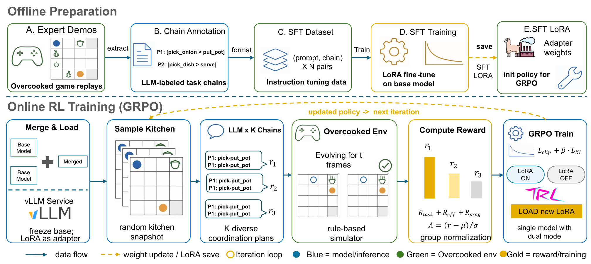
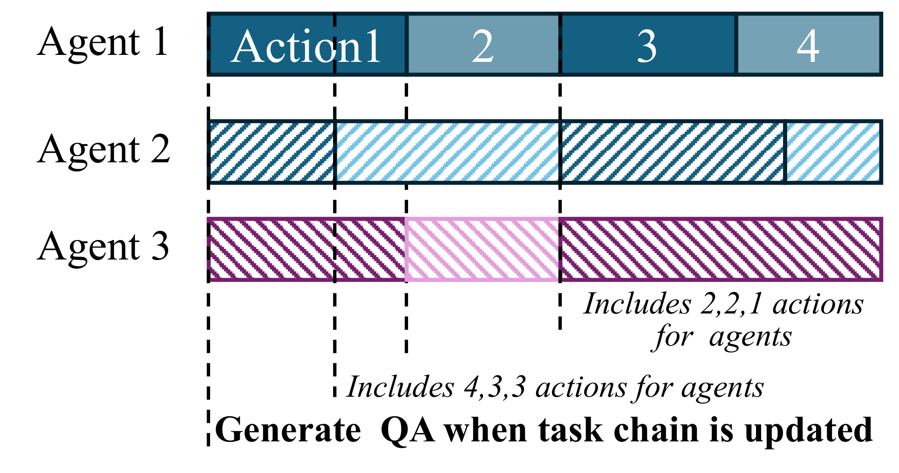
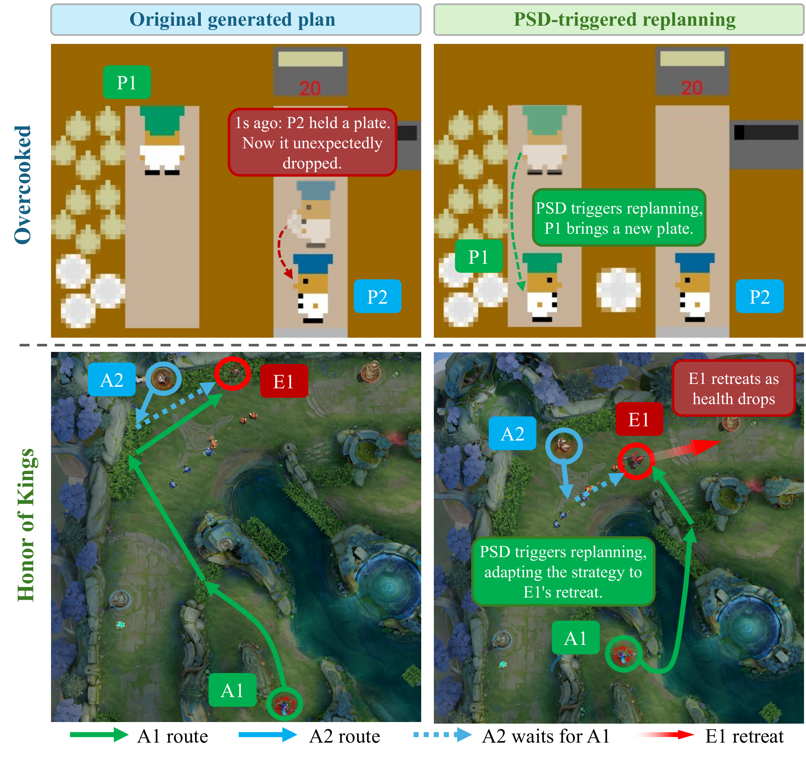
