# Context Language Models：模型自己维护上下文

[中文译文](2609.37725-ContextLanguageModels-译文.md) · [原文v1](https://arxiv.org/abs/2609.37725v1) · [官方代码](https://github.com/facebookresearch/context-language-models)。阅读：2026-11-12。

先确认Zotero运行，connector保存书目与PDF均返回201，再精读27页PDF及HTML。PDF仅保存在Zotero的storage/Y5N53KIL，未放仓库。关键原图页在figures。核查代码commit：483198229ab7b90c0eed4651306ab3b3505aaf50。未部署服务或复现得分。

## 0. 论文发表状态

Context Language Models，arXiv:2609.37725v1，2026-09-29公开。当前原文和官方仓库未标正式会议或期刊，按“未发表任何期刊/会议，已有arXiv预印本”记录，不冒认接收状态。

作者13位：Rulin Shao、Shannon Zejiang Shen、Junjie Oscar Yin、Yuetai Li、Minheng Wang、Hamish Ivison、Radha Poovendran、Nathan Lambert、Teng Xiao、Mike Lewis、Wen-tau Yih、Luke Zettlemoyer、Pang Wei Koh。

## 1. 论文提出了什么问题

长期任务的上下文不断增长。固定摘要可能丢失逐字信息，递归分支可能不能修改主上下文，普通文件可以存储资料却不一定主动清除当前输入。作者希望让模型决定下一轮自己看见什么，并学习这种能力。

CLM将当前上下文映射成文件，模型通过通用代码编辑，结果同步到下一轮输入。多个Agent各自使用上下文文件，支持子Agent及群体任务。

## 2. 相关工作、局限性和本文的改进

第2节及附录A比较Mini-SWE-Agent、Summary、MEM1、Self-Compact、ACM、RLM、Context Folding，区分外部调度、专用管理工具与递归执行。

区别不是普通的“记忆文件”：编辑这个特定文件会改变下一轮真正送入模型的上下文。未编辑时仍默认追加。技能指令、RL效率奖励、服务端Suffix Cache Reuse是另外三层改进，要分别评测。

与我们工作的关系：它解决保留哪些信息，我们解决计划改变怎样影响队友。上下文文件可保存承诺和依赖，但不能替代共享约束、版本确认与执行核验。

## 3. 作者如何分析问题并引出具体方案

### 3.1 先隔离管理能力，再比较真实任务

原创ContextBench尽量不要求复杂推理，分别测逐字保留、原地改写、卸载检索和日志查询。生成器保证任务需要保留的信息能够容纳，避免把无解任务当作管理失败。

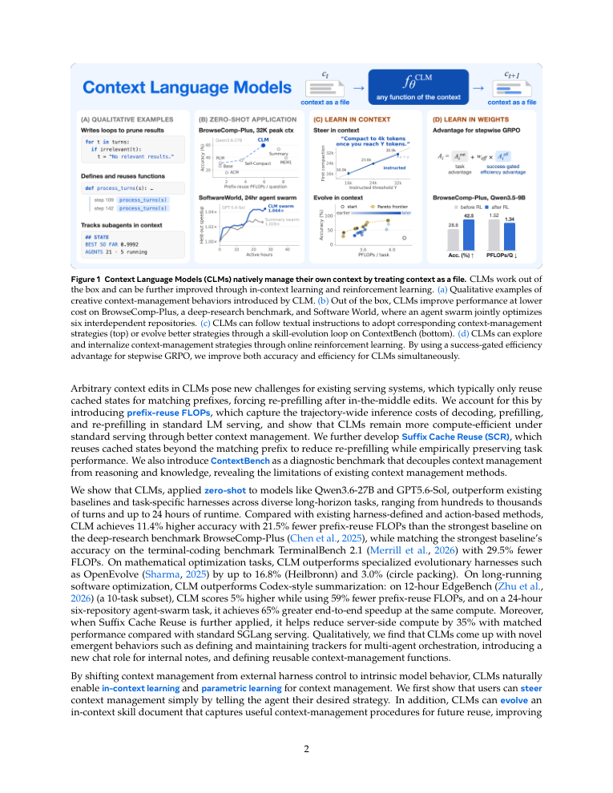
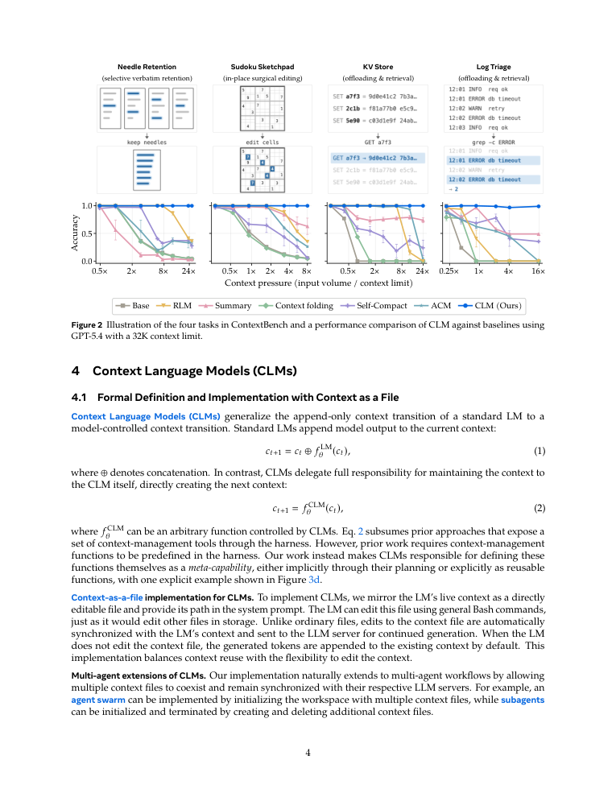

### 3.2 从追加历史变成编辑下一轮输入

标准模型更新为c(t+1)=c(t)加模型输出；CLM为c(t+1)=f_CLM(c(t))。文件同步器将修改送给模型服务，仍然需要harness，不是去掉外部系统，也不是零样本改变网络结构。

模型可以维护记分板、删去无关搜索结果、保留原文指针、创建自己的进展笔记。创建或删除子上下文文件对应子Agent生命周期。文件写权限本身不保证并发一致性。

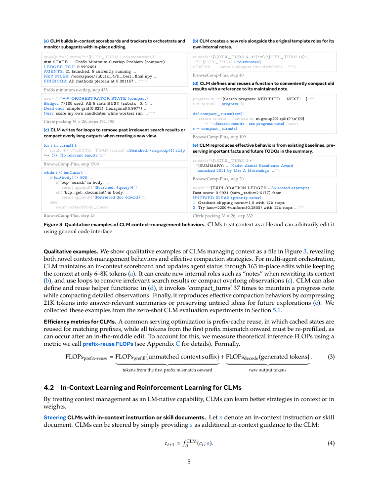

### 3.3 技能与强化学习怎样优化

技能演化固定模型，用训练轨迹提出管理指令，开发集选择，冻结后评估保留集。

RL从完整轨迹任务结果计算GRPO优势并传播到各次调用。效率项只在成功轨迹间比较：A_eff=clip((成功组平均FLOPs−当前FLOPs)/平均FLOPs,-1,1)。失败为0，成功不足两条的组也为0。总优势为A_out+w_eff乘A_eff，代码用mask只把效率项加到上下文编辑token。

这避免直接奖励删除量或编辑频率，但信用仍是轨迹级近似，依赖成功判定和成本估计。

### 3.4 为什么还需要后缀缓存复用

上下文A+B+C改为A+B′+C，标准前缀缓存只能复用A，C也需重新prefill。SCR复用保留下来的C旧KV，仅计算新片段。

C包含旧前缀信息，是stale cache。因此SCR是近似计算，不是对新上下文精确重算。混合注意力模型还需处理位置和线性注意力状态。平均准确率相同不代表每个输出相同。

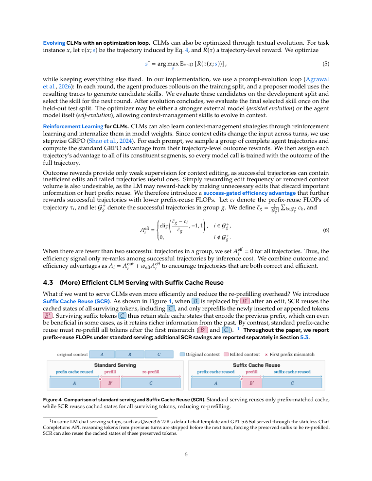
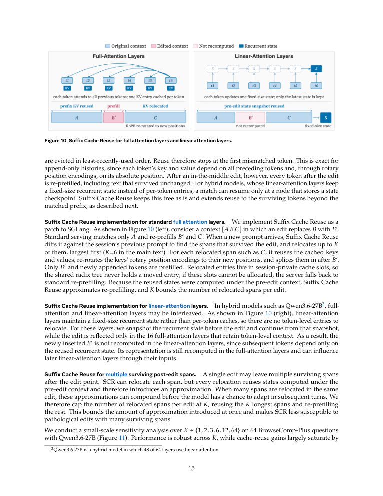

## 4. 具体技术、数据选择与详细实验操作

### 4.1 原创ContextBench的构造

操作作为连续用户消息进入同一对话，Agent处理后发送READY_FOR_NEXT_OP接收下一条，不能让harness在信息进入前自动截断。实例由种子生成并检查。

上下文32768，响应预留2048，可用30720；单操作不超过可用空间五分之一，必要保留内容不超过一半，均留10%余量。压力是总输入token除以32768，最高约24倍；低于1倍是控制档。

| 任务 | 输入及查询 | 指标 |
| --- | --- | --- |
| Needle Retention | 约4K token块，2—8条needle、140条填充行 | 最终上下文逐字保留 |
| Sudoku Sketchpad | 16×16棋盘，每轮修改一格，不是求解数独 | 每个版本完全一致 |
| KV Store | 每批100个SET，24词随机值，24次GET | 值精确匹配 |
| Log Triage | 每批14—54行日志，24次查询/计数 | 回答精确匹配 |

主诊断用GPT-5.4、32K；每档4种子，部分8种子。最终总样本数需结合档位清单，不能简单称4条。外部文件里的答案本身不计分，需检索回上下文作答。

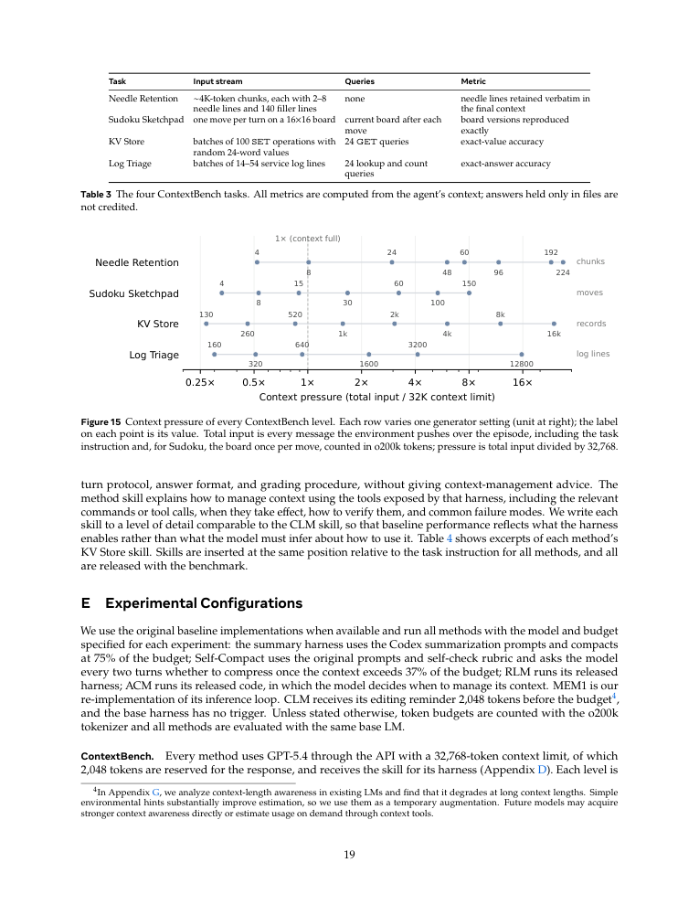

### 4.2 真实任务规模与选择

| 任务 | 来源及实际量 | 设置与目的 |
| --- | --- | --- |
| TerminalBench2.1 | 89个公开任务 | 容器最终状态verifier评分，每命令180秒，任务默认时限4倍 |
| TBLite | OpenThoughts-TBLite，所读配置未列最终条数 | 终端代码任务，输出上限2048 |
| BrowseComp-Plus | 全部830题、固定语料 | 搜索10段512-token片段，文档读取8192；未答算错 |
| 数学优化 | 4题，每方法每题1次 | Claude4.6 Sonnet，32K，100次已评分尝试或5小时 |
| EdgeBench-10 | 48个可运行公开任务中10个，每个3种子 | 12小时、无网络，统一0—100评分，计入子Agent成本 |
| Software World | 6仓库、6Agent、17个隐藏下游CPU基准 | 超24小时，几何平均指令数加速，破坏基准记1.0 |
| 技能演化 | 每技能先6训练再12；开发102/任务×1种子 | 辅助演化冻结后测试102/任务×3种子 |
| RL | OpenResearcher训练3040、验证500；BCP830 | 验证选择checkpoint，再测跨任务泛化 |

四数学任务为26圆装箱、Erdős最小重叠、平面min-max/min-dist、Heilbronn三角形。EdgeBench涵盖代码、图学习、仿真和优化；具体10任务清单在原表5。

### 4.3 模型、参数和公平性

零样本主模型Qwen3.6-27B，补充Qwen3.5-9B，思考开启。TB输入32000、输出4096、附录E64轮，但主图注写100轮，须复现时明确来源。BCP附录E为23560-token预算、100任务轮，温度0.7、top-p0.95、输出4096，编辑轮不计任务步，溢出重试最多6次。温度0的Qwen3.5-27B按模板判答案完整正确。

EdgeBench输出8192、32K或128K，不设实际任务轮上限，回滚50次；子Agent最多6个、各40轮。Software World使用Pi、GPT-5.6-Sol及272K上下文，成本是累计API美元。

RL每步8题×32轨迹、70步，学习率10^-6、weight decay0.1、KL0.01、clip0.2/0.28。SGLang采样温度0.7、top-p0.95、输出4096。CLM28K、预留2048、80任务轮不计编辑；Summary在28672压缩、100轮。效率权重0.25；policy16块H200、rollout48块H200。训练判题GPT-5.4-nano。奖励与轮数不同，不能声称仅改变文件接口。

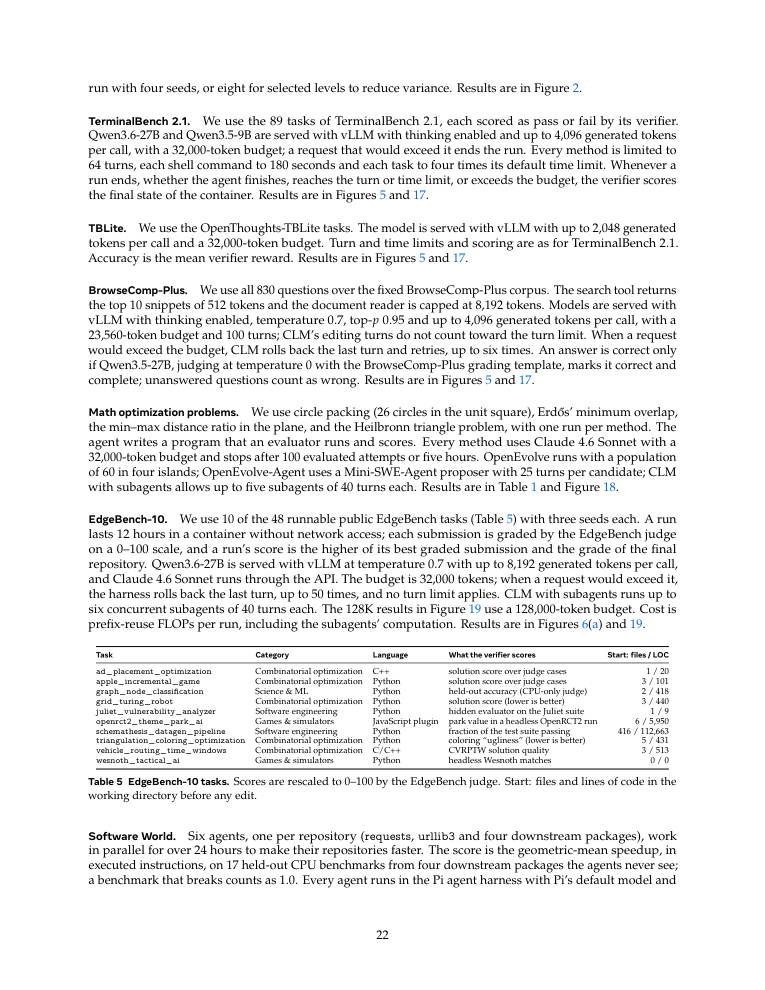
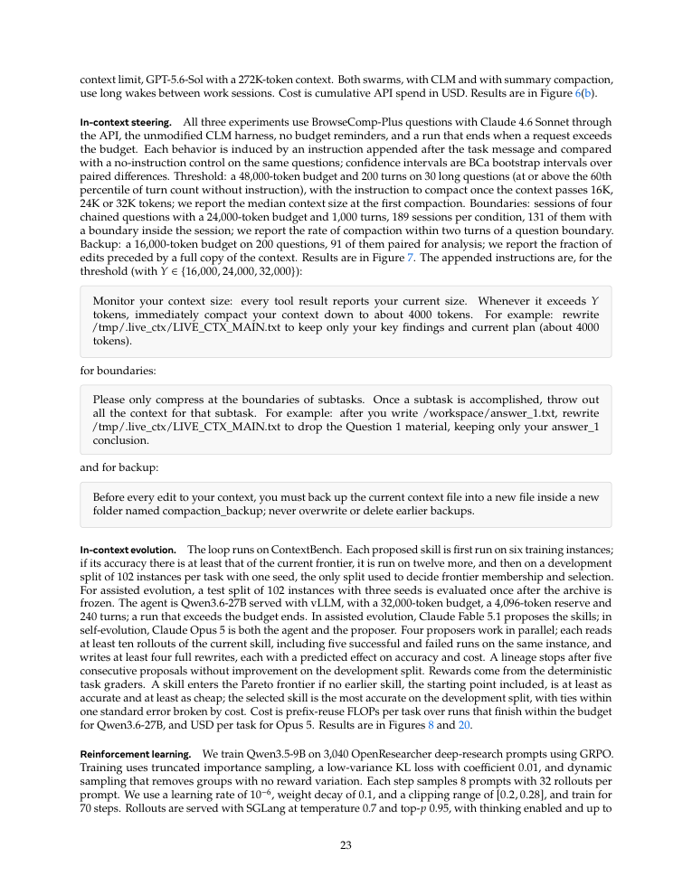

### 4.4 成本与复现顺序

主要成本为标准前缀缓存下估计的prefix-reuse FLOPs，包含prefill与decode；SCR实测节省单独报告。FLOPs、token、API美元、墙钟不能互换。部分技能图只计算预算内完成运行的成本，要单独注明失败，不能宣传全体平均省钱。

1. 固定代码commit与CC BY-NC4.0许可，在隔离容器部署，保存任务种子和哈希。
2. 安装仓库，配置OpenAI兼容服务和Harbor任务。最小入口为pip install -e .，随后clm-harbor run -p任务路径 -a clm-minimal -m openai/模型名，并设置api_base。
3. ContextBench通过Harbor加载RulinShao/ContextBench，Agent为clm_contextbench:ClmStream；固定压力档、预算与种子。
4. 显式覆盖原文参数，记录每次请求、文件编辑前后、任务步/编辑调用、回滚、真实token与服务日志。
5. 同模型同任务运行Summary等对照，用最终verifier评分，并报告失败、全部成本。
6. 技能仅在训练开发筛选，冻结后一次测试；RL先接外部训练框架，再测跨数据集。
7. RL README明确训练系统不在本仓库，须安装ProRL-Agent-Server和Slime、应用patch；patch不生成a_eff和role_mask，仍需自行补接。不能称clone即可完整复现RL。
8. SCR固定服务版本，开关分别测质量与缓存计算，加入关键前缀改写测试。

当前代码bcp.yaml是28672、500步且带提醒，与纸面23560/100不完全一致。README还含默认fit/shrink编辑门、调用上限；不要把“自由编辑”理解成没有任何系统限制。

## 5. 实验设计与结论

BCP59.4%，相对Summary提高11.4%，不是提高11.4个百分点；FLOPs少21.5%。TBLite73.7对67.0，提高6.7个百分点，FLOPs为91%；TB匹配Summary质量、FLOPs约70%。

EdgeBench42.3→44.2，约相对提升4.5%；437→181PF，约省59%。Software World的65%是改善幅度更大，不是正确率提高65个百分点。

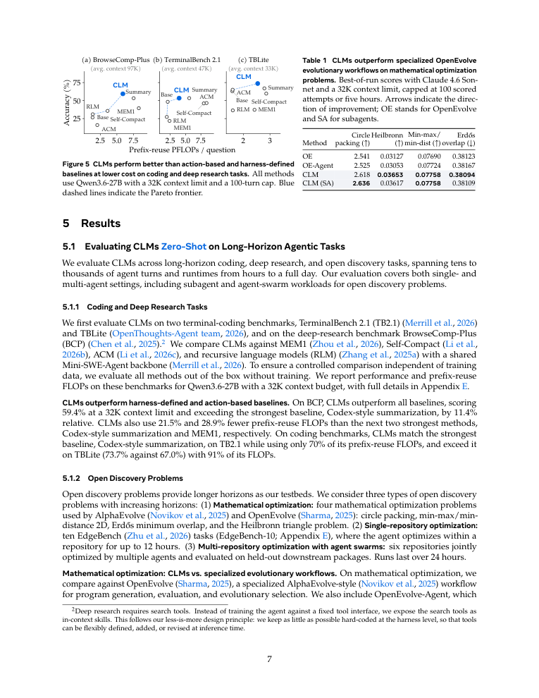
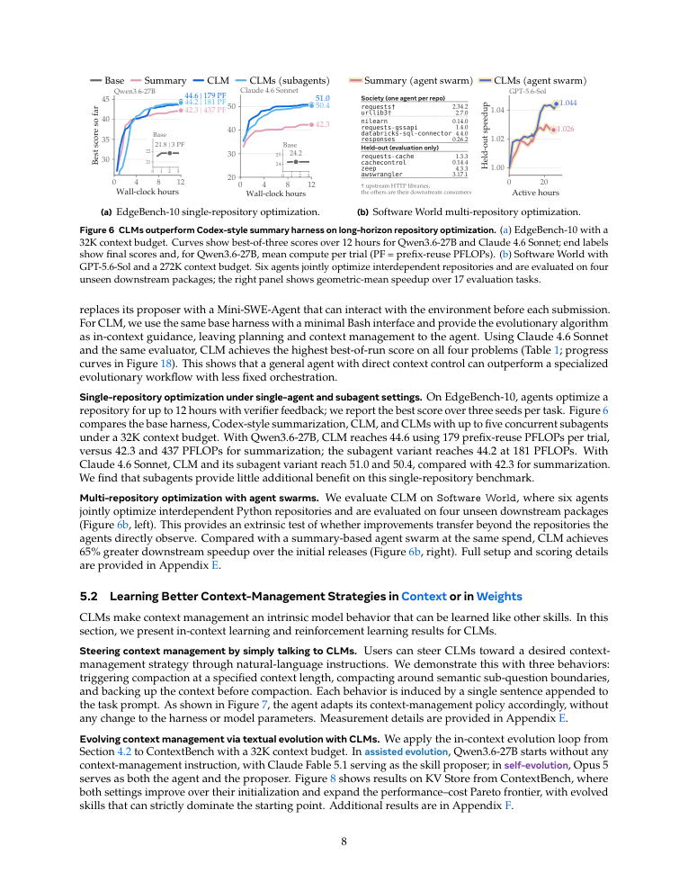

RL的CLM28.8→42.5，提高13.7个百分点，即相对47.6%；1.52→1.34PF，省约12%。训练后Summary42.1、2.19PF；CLM42.5、1.34PF。

SCR图9准确率均60.2，10.98→7.14PF，省35%；这是另一次服务实验，不直接等于零样本59.4那次运行，不将其叠乘到所有结果。

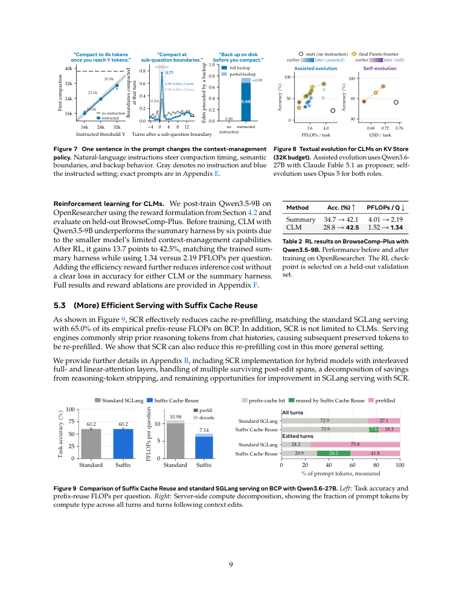
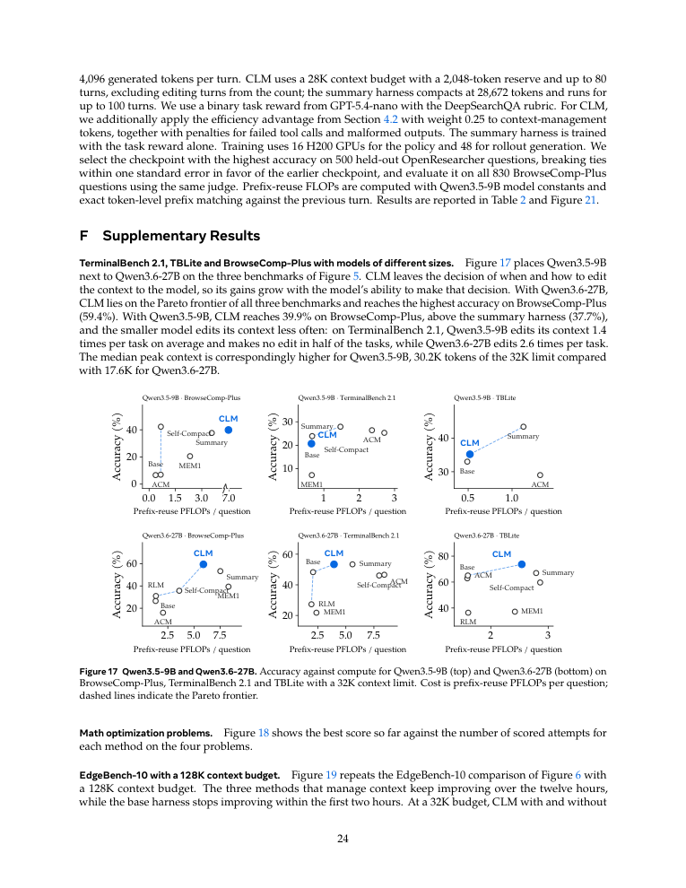
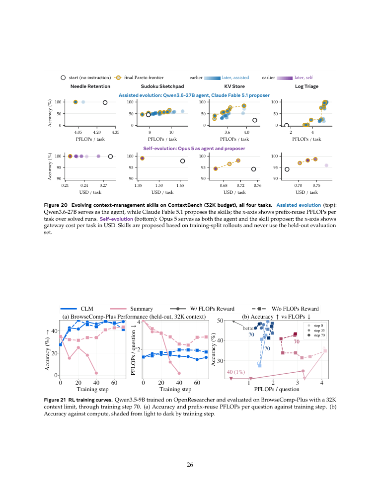

## 6. 贡献总结

贡献覆盖可编辑真实上下文、诊断集、技能/RL学习与后缀缓存服务四层。既有多Agent实例，但不证明资源承诺协调与并发安全。

## 7. 不足概述

边界包括模型自主管理能力、安全写权限、近似缓存、预算口径与长程评测方差。以下按规范七项独立讨论，不把读者推断当作者声明。

## 8. 中文译文

见[单独译文](2609.37725-ContextLanguageModels-译文.md)：完整摘要与问题、方法、数据、结论核心选译，不是27页逐字全译。

## 9. 本论文的假设是什么

作者方法前提（4.1节式2）：模型可编辑上下文镜像，系统会同步到后续输入。这是实现条件，不是所有模型都善于管理的保证；应以实际请求与编辑hash验证。

作者待检验假说（3、5节）：可灵活编辑比固定管理更能适应任务。诊断和真实任务支持指定模型与预算，附录F较小模型的编辑能力较弱，说明并非无条件结论。

作者奖励定义（式6）：只有可靠判定的成功轨迹、且同组至少两条成功，才可比较效率。这个设定避免奖励廉价失败，不证明每个编辑有独立因果贡献。

## 10. 本论文没做什么

第5节未测试Flatland三方通行承诺、通信时延或资源预约修订，这是范围不同，不自动是缺陷。第6节讨论安全，但没有任意编辑下的安全证明。数学优化每题每方法一次，未充分验证跨种子稳定性。未展示1.5B模型能可靠管理长期依赖，不可直接迁移其大模型收益。

这些缺项分别限制多Agent资源协调、可信部署、稳定性和小模型泛化的外推，不要求论文包办所有问题。

## 11. 和哪篇论文的结论对不上

核查范围是本文第2节及附录A、本文对照结果，以及Zhao等Stronger-MAS（ICLR2026，arXiv:2510.11062v5，https://arxiv.org/abs/2510.11062v5）。暂未发现对齐模型、任务和预算后直接相反的外部结论，不编造对立文献。

Stronger-MAS第4.1节要求同具体输入节点分组；CLM第4.2节比较同初始问题的完整轨迹，再将结果优势传播到不同上下文段。表面分组不同，但学习对象不同，不构成已确认冲突。若检验哪种归因更适合编辑，需固定采样和训练预算，比较完整轨迹归因与同节点分支归因。本文未完成这种对照，不能替两篇论文给出优劣结论。

## 12. Limitation：局限与适用边界

作者第6节指出上下文写权限可能清除安全提示或隐藏不当行为。它影响可信部署，不否定受控任务收益；需权限隔离、不可改审计、注入和误删测试。

作者4.3节与附录B承认SCR旧后缀状态。它限制“精确等价”主张；平均准确率相同不足，需要关键约束前缀改变后的压力测试。

读者依据附录E判断：编辑轮、回滚和训练基线预算不同，削弱单因素归因。需报告总调用、token和全部失败成本，并匹配额外重试。

读者依据数学优化每方法一次判断：不能据单次最好成绩证明跨随机条件稳定。应重复运行、报告区间，而非否定所有任务结果。

## 13. 隐含前提

读者推断（4.1节与context_env代码）：文件格式、同步器和角色边界可靠。若不成立，可能编辑成功但实际输入不符，需保存编辑diff、版本和真实请求。

读者推断（附录C、E）：judge与成本估计不系统性偏向某种写法。否则会奖励漏信息但被判对的轨迹，或高估重prefill节省。需人工抽检、独立判定与实测服务统计交叉核验。

读者推断（4.1节、附录F/G）：模型能够判断未来还需要的信息。较小模型编辑少、上下文长度估计误差说明此能力不能默认成立。需按模型规模与依赖跨度检查遗忘，失败会表现为删掉后续必需证据。

## 14. 矛盾结论与未解释现象

图5写100轮，TB附录E写64；正文泛称32K，BCP附录为23560，当前代码为28672/500步。属于版本或口径待核实，不直接判定实验错误。影响精确复现，需要结果对应的运行manifest。

第5.2节RL前CLM28.8低于Summary34.7；附录F另一零样本配置为39.9高于37.7。预算与流程不同，不可合并为真矛盾，也不支持小模型总能胜出。需同配置复跑分离能力与harness影响。

SCR准确率相同与近似缓存不是逻辑冲突：任务平均相同不代表每条输出一致。本文未充分解释错误尾部的变化，需要配对案例和关键条件改写测试。

## 15. 空位：尚未覆盖的研究与证据位置

1. 已覆盖上下文自由编辑，尚缺我们关心的“队友未来依赖的哪些记录必须保留”证据。可在同状态分支删除/保留承诺，检查后续可行性。记忆与承诺研究可能已有先例，不能因本文未做就称新颖。
2. 已有成功门控效率奖励，尚缺单个编辑改善后续协作的因果归因。可完整保存环境及私有状态，控制额外工具预算后分支验证；若无差异则削弱该假说，也有被既有信用分配研究覆盖的风险。
3. 已有SCR平均收益，尚缺资源禁入、撤销条件等关键前缀改变后旧缓存影响的系统检验。可用精确重算对照；若约束一致则风险减弱，若错误增加则限定适用边界。

这些是阅读产生的可验证问题，不是已通过全面新颖性检索的研究贡献。
