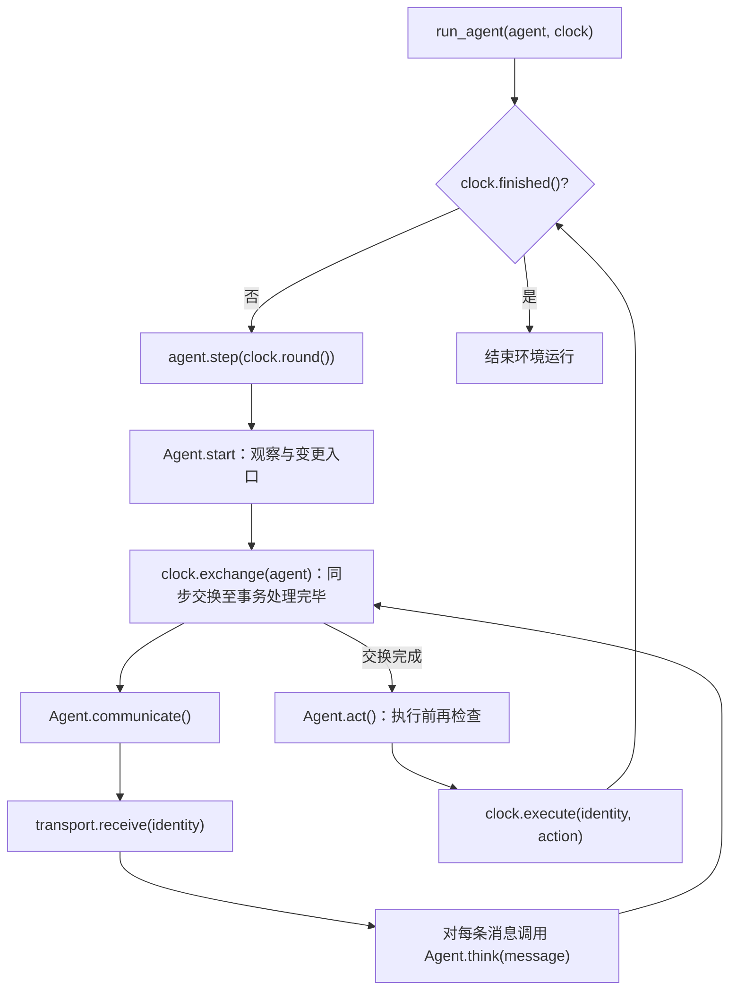
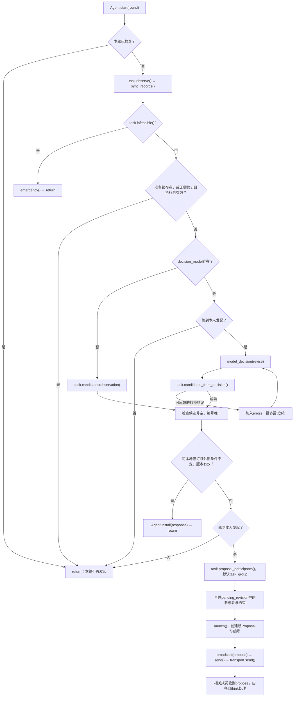
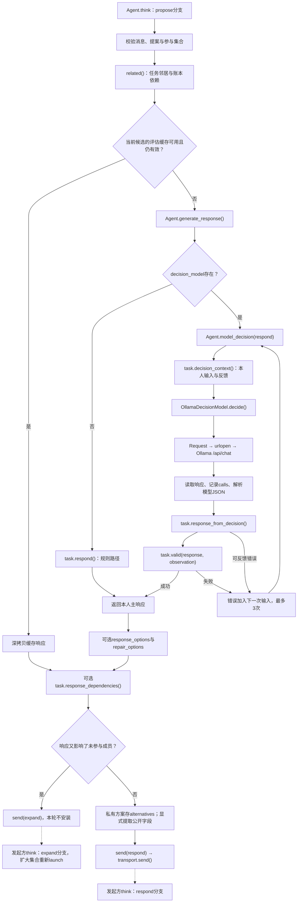
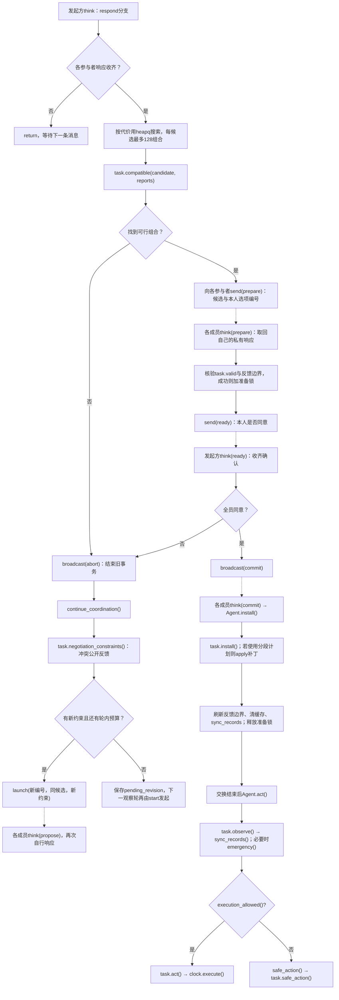

# 核心代码逐段详解：从 Python 语法到协调机制

本文逐段对应同目录的 `agent.py` 与 `llm.py`，并用 `expr/011-llm-coordination/run.py` 说明任务插件如何接入。当前有两条明确路径：传入 `decision_model` 时使用模型生成候选请求与本人响应；未传入时保留规则路径，用于基线和兼容旧实验。不要把后者的结果解释为大模型结果。

建议先读第1节职责划分、第6—8节执行流程，再看第10节插件契约和第12节HTTP调用。数据对象、局部补丁和账本可在阅读流程时回查。

## 函数调用图：把整个流程串起来

先看总图，再按下面三张分图读源码。实线表示函数调用或当前函数内的处理分支；虚线表示消息投递后，另一个成员稍后处理，**不是A直接调用B的私有函数**。图中的“任务插件”表示`self.task`，“模型客户端”表示`self.decision_model`。

### 总图：观察、协调、近期执行

读图注意：`clock.exchange`是外部实现，必须保证交换屏障；图中通过`communicate`收消息是一种契约实现方式。真实模型资源实验使用`demo.run_round`作为替代驱动：先对每个成员调用`step`，再直接把收件箱消息交给各自的`think`，最后调用每人的`act`。因此该实验没有实际调用`run_agent`和`communicate`，但使用的是同一套Agent方法。

### 分图一：start如何决定是否调用模型、是否联系队友

其中“可本地修订”的实际调用顺序是`local_revision`生成响应，再检查`response.feasible`、`external_conditions_unchanged`和`task.valid`。模型路径到这里之前已经调用候选决策，不应把“没有通信”误读成“没有调用模型”。图中的3次重试只覆盖输出转换错误；HTTP、JSON解析等异常，以及重试耗尽后的报错分支，见第7、12节。

### 分图二：收到提案后，模型如何产生本人的响应

`revise`阶段也复用图中的`model_decision → decision_context → decide → HTTP`链，只是返回后调用`candidates_from_decision`而非`response_from_decision`。初次`related`检查也可以发送扩组请求；响应生成后的检查则用于发现“为了配合A，我将影响C”的新关系。缓存和扩展菜单都是可选的；当前真实模型资源实验未启用它们。

### 分图三：组合、确认、冲突反馈与执行

`compatible`检查不通过时，搜索会先尝试预算内的其他组合；图中的“未找到”指本轮菜单或搜索预算内没有结果。准备确认失败时调用`continue_coordination`的原因是准备状态失效，而不一定是资源组合冲突。`cancel`、非法响应及差量基版本不匹配不全部走自动续商，详见第8.4—8.7节。

`SegmentedPlan.apply`不是核心自动调用的固定步骤：核心调用`task.install`，是否使用分段补丁由适配器决定。若启用，它的内部顺序是`valid(patch) → deepcopy(updates) → 只写updates中的片段 → 对应版本加1`。未参与的任务片段不写入，所以不被重做。

### 跟着真实模型实验走一遍

1. 在`expr/011-llm-coordination/run.py`的`execute`创建每位成员的`ResourceTask`和`Agent`，注入`OllamaDecisionModel`。
2. `run_round`调用每人的`step → start`；0号成员满足修订条件且轮到发起，模型输出预约请求，插件转为候选，`launch`发提案。
3. 各成员收到提案后，走`think → generate_response → model_decision → decide`，各自返回一个时间槽，插件构造本人的`PlanPatch`。
4. 发起方收齐响应后调用`compatible`。冲突则将当前槽写入新约束，重新提案；每个成员根据新输入再次调用模型。
5. 找到可行组合后，依次交换`prepare → ready → commit`，各人的`task.install`只更新自己的共享预约片段。
6. 后续观察轮中，按需法因已有有效安排直接返回；固定轮换对照在0号成员再次轮到时重新调用同样流程。观察结束后，实验运行器按最终时间槽推进资源时钟并检查占用。这一步是资源实验自己的执行循环，不是`Clock.execute`的实现。

这样读，主线就是：**驱动循环 → start判断变更 → 本人模型生成候选/响应 → 消息交互 → 程序检查组合 → 各自确认并安装局部计划 → 近期执行与反馈**。

## 1. 先分清核心做什么、任务插件做什么

`Agent`决定什么时候继续执行、什么时候询问其他成员、什么时候允许提交。`Task`描述实际任务的状态、可行条件、代价和执行方式。模型路径下，它还负责整理模型输入、把模型决策转为候选或局部补丁；规则路径下，则直接生成候选与响应。核心不是一个能自动理解任意任务的规划模型：换任务时仍需实现这些接口，但不必重写消息流程。

每个成员都创建一个 `Agent` 实例，类相同，`identity`、`task`和本地状态不同。模型路径由`self.generate_response(...)`调用本人的模型决策，再让本人的任务插件转换输出；只有规则路径才直接调用`self.task.respond(...)`。两条路径都不允许A进入B的私有规划器。发起方收到的是公开摘要，通过响应编号选择方案；每个人根据编号取回自己保存的私有计划。

## 2. 阅读本文件需要的 Python 语法

| 写法 | 语法含义 | 在本核心中的作用 |
| --- | --- | --- |
| `class Agent:` | 定义类，即对象的结构和方法集合 | 所有成员复用一种行为规则 |
| `def start(self, round):` | 定义实例方法；`self`指当前对象 | 访问本成员状态，而不是全体成员的共享变量 |
| `self.responses = {}` | 创建空字典并保存为实例属性 | 按提案编号保存收到的响应 |
| `dict[str, int]`、`Any` | 类型提示；前者描述键和值类型，后者允许任意对象 | 帮助理解接口，并不自动验证运行时数据 |
| `tuple[str, ...]` | 任意长度的字符串元组；这里的省略号是类型语法 | 表示成员编号集合的不可变序列 |
| `Response \| None` | 联合类型：响应对象或者空值 | 表示可选的本地修订结果 |
| `@dataclass` | 装饰器，自动生成初始化等方法 | 不必手写各数据对象的字段赋值构造函数 |
| `frozen=True` | 阻止对数据类字段重新赋值 | 保持提案快照字段稳定；不会递归冻结内部字典 |
| `field(repr=False)` | 不把字段放进对象的默认字符串表示 | 避免打印私有计划；它本身不是权限隔离或加密 |
| `getattr(obj, name, None)` | 读取具名属性，没有则返回空值 | 可选插件接口不存在时走默认路径 |
| `callback(...) if callback else None` | 条件表达式，只执行选中的分支 | 有扩展函数才调用，避免空值调用错误 |
| `set(...)`、`a \| b`、`a - b` | 集合、并集、差集 | 去重参与者、合并依赖、排除自己 |
| `a <= b`（集合） | 判断a是否为b的子集，不是比较数量 | 阻止未知成员或不完整的补丁写集合 |
| `all(...)`、`any(...)` | 全部为真、至少一个为真；空集合分别为真、假 | 检查全员确认、是否存在失效依赖 |
| 列表/字典/集合推导式 | 对元素遍历、筛选并创建新容器 | 组装公开报告及相关成员集合 |
| `return` | 立即结束当前函数 | 本轮无须协调时跳过后续工作，不代表任务结束 |
| `raise ValueError(...)` | 抛出输入或状态错误 | 暴露插件违约，不能把程序错误伪装成任务成功 |
| `...`（接口方法体） | 此处不提供具体实现 | `Protocol`列出约定，任务插件必须真正实现行为 |

`and`、`or`有短路行为。例如`callback is None or callback(observation)`在接口不存在时不调用它；`response is not None and response.feasible`不会对空值读取字段。这既表达条件，也防止非法访问。

## 3. 数据对象为什么要分开

`Candidate(key, public)`是发起方提出的局部变化，`key`用于关联响应，`public`是任务定义的公开条件。`Response(feasible, delta_cost, public, private_plan)`是某位成员对这个变化的回答。`feasible`说明本地可行，`delta_cost`说明相对原安排的代价；它们不能代替跨成员的相容性检查。

`Proposal`固定本次提案的发起人、轮次、候选、参与者、重试次数和约束。重试或扩组会创建新编号，防止旧确认误批准新方案。`Message`是信封，分别保存发送者、接收者、消息种类、提案编号和内容。消息种类决定`think`走哪个分支。

`Commitment`记录某成员承诺的性质、版本、起止时间和前提；`Dependency`记录谁将在什么时候使用哪个版本的承诺。因此B还没有开始行动，也能登记将来需要A提供的条件。数据结构只保存任务插件报告的依赖，不会自动从自然语言推出遗漏关系。

## 4. 局部计划：为什么不是重做一个人的全部任务

`SegmentedPlan.__init__`用`copy.deepcopy(segments)`保存独立副本，避免外部对象修改顺带改变当前计划；`dict.fromkeys(segments, 0)`为每个片段建立初始版本0。

`PlanPatch.base_versions`是生成补丁时读取的相关片段及版本，`updates`是确实要修改的片段。读取集合可以比写集合大：B只改自己的交接步骤，但这个步骤还依赖一个不被修改的准备步骤。

`valid`依次检查：写集合非空；每个要写的片段都在读取版本表中；每个相关片段仍存在且当前版本等于补丁记录版本。`all`对整个读取集合逐项比较，因此不会漏掉“没有修改、但决定本次修改是否仍成立”的条件。

`apply`先调用`valid`，失败则抛错，不写任何片段；成功后深拷贝更新内容，只遍历`updates.items()`，对对应片段赋值并把版本加1。没有出现在写集合的片段既不被赋值，也不增加版本。这就是保留无关任务的直接实现原因，而不只是文档约定。

例：本地有`prepare`、`handover`、`other_work`三个片段。补丁读取前两个，只更新`handover`。安装时只改交接；如果准备工作版本已变，整个补丁必须重新生成；`other_work`保持原样。

## 5. 依赖账本 Ledger 的全部操作

| 方法 | 内部步骤与作用 |
| --- | --- |
| `__init__` | 创建承诺、依赖两张字典，分别按唯一键保存记录 |
| `register_commitment` | 拒绝空时间区间；替换时要求同一所有者且版本递增；使旧版本的活动依赖失效，再深拷贝新记录 |
| `register_dependency` | 找到对应承诺，检查所有者、版本、活动状态；要求未来使用窗口完整落在有效期内，满足后才保存 |
| `release` | 将指定依赖标记为已释放，不再把它当成活动关系 |
| `release_commitment` | 释放承诺，同时使依赖该承诺的活动记录失效 |
| `advance` | 随轮次推进，把到期承诺标为过期；把已结束的依赖标为过期，仍需使用但供应承诺已失效的依赖标为失效 |
| `peers` | 遍历活动依赖，若当前成员是提供者就取使用者，反之取提供者，最后排除自己 |
| `revoke` | 撤销某人的活动承诺，并使相应活动依赖失效 |

用状态而不是直接删除，能够保留“为什么不能继续执行”的原因。账本不向全网自动同步；任务接口必须提供可靠的记录，消息层还要负责必要通知。

## 6. 核心循环与初始化

`run_agent`在`while not clock.finished()`中依次调用`step`、`exchange`、`execute`。`finished`由环境定义，不是看到一次协商失败就结束。`step`转调`start`；`communicate`逐条接收消息并调用`think`；`act`只返回当前允许执行的动作。`Clock.exchange`必须完成同步消息处理和提交屏障，不能随意收几条消息就推进环境。

`Agent.__init__`首先要求至少三个不同成员且包含自己，再校验任务组。`sorted`保证同样输入有稳定顺序，轮换发起才不会因字典顺序不同而产生分歧。`local`、`responses`、`prepared`等字典保存不同阶段的状态；`locked`表示准备锁；`final`记录已经结束的事务；`pending_revision`保存尚未解决的修订。它们属于每个实例，不是全体共用一份。

`decision_model`保存注入的模型对象，默认`None`。这里使用依赖注入：核心只要求对象有`decide`方法，不在协议中绑定某个厂商。实验可以让多个成员共享同一个无会话客户端，但每次请求都携带本人身份和上下文，不会因此共享私有行动链。

`max_negotiation_rounds`限制一条提案链中的协商尝试次数，不能小于1；预算用完后可跨观察轮继续。它与模型输出校验的3次尝试不是同一个限制。`evaluations`是本地响应缓存，`sent_public`和`received_public`用于可选差量报文；它们是工程优化，不是任务求解器。

## 7. start：为什么没有影响就不通信

1. `started_round == round`时直接返回，防止一个成员在同一环境轮次重复发起。
2. 读取观察并同步账本；若任务已经不可执行，进入`emergency`撤销相关承诺。
3. 已准备锁定时不启动另一轮；没有待处理修订、任务不需要修改且执行仍有效时，也直接返回。这条分支保留原安排，不生成重复提案。
4. 规则路径直接调用`task.candidates`。模型路径先检查本轮是否轮到自己；没有轮到就返回，不先支付一次候选生成调用。轮到后执行`model_decision("revise", observation, errors=errors)`，再用`candidates_from_decision`转换为候选。
5. 模型候选转换中的`ValueError`、`KeyError`、`TypeError`会进入错误列表，最多尝试3次；`break`表示成功跳出循环，`for...else`中的`else`只在没有成功`break`时执行并报错。模型调用也在`try`中，JSON解析和输出类型错误可重试；HTTP及网络异常不在捕捉范围内。
6. 两条路径都检查候选非空、编号不同。错误文本提到保持项，但代码不识别哪个候选是保持项；插件负责此约定。
7. 同时提供`local_revision`与`external_conditions_unchanged`时，尝试内部修订。响应可行、外部条件未变、版本有效才安装而不通信。注意它发生在候选生成之后：模型路径即使最后本地完成，也已经调用过候选决策模型，不能说这条路径完全不耗token。
8. 之后统一检查轮换机会。规则路径在这一步才检查，因此可能已经生成过本地候选；模型路径前面已提前检查一次。`round % len(task_group)`选择本轮发起成员。
9. `proposal_participants`按交互内容选择参与者，默认任务组；检查包含本人且没有未知成员。有`pending_revision`时合并上次参与者并保留约束，避免漏掉已发现关系。
10. `launch`递增序号，创建新编号和提案并发送。相同候选的冲突重试也用新事务编号，旧确认不能批准新事务。

`related`合并插件给出的相关方与账本里的依赖邻居，并拒绝未知编号。`broadcast`虽然名字叫广播，实际循环的是提案参与集合；没有提案上下文时才使用任务组，不默认发给所有已知成员。

## 8. think：逐种消息解释内部机制

### 8.1 提案与自行响应

接到`propose`后先核验发起人、提案键、参与集合和重复消息，再查账本与插件报告的相关成员。对每个候选，优先检查可选评估缓存：键包括插件提供的状态标记、候选编号和公开内容、发起人、参与集合以及反馈约束；缓存中的每个响应还必须通过当前`task.valid`。缓存最多256项，满后删除最先插入的一项，并非最近最少使用策略。

未命中缓存时调用`generate_response`。模型路径执行第8.6节的模型响应流程；规则路径调用`task.respond`。随后，若有`response_options`则用它生成菜单，否则仅保留主响应；若有`repair_options`再追加修复项；最终菜单为空时恢复主响应。可选菜单接口本身仍由插件实现，不保证其中每项均来自大模型。当前真实模型资源实验没有启用这些菜单接口，也没有提供评估缓存键，所以响应均实际调用模型。

私有响应保存到`alternatives`，公开消息显式摘取可行性、代价、条件、本人编号和选项编号。主响应的代价在发送前检查为有限值，选项的可行性与有限代价还会在发起方组合时筛选。`private_plan`不进入公开消息，是显式构造消息字段的结果。

如果`response_dependencies`发现生成的配合方案还影响第三方，则发出`expand`。发起方结束旧事务，将新发现成员加入集合，使用新编号重新提案。不能先安装A/B的结果，再要求C被动接受。

### 8.2 收齐响应与组合搜索

发起方按候选整理每人的可行响应，并根据`delta_cost`排序。一个组合用元组表示，例如`(0, 1, 0)`表示A选第0项、B选第1项、C选第0项；不是由A替B写行动链。

`heapq.heappush`把组合放入最小堆，`heappop`取当前总代价最小的一项。初始组合取各菜单第0项，后续邻居每次只把一个人的选项下标增加1。`seen`记录已经入队的下标元组，避免相同组合被多条路径重复生成。每取一个组合都调用`task.compatible`检查公开条件是否共同成立；单人都可行并不代表组合可行。

每个候选最多检查128个组合。找到的结果是在已生成菜单和当前搜索预算内比较得到的，不能称任务的全局最优。不同候选的可行结果再按总代价和候选编号选择，以便同成本时有稳定结果。

### 8.3 prepare、ready、commit

`prepare`携带候选编号及本人选项编号。成员从自己的本地菜单取回完整响应，再查：事务没有被阻止、没有锁定别的事务、响应存在且可行、当前版本有效、反馈边界仍在未来。成立则写入`prepared`并设置`locked`，防止一边准备提交一边行动使版本改变。

每人通过`ready`回复确认。发起方用集合相等检查参与者是否收齐，再用`all`检查是否全同意；全同意才发送`commit`。接收者只安装本地已经准备好的响应，然后释放锁并将事务加入`final`。若本地根本没有准备结果却收到提交，代码抛错，不能凭空拼出一个方案执行。

### 8.4 没找到方案时不是结束任务

`abort`结束的是旧提案事务，用来清理准备状态，并不表示终止整个任务。没有可行组合或准备阶段状态变了，会调用`continue_coordination`。但并非所有取消都会自动重试：`cancel`、非法响应以及差量基版本不匹配分支只结束当前事务，是否重新发起还取决于下一轮任务条件。任务插件可以根据失败报告给出新约束；有约束且尚有轮内预算时立即建立新提案，否则把参与者和约束写入`pending_revision`，下一观察轮继续。

等待时仅在旧安排仍有效的前提下继续旧安排；否则用任务定义的安全动作。损失最小的选择只能在满足硬约束的选项中比较，不能为了避免等待选择碰撞方案。候选不完备时，代码也不能保证总能找到可行解。

### 8.5 撤销与差量响应

`revoke`使相关成员重新检查对发送方的依赖；不能把撤销当作对某个新方案的批准。差量响应的含义是“在某一已知版本上修改这些字段、删除那些字段”，接收方必须核验基版本并恢复完整公开响应，不能把差量字典直接当成完整菜单。

`send`比较差量信封与原内容的JSON长度，只有较短才使用差量；否则发完整版本。它比较的是序列化字符串长度，不是实际网络链路计费；实验通信字节应由实验自己的统一计数口径决定。`private_plan`未进入公开消息是显式构造公开内容的结果，不是`repr=False`自动过滤的结果。

### 8.6 generate_response：模型怎样生成本人的响应

没有模型对象就直接返回`task.respond`的结果。有模型时先创建`errors=[]`，在`range(3)`循环内调用`model_decision("respond", ...)`，输入包含提案、候选、当前观察及之前转换错误。`**details`是关键字参数收集与展开语法，使同一个入口能够承载候选和响应两个阶段的上下文。

模型决策返回后，`response_from_decision`把字典转换成带私有补丁的`Response`，随后`task.valid`检查当前版本。通过后记录`model_response`事件并立即返回；转换错误或当前版本校验失败则把错误文本加入下一次输入。三次均失败时抛出`RuntimeError`，没有规则替代。

这段校验不自动证明资源全局可行：任务转换函数检查本人的输出，跨人互斥仍由`compatible`检查。模型调用已纳入`try`，JSON解析和对象类型错误会反馈重试；HTTP与网络异常仍直接上抛。模型不合法是程序错误分支，不能与正常的“旧协商事务取消、任务继续”混为一谈。

### 8.7 cancel、迟到消息与事务结束

`cancel`只有来自本次参与者才被处理，发起方发送`abort`清理旧事务。接收`commit`或`abort`时还要验证消息确实来自本次提案所有者；随后删除准备结果、释放属于本事务的锁并记入`final`。已结束事务的大多数迟到消息在入口直接忽略。`revoke`先于这个过滤处理，用于通知依赖变更，不依赖某个普通提案仍然活动。

## 9. 安装、失效检查与行动的全部辅助方法

| 方法 | 内部实现及为什么需要 |
| --- | --- |
| `sync_records` | 先推进账本时间，再调用可选`commitment_records`；仅登记新键或更高版本，避免反复覆盖同版本状态 |
| `install` | 检查反馈边界在未来，调用任务安装本人的响应，刷新边界、清空旧评估缓存，再读取安装后状态更新记录 |
| `execution_allowed` | 联合检查插件执行条件、反馈边界、自身承诺状态、是否有失效的输入依赖；任何一项不满足都不能继续原动作 |
| `safe_action` | 调用任务提供的安全动作；没有实现就报错，核心不知道不同任务中什么动作才安全 |
| `emergency` | 找到依赖邻居，撤销自己的活动承诺及任务计划，清理执行边界和缓存，再向相关方发撤销通知 |
| `act` | 先拒绝在准备锁未释放时执行；重新观察、检查不可行状态；原计划有效则调用任务行动，否则返回安全动作 |
| `step` | 只转调`start`，使循环入口保持简单 |
| `communicate` | 遍历本成员收件箱，对每条消息调用相同状态机 |

因此，“执行到反馈边界”并不是完全不看环境，而是不重复求解仍然有效的计划。每次真正行动前仍做轻量有效性检查；到期、依赖失效或紧急情况才触发调整。

## 10. 接口如何接入另一个任务

以下基本`Task`接口主要定义规则路径及两条路径共用的执行契约；不是说模型路径仍由规则函数生成响应。基本接口按用途分为：`observe`读取本地状态；`needs_revision`和`infeasible`识别普通变更与紧急失效；`candidates`生成发起方候选；`respond`生成本人响应；`compatible`检查公开响应组合；`valid`再次核验本地响应；`install`安装；`revoke`撤销；`dependency_changed`处理他人的变化；`act`生成近期动作；`coordination_peers`报告相关方。

可选`AdaptiveTask`进一步提供：`proposal_participants`按交互选组；`response_options`和`repair_options`给出配合方案；`local_revision`与`external_conditions_unchanged`实现内部修改免通信；`feedback_boundary`确定必须等待结果的位置；`execution_valid`与`safe_action`保护执行；`evaluation_key`声明可复用计算的范围；`negotiation_constraints`生成下一轮约束；`commitment_records`登记承诺与依赖；`response_dependencies`发现配合方案的连锁影响。

模型路径另外要求任务对象实现三项方法。目前它们通过运行时调用接入，尚未列入`Task`或`AdaptiveTask`的类型声明，不是自动可选回调：

| 方法 | 输入与输出 | 内部职责 |
| --- | --- | --- |
| `decision_context(stage, observation, **details)` | 阶段、观察、候选/提案/错误 → JSON可序列化字典 | 只整理本人需要的信息，提供提示和可选`output_schema` |
| `candidates_from_decision(decision, observation)` | 模型字典 → 候选元组 | 校验字段并转换局部变更；非法字段抛出可反馈异常 |
| `response_from_decision(decision, proposal, candidate, observation)` | 模型字典 → 本人的`Response` | 检查本地硬条件，计算代价，生成带当前版本的私有补丁 |

传了模型却缺少这些方法会产生`AttributeError`，不是自动退回规则。新增任务必须同时实现模型输入、输出转换和执行校验，不能只实现一个提示词。

`Transport`只负责`send`和`receive`，不决定任务方案。`Clock`负责轮次、结束条件、消息交换和动作推进。把这两者与Task分开，才能在不改协调核心的情况下换环境或消息实现；但当前同步假设不能因此自动变成异步容错保证。

## 11. 从实验看两条路径怎样运行

- 局部连锁案例位于`expr/007-local-chain`，响应组合诊断位于`expr/010-chain-menu`：规则路径检查扩组、局部补丁与多轮确认。
- 铁路许可对照位于`expr/009-route-permit`：规则路径检查保留有效许可的通信和评估成本。通信减少96.53%、评估减少97.36%均相对每步询问，不是模型token结果。
- 真实模型对照位于`expr/011-llm-coordination`：通过`decision_model`启用同一核心的模型路径，使用Qwen2.5-1.5B，本人生成时间槽响应并根据公开冲突反馈修订。

真实模型实验中，`needs_revision`由任务事件判断，不由模型自由决定；候选请求类型固定为预约。响应Schema限定本人的合法整数槽，冲突时根据低编号成员公开预约排除不合法槽；旧槽仍合法时合法域固定为旧槽。稳定规则来自任务程序，不能解释为模型自主学会稳定承诺。

每次参与响应都会调用模型，没有规则回退或评估缓存。3人和4人两组配对均完成，最终预约与执行轨迹相同；按需24次调用、固定轮换42次，输入token为5709对8985，减少36.46%。这是构造资源任务，不是铁路在线LLM结果。实验还保留格式失败和换槽不稳定的早期批次。

## 12. llm.py：HTTP调用逐句解释

### 12.1 客户端初始化

`__init__(model="qwen2.5:1.5b", endpoint="http://localhost:11434/api/chat")`保存模型名和服务地址，`calls=[]`创建当前客户端的调用记录。它没有自动下载模型、启动Ollama或建立远程会话；运行前必须准备服务与模型。

### 12.2 输入消息与字典展开

`messages`是含两个字典的列表。system消息说明只决定本人的动作；user消息用`json.dumps`把身份、阶段与任务上下文变成字符串。`ensure_ascii=False`使中文保持可读。`{"identity": identity, "stage": stage, **context}`将上下文键展开到同一个字典；若插件提供同名键，后展开的值会覆盖前面的身份或阶段，因此插件应避免这两个保留键。

客户端不自动附加聊天历史，也没有每个Agent长期对话记忆。上一轮约束通过任务插件生成的当前输入显式携带。共享客户端只共享服务配置与日志，不等于共享成员的任务状态。

### 12.3 格式、温度与生成上限

`context.get("output_schema", "json")`在有Schema时启用结构化输出，否则仅要求JSON。请求的`format`字段约束生成形式；任务合法域可以由Schema进一步收窄，但跨成员约束仍需协议核验。

`temperature=0`降低采样随机性，不能保证跨硬件和服务版本完全一致。当前`num_predict=32768`设置输出token上限，`num_ctx=32768`设置上下文窗口。输入也会占用窗口，因此不能保证生成32768个输出token；实际长度还受剩余容量、模型结束符及服务实现约束。较大的上下文配置可能增加内存占用，过长任务输入仍需适配器控制。`stream=False`要求一次返回完整回答，所以不能边接收token边执行。历史实验快照保留当时的96与2048，不因本次修改而改变既有实验结果。

### 12.4 编码、发送与读取

`json.dumps(payload).encode("utf-8")`先把Python字典序列化成JSON字符串，再编码成HTTP请求体字节。`Request(..., data=..., headers={"Content-Type": "application/json"})`声明JSON请求；提供请求体时默认使用POST。服务地址默认仅指向本机。

`time.perf_counter()`记录单调高精度时钟。`with urlopen(request, timeout=180) as connection`打开请求并确保离开代码块时关闭连接；超时参数限制底层阻塞操作，不是整个实验的总时限。`json.load(connection)`读取HTTP响应并解析外层JSON。

### 12.5 日志、模型回答与异常

收到外层JSON后，`calls.append`保存成员身份、阶段、完整请求、服务端原始响应及耗时。`return json.loads(result["message"]["content"])`再解析模型生成的内层JSON，交给任务插件。

外层响应中的`prompt_eval_count`与`eval_count`由实验累加为输入/输出token。它们不是费用估计，也不等于实际网络流量。模型生成内容若不是合法JSON，解析会抛错；此时外层响应已保存到`calls`。若HTTP或外层JSON读取失败，尚未执行append，因此该失败不在调用列表中。

客户端只把记录存在内存，不会自动写文件。实验运行器负责将`calls`持续写盘，并保存源码快照；不能因为对象里有`calls`就宣称任意脚本都已永久归档。客户端没有HTTP自动重试、隐藏缓存或规则回退。

## 13. 快速核对新版代码的阅读清单

1. `Agent.__init__`：确认是否传入模型对象，分清规则与模型路径。
2. `start`：跟踪有效性检查、轮换机会、模型候选转换、本地修订与参与者选择。
3. `model_decision`和`OllamaDecisionModel.decide`：从本人输入一直跟到HTTP请求与返回JSON。
4. `generate_response`：确认谁产生本地响应、哪些异常反馈重试、哪些异常直接上抛。
5. `think`：跟踪缓存、菜单扩展、依赖扩组、公开组合搜索和prepare/ready/commit。
6. `SegmentedPlan.apply`、`install`与`act`：确认补丁只改受影响片段，执行前再次核验。
7. 阅读真实模型资源实验中的`decision_context`与`response_from_decision`：分清模型选择与程序施加的合法域，最后核对原始调用记录。
